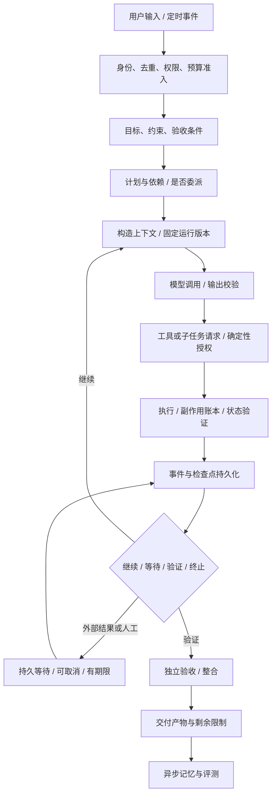
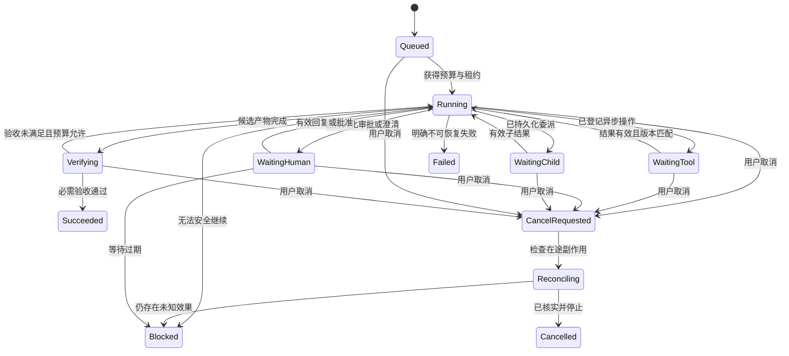

# Agent 与多 Agent 执行问题及解决方案手册

> 状态：研究与设计输入 v0.1；查阅日期：2026-11-14。面向 Auton 从零构建，不代表已有实现。
> 研究方法：搜索并查阅框架作者、产品工程团队和技术作者的原始博客；提炼问题，再推导适用于 Auton 的运行时机制、检测指标及故障测试。
> 证据边界：来源表中的“博客要点”是来源摘要；问题库中的具体接口、状态机、测试及优先级均为**本手册提出的工程建议**，不是博客作者共同认可的标准，也不是已经验证的性能承诺。本文不声称穷尽所有问题。

## 阅读导航

- [1. 范围、术语与使用方法](#1-范围术语与使用方法)
- [2. 博客来源与分歧](#2-博客来源与分歧)
- [3. 执行生命周期与故障分类](#3-执行生命周期与故障分类)
- [4. 目标理解、计划与终止](#4-目标理解计划与终止)
- [5. 模型调用与输出协议](#5-模型调用与输出协议)
- [6. 上下文、压缩、检索与记忆](#6-上下文压缩检索与记忆)
- [7. 工具、外部副作用与执行环境](#7-工具外部副作用与执行环境)
- [8. 持久化、恢复与调度](#8-持久化恢复与调度)
- [9. 多 Agent 拆分、委派与消息](#9-多-agent-拆分委派与消息)
- [10. 多 Agent 写入、整合与验证](#10-多-agent-写入整合与验证)
- [11. 安全、权限与供应链](#11-安全权限与供应链)
- [12. 人机协作与交付](#12-人机协作与交付)
- [13. 评测、可观测性与自进化](#13-评测可观测性与自进化)
- [14. 成本、性能与生产运维](#14-成本性能与生产运维)
- [15. 跨层故障链与处置手册](#15-跨层故障链与处置手册)
- [16. Auton 的建议契约与状态机](#16-auton-的建议契约与状态机)
- [17. 故障注入与验收矩阵](#17-故障注入与验收矩阵)
- [18. 实施顺序与设计决策清单](#18-实施顺序与设计决策清单)

## 1. 范围、术语与使用方法

本文覆盖个人本地 Agent、常驻助手、编码/检索/数据分析 Agent，以及 supervisor-worker、handoff、并行研究、实现与审查等多 Agent 模式。多模态、浏览器、定时任务和跨会话记忆也包含在内。机器人实时控制、模型训练集群及各行业的专门业务规则不作完整展开。

**目标**：遇到一个失败，能够明确它属于哪一层、怎样发现、谁负责恢复、哪些动作必须停止、用什么实验确认修复。不能把所有错误归成“模型不够强”或“提示词还需优化”。

### 1.1 必须区分的对象

| 对象 | 含义 | 不能混同的东西 |
|---|---|---|
| Goal | 用户期望与边界，可跨多个任务 | 一张没有验收条件的待办表 |
| Task / Episode | 一个可判定结果的任务单元 | 一次模型请求 |
| Run | 对任务的一次执行，可暂停恢复 | 对话窗口、HTTP 连接 |
| Attempt | 某一步的单次尝试 | 业务操作本身 |
| Operation | 希望在外部世界发生的一次逻辑动作 | 因重试产生的多个网络请求 |
| Model turn | 一次模型生成 | 一个完整用户任务 |
| Checkpoint | 恢复执行所需的持久状态 | 纯文字对话摘要 |
| Artifact | 文件、补丁、报告、外部资源及其版本 | Agent 声称完成的文字 |
| Evidence | 能支持具体判断的可定位观测 | 无来源的自述和猜测 |
| Delegation | 有范围、预算、权限与结果契约的子任务 | 给另一个模型一句角色提示 |

### 1.2 问题卡的读法

每条问题采用稳定编号，便于引用到需求、ADR、实现任务和回归测试。字段依次为：**表现/触发 → 根因 → 预防与检测 → 恢复 → 验证**。每章列出启发来源；条目是从这些材料推导的 Auton 设计建议，不表示来源逐项讨论了所有细节。

建议优先级：P0 = 若启用相关能力，必须先保护数据、授权或恢复一致性；P1 = 常规可用性必需；P2 = 使用量、任务类型或实验结果说明有需要后再做。优先级不是发生概率的统计结论。

一项修复应有明确 owner。模型负责提出计划与解释，运行时负责状态转移与预算，工具适配器负责实际副作用，评测负责独立验证。不能用“让 Agent 记住以后别犯”代替任何一层的确定性责任。

## 2. 博客来源与分歧

### 2.1 已查阅的博客

下表只记录简短要点，不转载正文。发布日期以页面明确标注为准；未在本次摘录中核实的日期不猜测。所有链接查阅于 2026-11-14。历史博客中的产品能力、模型选择与数值不应直接作为今天的默认配置。

| 编号 | 原始博客 | 日期 | 博客要点与本文用途 |
|---|---|---|---|
| SRC01 | [Anthropic：How we built our multi-agent research system](https://www.anthropic.com/research/multi-agent-research-system) | 2025-06-13 | 研究任务需要清楚委派范围和产出；过度搜索、重复工作和协调开销是实际问题。用于任务拆分与停止策略。 |
| SRC02 | [Cognition：Don’t Build Multi-Agents](https://cognition.com/blog/dont-build-multi-agents) | 2025-06-12 | 交接会损失背景，独立动作包含相互冲突的隐含决策。用于共享决策与接口契约。 |
| SRC03 | [Cognition：Multi-Agents: What’s Actually Working](https://cognition.com/blog/multi-agents-working) | 2026-04-22 | 更新后的经验强调多方推理配合串行写入；独立审查具有不同的上下文需求。用于限制并行写入和审查隔离。 |
| SRC04 | [Anthropic：Writing effective tools for agents](https://www.anthropic.com/research/writing-tools-for-agents) | 2025-09-11 | 工具边界、命名、返回语义与响应长度影响使用质量。用于工具契约与错误反馈。 |
| SRC05 | [Anthropic：Effective context engineering for AI agents](https://www.anthropic.com/research/effective-context-engineering-for-ai-agents) | 2025-09-29 | 上下文需动态选择；更大的窗口不等于更好的任务表现。用于信息预算和渐进披露。 |
| SRC06 | [LangChain：Context Engineering](https://www.langchain.com/blog/context-engineering-for-agents) | 2025-07-02 | 从写入、选择、压缩、隔离四种动作组织上下文管理。用于区分不同治理手段。 |
| SRC07 | [Drew Breunig：How Long Contexts Fail](https://www.dbreunig.com/2025/06/22/how-contexts-fail-and-how-to-fix-them.html) | 2025-06-22 | 提出污染、分心、混淆与冲突的分类。本文借用其诊断视角，不照搬其中转述的实验数值。 |
| SRC08 | [Anthropic：Effective harnesses for long-running agents](https://www.anthropic.com/research/effective-harnesses-for-long-running-agents) | 2025-11-26 | 跨会话任务会半途丢状态或过早宣布完成；结构化进展和环境初始化有帮助。用于可恢复任务与验收。 |
| SRC09 | [LangChain：Building LangGraph: Designing an Agent Runtime from first principles](https://www.langchain.com/blog/building-langgraph) | 2025-09-04 | 队列、检查点、流式反馈、人工介入和 tracing 是长任务运行时的重要能力。用于恢复与交互。 |
| SRC10 | [AWS：Timeouts, retries, and backoff with jitter](https://aws.amazon.com/builders-library/timeouts-retries-and-backoff-with-jitter/) | 2019-12-05 | 超时不代表副作用没有发生；不受控重试可能放大故障。用于分层超时和重试预算。 |
| SRC11 | [Temporal：What is idempotency? And why it matters for durable systems](https://temporal.io/blog/idempotency-and-durable-execution) | 2024-02-27 | 持久执行仍需处理活动的重复执行和部分成功。用于业务幂等键与执行账本。 |
| SRC12 | [LangChain：Running Subagents in the Background](https://www.langchain.com/blog/running-subagents-in-the-background) | 2026-04-16 | 同步子任务会阻塞 supervisor；异步任务需要可查询、可调整和可取消的控制面。 |
| SRC13 | [LangChain：Organizing Context in a Multi-Agent Harness](https://www.langchain.com/blog/organizing-context-in-a-multi-agent-harness) | 2026-09-08 | isolated 和 fork 两种上下文模式各有用途，执行者与独立验证者不能一概而论。 |
| SRC14 | [Cursor：Scaling long-running autonomous coding](https://cursor.com/blog/scaling-agents) | 2026-01-14 | 平级自协调与共享文件锁出现瓶颈；分离规划和执行是其研究中的一种有效结构。 |
| SRC15 | [Cursor：Towards self-driving codebases](https://cursor.com/blog/self-driving-codebases) | 2026-02-05 | 更详细讨论长运行行为、环境资源、目标表达及吞吐权衡；研究项目的取舍不能直接用于生产修改。 |
| SRC16 | [Anthropic：Beyond permission prompts: making Claude Code more secure and autonomous](https://www.anthropic.com/research/claude-code-sandboxing) | 2025-10-20 | 提示疲劳促使其用文件系统与网络隔离共同限制行动范围。用于沙箱边界。 |
| SRC17 | [Simon Willison：The lethal trifecta for AI agents](https://simonwillison.net/2025/Jun/16/the-lethal-trifecta/) | 2025-06-16 | 私有数据、不可信输入与外部通信的组合带来外泄风险。用于能力拆分与数据流检查。 |
| SRC18 | [Anthropic：Demystifying evals for AI agents](https://www.anthropic.com/research/demystifying-evals-for-ai-agents) | 2026-01-09 | 区分 trial、grader、trace 与最终环境结果，并区分能力和回归评测。用于验证与指标。 |
| SRC19 | [Anthropic：Quantifying infrastructure noise in agentic coding evals](https://www.anthropic.com/research/infrastructure-noise) | 2026-02-05 | 资源配置会改变编码评测表现，环境故障不能不加区分地归因给模型。 |
| SRC20 | [Anthropic：Code execution with MCP](https://www.anthropic.com/research/code-execution-with-mcp) | 2025-11-04 | 按需发现工具和在代码中处理数据可减少模型上下文负担，同时引入执行环境责任。 |
| SRC21 | [LangChain：How we built Agent Builder’s memory system](https://www.langchain.com/blog/how-we-built-agent-builders-memory-system) | 2026-02-21 | 记忆何时写、写到哪里、格式如何验证，都需要设计；文件形态不等于必须采用真实文件存储。 |
| SRC22 | [AWS：5 production challenges in multi-agent systems and how Deep Insight solved them](https://aws.amazon.com/blogs/machine-learning/5-production-challenges-in-multi-agent-systems-and-how-deep-insight-solved-them/) | 本次不固定发布日期 | 一个数据分析系统的分层协作、独立数值验证、代码隔离与运维案例。用于端到端流程对照。 |
| SRC23 | [LangChain：New context engineering challenges in late 2026](https://www.langchain.com/blog/context-engineering-challenges-late-2026) | 2026-11-02 | 常驻 Agent 的通知、记忆取舍、异步唤醒、目标追踪仍存在开放问题。用于列出尚未解决的设计选择。 |

### 2.2 如何理解博客之间的分歧

**共享背景与隔离背景并不互斥。** SRC02 强调上下文完整性；SRC03、SRC13 则提醒独立验证者不应继承实现者的全部解释。建议：执行者获得目标、约束、接口和相关决策；验证者获得规格、实际产物与原始证据，先独立判断，再阅读实现者说明。fork 不是越多越好，隔离也不是信息越少越好。

**并行写入没有通用胜者。** SRC03 倾向串行写，SRC14/SRC15 在研究任务中探索较大规模并行。建议：Auton 默认并行读、隔离产出、受控整合；只有接口稳定、变更可隔离、集成验证充分时才并行写。代码行数和提交吞吐不能代替用户任务成功率。

**工作流与自主 Agent 可以组合。** 状态提交、审批、预算、权限应由确定性代码控制；探索路径和诊断可由模型决定。固定每个推理步骤会降低适应性，但把所有控制交给模型也难以恢复和审计。

**不要照搬案例中的自动审批。** SRC22 描述了计划审核超时自动通过的产品选择。Auton 中等待超时应进入过期/待处理状态；高风险操作不能把沉默解释为同意。这是本文的取舍，不是来源的原结论。

### 2.3 研究局限

博客通常缺少完整消融、失败样本分布和可复现实验，厂商文章也有产品选择偏向。本文没有据此计算各问题的发生率，没有把不同任务的提效数字拼成结论。来源间重复引用同一案例不构成独立证据。每个建议都要在 Auton 的任务分布、预算和操作系统上验证；来源没有通用答案的问题会明确保留为决策项。

## 3. 执行生命周期与故障分类



每个节点都可能局部成功、整体失败。例如工具返回成功但改错资源；子任务完成但基于过期规格；所有节点执行正常但目标本来就理解错了。

错误至少区分：`intent`、`planning`、`model_protocol`、`tool_contract`、`tool_business`、`environment`、`authorization`、`effect_unknown`、`state_conflict`、`coordination`、`verification`、`resource`。另记录归因置信度，不要求模型一次就给出正确根因。业务结果状态与基础设施错误状态应分开。

## 4. 目标理解、计划与终止

启发来源：[SRC08 长任务](https://www.anthropic.com/research/effective-harnesses-for-long-running-agents)、[SRC15 目标表达](https://cursor.com/blog/self-driving-codebases)、[SRC23 常驻目标](https://www.langchain.com/blog/context-engineering-challenges-late-2026)。本章为工程推导。

### G01 · 目标模糊，执行得越久偏得越远（P1）

- **表现/根因**：用户说“优化项目”，Agent 自行选择重构；“优化”没有绑定性能、成本、体验或可维护性，默认假设被当成需求。
- **预防与检测**：保存 GoalSpec：目标、范围、不可破坏项、产物、可观测验收条件、未知项。明确区分用户原话、已确认约束、暂定假设；检查计划能否逐项映射到验收条件。
- **恢复**：暂停依赖歧义的写操作，先收集可逆证据；仅对会改变结果的歧义提问，更新 goal revision，失效旧计划。
- **验证**：用同一模糊请求加不同约束，检查计划随约束改变，而不是始终走固定模板。

### G02 · 把任务拆成一堆动作，却没有覆盖用户结果（P1）

- **表现/根因**：计划列“读代码、写文件、跑测试”，却没有“用户能完成什么”；实现者按勾选清单交差。
- **预防与检测**：计划中的每项有产物和完成证据；建立 requirement → task → artifact → check 的覆盖表；不能用工具调用次数表示进度。
- **恢复**：保留已完成产物，针对漏掉的验收项补任务；不为维持旧计划形式重做全部流程。
- **验证**：故意提供一个不完整计划，要求系统发现未分配的验收条件。

### G03 · 计划过度细化或过早固定（P1）

- **表现/根因**：尚未读项目就安排几十步；发现接口不同仍照旧执行。规划把未知假设当事实。
- **预防与检测**：采用滚动计划：下一段具体，远期只列里程碑；每个高影响假设附验证任务，发现新事实后检查受影响依赖。
- **恢复**：只重排未执行部分；使依赖旧假设的子任务过期；保留规划变更原因。
- **验证**：执行中修改接口或输入数据结构，检查系统是否先修订计划再继续。

### G04 · 无限循环、反复重试与无效探索（P1）

- **表现/根因**：反复搜索同一信息、修同一错误、review 与 rewrite 来回循环；模型缺少可执行停止条件。
- **预防与检测**：同时限制 turn、工具调用、耗时、费用和委派深度；对“动作类型 + 目标 + 参数摘要 + 状态版本”计算重复指纹；进展根据新证据或产物变化判断，不能只看新文字。
- **恢复**：触发无进展状态后改变策略、缩小问题或报告阻塞；不能以换措辞重置重试额度。
- **验证**：工具持续返回相同错误、搜索无结果、审查持续出现同一意见，检查有界停止与部分结果交付。

### G05 · 过早宣布完成，或明明完成却继续做（P1）

- **表现/根因**：模型看见已有文件就说完成；或满足需求后继续加功能。终止依赖自然语言感觉。
- **预防与检测**：区分模型生成结束、子任务结束和业务验收结束；终止谓词检查产物存在、关键检查结果、未解决必需项和未知副作用。
- **恢复**：缺验收证据则回到验证；验收满足则停止新增工作，整理结果。
- **验证**：放入半成品假装完成；另提供已满足验收的环境，检查两种场景的停止行为。

### G06 · 新消息被当成新任务，旧目标被丢弃（P1）

- **表现/根因**：用户问“进度如何”导致执行结束；“改用 CSV”未传播给后台 worker。聊天与任务状态没有分离。
- **预防与检测**：输入分类为补充、修订、查询、暂停、取消、新目标；状态查询不改变目标。修订递增版本，并计算受影响任务。
- **恢复**：对旧版本结果标记 stale；需要的产物可以重新验证后复用，不能默默合并。
- **验证**：任务运行、等待批准、等待子任务时分别插入查询和修订，检查任务生命周期与更新传播。

## 5. 模型调用与输出协议

启发来源：[SRC04 工具契约](https://www.anthropic.com/research/writing-tools-for-agents)、[SRC09 非确定性运行时](https://www.langchain.com/blog/building-langgraph)、[SRC10 网络故障](https://aws.amazon.com/builders-library/timeouts-retries-and-backoff-with-jitter/)。以下是适配层设计建议。

### L01 · JSON 合法，但业务参数错误（P0/P1，取决于副作用）

- **表现/根因**：字段齐全但金额单位、项目 ID、时区或日期错误；只验证语法，没有验证业务约束。
- **预防与检测**：schema 后再做范围、单位、枚举、资源存在性、权限和相互约束校验；人类可读名称必须解析成稳定 ID，歧义时不猜。
- **恢复**：向模型返回具体字段错误和可选值；修复次数有界。带副作用请求在全部校验完成前不出站。
- **验证**：合法 JSON 中混入错误单位、同名资源和无效日期，检查不会执行错误对象。

### L02 · 流式响应中断或工具参数只收到一半（P0）

- **表现/根因**：UI 已显示部分回复，工具调用尚未完整，连接断开；框架提前执行半成品参数。
- **预防与检测**：按 provider 协议汇总增量，只有完整结束标记、调用 ID 和参数验证通过才形成可执行请求；区分展示流和控制流。
- **恢复**：标记该生成 attempt 为 incomplete；已完成工具操作从账本恢复，不能重放整轮副作用。
- **验证**：在参数字符、工具结束标记、最终消息三个位置断流，确认没有半次执行或重复执行。

### L03 · provider 差异、模型别名漂移与回退失真（P1）

- **表现/根因**：同一接口在不同 provider 的工具、结构化输出、图片、错误和结束原因语义不同；回退模型丢掉约束。
- **预防与检测**：建立 capability matrix 和规范化 adapter；记录请求模型、实际模型、配置及 finish reason。工具调用与结果 ID 必须匹配；不能把不支持的能力静默降级。
- **恢复**：在能力相容的模型间回退；不相容则暂停依赖能力的步骤。回退仍受原预算和权限约束。
- **验证**：切换 provider、删除一项能力、模拟别名变更，运行同一批契约用例。

### L04 · 拒答、截断、限流和故障都被重试为“模型没答好”（P1）

- **表现/根因**：遇到 429 不停换措辞；内容拒答被当解析失败；输出长度截断被当完整结果。
- **预防与检测**：分别记录 transport、quota、refusal、length、schema、semantic 等结果；重试策略按类型选择；遵守服务端等待提示并受总 deadline 约束。
- **恢复**：限流排队，截断拆分产物，格式问题有限修复；权限或内容边界问题不通过换模型绕过。
- **验证**：对每类结果检查错误码、重试次数、预算结算和用户可见状态。

### L05 · 模型“自信”被当成完成证据（P1）

- **表现/根因**：声称运行了测试、查到了网页、写好了文件，实际没有对应事件。语言生成和事实观测混用。
- **预防与检测**：所有“已执行/已验证”结论绑定 tool result、artifact hash 或外部 receipt；允许明确 unknown，模型置信语气不参与授权。
- **恢复**：把无证据结论降为未验证；补执行或在交付中说明范围。
- **验证**：模型输出伪造成功文字，工具无事件或实际失败，检查不会被认定通过。

## 6. 上下文、压缩、检索与记忆

启发来源：[SRC05](https://www.anthropic.com/research/effective-context-engineering-for-ai-agents)、[SRC06](https://www.langchain.com/blog/context-engineering-for-agents)、[SRC07](https://www.dbreunig.com/2025/06/22/how-contexts-fail-and-how-to-fix-them.html)、[SRC21](https://www.langchain.com/blog/how-we-built-agent-builders-memory-system)。具体治理规则为 Auton 建议。

### C01 · 上下文没满，质量已经下降（P1）

- **表现/根因**：历史工具输出淹没目标，模型重复旧动作；把窗口上限当作最佳工作区大小。
- **预防与检测**：分别预算指令、任务状态、检索、工具输出、历史和预留输出；大结果落盘，返回可定位引用。监控重复率、约束违背和检索后收益，不仅记录 token。
- **恢复**：从结构化任务状态构造新上下文，保留原轨迹可回查；不能简单保留最后若干轮而丢掉早期约束。
- **验证**：逐步注入无关输出，比较关键约束保持率与任务成功率。

### C02 · 摘要丢失否定词、用户约束或未完成动作（P0/P1）

- **表现/根因**：“不要发布”压缩后只剩“完成发布流程”；已尝试被写成已成功。摘要没有类型和证据校验。
- **预防与检测**：把目标、禁止项、批准记录、未知副作用、未完成工具调用作为不可随意改写的结构化字段；摘要写明来源事件区间和版本。
- **恢复**：用原始事件修复摘要，撤销由错误摘要产生的计划；重新验证依赖结论。
- **验证**：多次连续压缩后检查否定约束、数值、资源 ID 和执行状态是否保持。

### C03 · 幻觉污染上下文，后续不断自证（P1）

- **表现/根因**：最初猜测 API 不支持某功能，之后所有计划都以此为事实；模型输出被再次检索为证据。
- **预防与检测**：事实、假设、推断、外部原文分层；重要决策必须能追溯到独立观测；重复自引不增加可信度。
- **恢复**：标记污染源，找出其派生摘要、记忆和子任务，逐项失效并重算。
- **验证**：植入一个可被工具证伪的初始假设，检查后续能纠正而非不断强化。

### C04 · 指令、项目规则、Skill 与记忆冲突（P0/P1）

- **表现/根因**：全局记忆要求 npm，项目要求 pnpm；外部文档伪装成用户命令。所有文本拼在一起，没有明确权威与作用域。
- **预防与检测**：将授权策略放在模型外；上下文显示来源、作用域和生效版本；经验不能覆盖用户明确约束或系统权限。
- **恢复**：对同级且影响结果的冲突请求裁决，禁用可疑资产；不是一律选最新文本。
- **验证**：组合全局、项目、用户和外部内容冲突，检查最终行为与固定策略一致。

### C05 · 检索命中很多，但漏掉决定性信息（P1）

- **表现/根因**：相似度高的旧文档覆盖当前配置；分块切断表头、例外条款和代码定义。
- **预防与检测**：检索前做权限、项目和时间过滤；结合关键词、标识符、语义和邻接展开；相关性与权威性分别排序。重要否定结论需要搜索完整性说明。
- **恢复**：检查未覆盖的资料范围，用原始文件定向读取；找不到时明确证据不足。
- **验证**：加入近似文档、更新版本、否定条款和跨块表格，测试检索召回与最终判断。

### C06 · 检索缓存、索引和源文件不同步（P1）

- **表现/根因**：文件已改，embedding 仍旧；删除的记忆从缓存返回。只按查询字符串缓存。
- **预防与检测**：结果包含 source version、索引版本与有效时间；缓存键包含作用域和权限版本；读取时检查 tombstone 与当前可见性。
- **恢复**：使相关缓存失效，回源读取，重建损坏索引；索引是派生数据，不应成为唯一事实源。
- **验证**：写入、修改、删除后立刻查询，检查旧数据不再被使用。

### C07 · 不该记的被记住，该记的没有记（P1）

- **表现/根因**：临时指令变成永久偏好；用户反复纠正仍不生效；缺少写入目的和适用范围。
- **预防与检测**：记忆候选区分明确用户要求、推断偏好、任务事实；保存项目、用途、来源、验证状态和 TTL。用户显式记忆也不能提升权限。
- **恢复**：允许用户查看、修订、撤回；可疑推断退回候选区。捕获过程与正式晋升分离。
- **验证**：分别输入“仅这次”“以后都这样”“记住项目 A”，检查持久性与作用域。

### C08 · 记忆过期、矛盾、串用户或串项目（P0）

- **表现/根因**：把 A 的私有项目事实注入 B；旧地址覆盖新地址。隔离仅靠提示词或查询约定。
- **预防与检测**：存储层强制 namespace 与访问控制；事实区分有效时间和记录时间；读写均校验用户、项目、来源。
- **恢复**：立即停止受影响检索，隔离污染记录及派生内容；检查交付是否已外泄，不能只删除当前条目。
- **验证**：两个身份、两个同名项目、相互矛盾偏好混合运行，要求无越界命中。

### C09 · 并发整理覆盖记忆，或删后又被重建（P0/P1）

- **表现/根因**：两个 Curator 从同一旧版读出并覆盖；用户删除后，后台从历史再次提炼。
- **预防与检测**：条目版本 + compare-and-swap；合并时重读；删除记录传播到索引、缓存、待处理作业和派生资产，重建任务检查撤回标记。
- **恢复**：冲突候选重排，保留未采纳补丁；撤销后台旧作业的提交资格。
- **验证**：在读取后、提交前插入并发编辑和用户删除，检查不会复活或覆盖。

### C10 · Skill 触发不准、过多、失效或格式不兼容（P1）

- **表现/根因**：每轮加载全部技能；相似技能互相矛盾；技能依赖不存在工具。只有正文，没有触发与依赖验证。
- **预防与检测**：校验 name、description、依赖、作用域、预算和版本；分别评测触发误报/漏报与执行增益；工具升级后复测关联技能。
- **恢复**：禁用失效技能，退回基础工具能力；不要失败后再盲目追加同类技能。
- **验证**：有/无 Skill 对照，加入不该触发的相似任务，以及工具版本不匹配案例。

### C11 · 图片、PDF、网页视觉状态和文字证据不一致（P1）

- **表现/根因**：OCR 误读负号；只读 DOM 漏掉弹窗；旧截图被当作当前界面。感知快照无版本和坐标关系。
- **预防与检测**：保留原始文件/页面状态、采集时间、OCR 置信与页码；动作前重新定位；关键数值用结构化数据或第二种读取方式验证。
- **恢复**：回到当前页面重新观测，放弃旧坐标；无法判断时交付不确定项。
- **验证**：缩放变化、页面重排、遮挡、扫描 PDF、含负数表格，检查错误感知不导致写入。

## 7. 工具、外部副作用与执行环境

启发来源：[SRC04 工具设计](https://www.anthropic.com/research/writing-tools-for-agents)、[SRC10 重试](https://aws.amazon.com/builders-library/timeouts-retries-and-backoff-with-jitter/)、[SRC11 幂等](https://temporal.io/blog/idempotency-and-durable-execution)、[SRC20 代码执行](https://www.anthropic.com/research/code-execution-with-mcp)。本章账本、重试分类与测试方案为工程建议。

### T01 · 工具太多、重名或语义重叠（P1）

- **表现/根因**：误用删除接口更新资源；同名 MCP 工具覆盖；每轮全部 schema 占满上下文。
- **预防与检测**：命名空间、稳定 tool ID、清楚适用与不适用范围；按任务发现工具并固定 schema 版本；权限仍在执行时独立检查。
- **恢复**：返回可用工具摘要与具体错误，不把所有 API 描述重新塞进历史。
- **验证**：添加相似工具和恶意同名工具，检查工具绑定与选择准确率。

### T02 · 返回 HTTP 200，但业务失败或数据不完整（P1）

- **表现/根因**：接口 accepted 被当 committed；分页只读第一页；字段为空被模型补全。适配器只看网络状态。
- **预防与检测**：统一 envelope：业务状态、完整性、分页、错误类别、资源 ID、可验证 receipt；空结果、权限不足、截断和不存在分别表示。
- **恢复**：轮询异步业务状态或继续分页；无法核实时保留 pending/unknown。
- **验证**：200 内嵌错误、202、部分页、字段缺失与异步失败均不能被标为完成。

### T03 · 输出过大或被截断，关键错误隐藏（P1）

- **表现/根因**：长日志挤掉任务约束；截断末尾恰好丢掉失败信息。
- **预防与检测**：大输出存 artifact；返回状态、摘要、大小、截断标志和分段读取接口；代码层先聚合，避免把全量数据交模型过滤。
- **恢复**：按错误位置、行号或查询读取；不要求重新运行有副作用命令以获得完整输出。
- **验证**：把错误置于输出中间与末尾，确认摘要和分段读取都能发现。

### T04 · 超时后重复发送、重复创建或重复扣减（P0）

- **表现/根因**：外部已成功，本地没收到响应，框架自动重试；把请求失败当业务失败。
- **预防与检测**：工具调用前持久化 operation 与稳定幂等键；同一逻辑动作的所有 attempt 复用键。优先使用服务端幂等支持和可查询业务标识；结果未知进入 `UNKNOWN`。
- **恢复**：先按业务标识或 receipt 对账；明确未发生才重试。没有幂等或查询能力时，禁止自动重复高风险写操作并请求人工处理。
- **验证**：在“服务端提交后、响应前”和“响应后、本地提交前”断开，检查外部业务记录只出现一次；不能仅检查本地记录数。

### T05 · 批量任务部分成功，整体重试扩大损坏（P0）

- **表现/根因**：10 个资源修改了 7 个，框架把整批重新执行；无逐项 operation。
- **预防与检测**：批量父任务下逐项记录状态；区分可原子提交、可补偿和不可逆动作；定义依赖失败时已成功项是否保留。
- **恢复**：只重试已确认失败项；补偿也单独建账并验证，不能假定“撤回”总能成功。
- **验证**：第 8 项失败、补偿第 2 项失败、回执缺失，确认最终报告逐项说明。

### T06 · SDK、工具、Agent 三层重试相乘（P1）

- **表现/根因**：一次网络错误触发大量请求；每层都认为自己只重试几次。
- **预防与检测**：明确重试 owner；统一 attempt ledger、retry budget、退避与 jitter；父 deadline 传递到下层；业务校验失败不按网络错误重试。
- **恢复**：熔断故障服务，降低并发并等待；健康探测恢复后逐步放量。
- **验证**：持续 429/503、慢响应和短暂恢复，测量真实出站请求数与最大等待时间。

### T07 · 命令注入、路径错误、转义错误与工作目录漂移（P0）

- **表现/根因**：文件名含空格或特殊字符导致命令改变含义；相对路径改错目录；shell 组合扩大执行范围。
- **预防与检测**：优先参数数组调用；固定 cwd 与环境白名单；路径规范化和实际目标边界检查；动态数据不直接拼到 shell。用户输入是数据，不是可执行代码。
- **恢复**：停止进程树，核实实际修改；根据变更清单恢复，不能对整个工作区盲目 reset。
- **验证**：空格、Unicode、换行、符号链接、路径穿越及相对路径，检查行为和边界。

### T08 · 子进程泄漏、端口冲突与后台服务失控（P1）

- **表现/根因**：Agent 结束后测试服务器仍运行；后续任务连上旧服务。只跟踪父进程。
- **预防与检测**：每个 run 管理进程组、端口租约、临时目录和资源配额；记录启动者与释放时间；退出清理需要可重试。
- **恢复**：先优雅终止，再强制清理归属该 run 的进程；不可按模糊进程名杀掉用户其他任务。
- **验证**：在编译、服务启动与取消期间退出 worker，确认无孤儿进程和跨任务端口复用。

### T09 · 浏览器页面变化导致点击错误或重复提交（P0/P1）

- **表现/根因**：旧 locator/截图定位到不同按钮；验证码、登录过期、弹窗改变流程；提交后看不到反馈又点一次。
- **预防与检测**：动作前确认当前 URL、账户、资源和页面状态；写动作后读回业务状态；提交与导航分开记录。验证码等人工边界不通过反复点击处理。
- **恢复**：重新观测并对账；不可逆按钮结果未知时停止重试。
- **验证**：布局变化、慢提交、跳转、重复按钮、错误账户和失效登录。

### T10 · 环境依赖和外部状态与预期不符（P1）

- **表现/根因**：Python/Node 版本不同、锁文件失效、网络代理、locale、时区或工具权限变化。错误被归因到资产策略。
- **预防与检测**：启动 preflight 记录工具版本、依赖、OS、时区和资源；读取用户环境配置要保护秘密；不要自动升级全部依赖“试试看”。
- **恢复**：按具体缺项修复可逆环境，或报告环境阻塞；不要让 Evolution Engine 围绕环境故障改写 Skill。
- **验证**：缺依赖、离线、只读目录、时区变化和过期凭据，检查错误分类。

### T11 · MCP 服务挂起、工具清单变化或插件回调越权（P0/P1）

- **表现/根因**：启动 MCP 永不返回；工具 schema 运行中变更；插件 hook 在权限检查外执行。
- **预防与检测**：服务发现、连接、调用各自有 deadline；绑定服务身份和 schema digest；所有执行路径，包括 hook 和代码执行 API，都经过统一 policy。
- **恢复**：隔离故障服务，撤销未执行请求；schema 变化重新验证计划，不静默绑定同名新工具。
- **验证**：挂死、断线重连、恶意工具描述、动态换 schema 与回调写外部文件。

### T12 · 代码模式节省 token，却绕过逐工具控制（P0）

- **表现/根因**：模型写一段脚本循环调用大量 API，原本的审批、预算和工具 trace 不再逐项可见。
- **预防与检测**：脚本只能通过受控客户端访问服务；API 网关执行身份、权限、限额和 operation 记录；沙箱限制网络和凭据。模型提交的代码不是可信调度器。
- **恢复**：停止脚本与所有派生请求，逐项对账；不能把脚本进程退出码当批量动作结果。
- **验证**：脚本尝试直接 HTTP、读取凭据、调用未授权工具和超量循环，要求统一拦截。

## 8. 持久化、恢复与调度

启发来源：[SRC09](https://www.langchain.com/blog/building-langgraph)、[SRC10](https://aws.amazon.com/builders-library/timeouts-retries-and-backoff-with-jitter/)、[SRC11](https://temporal.io/blog/idempotency-and-durable-execution)、[SRC12](https://www.langchain.com/blog/running-subagents-in-the-background)。下列事务、租约和事件契约是本文建议。

### R01 · 进程崩溃，重启后从头做或忘记正在做什么（P0）

- **表现/根因**：长任务完成大半，重启后重新请求模型和执行工具；只持久化聊天，不持久化执行状态。
- **预防与检测**：在决策、外部操作和结果提交边界保存 checkpoint；已完成模型响应也记录，恢复优先复用；run 与 UI 连接生命周期分离。
- **恢复**：加载最后一致状态，对 in-flight 操作先核实；不能简单从最后一条自然语言回复续写。
- **验证**：对每个持久化边界随机 kill，检查已完成步骤不被无条件重做，未知写操作进入对账。

### R02 · 事件、状态表、产物与 Git 版本不同步（P0）

- **表现/根因**：事件写了完成，文件没落盘；Git 合并成功，SQLite 仍记旧版。跨存储操作不原子。
- **预防与检测**：在同库事务内提交事件与状态，跨存储使用 intent → effect → verified commit 的协议；产物按 hash 校验，发布有 manifest 与幂等步骤。
- **恢复**：reconciler 根据实际外部状态推进或标记待修复；禁止按单一“success”事件推断所有存储一致。
- **验证**：在文件写入、Git commit、SQLite 更新之间分别中断，验证重启可收敛且不重复发布。

### R03 · 至少一次投递造成重复任务或重复事件处理（P0）

- **表现/根因**：队列重投、webhook 重发、页面重复点击，生成两个 run。只在前端禁用按钮。
- **预防与检测**：入口 request key、消费 inbox 去重、状态机 CAS；同一请求返回已有 run。合法的“再做一次”必须创建新逻辑 ID。
- **恢复**：合并重复请求的展示，取消尚未开始的重复工作；已执行副作用按 operation 对账。
- **验证**：并发提交相同 key、重复事件、不同 key 同参数，检查前两种去重、后一种按产品语义处理。

### R04 · worker 失联后复活，旧执行者继续写（P0）

- **表现/根因**：租约到期任务被接管，原 worker 网络恢复后仍提交结果；只靠 heartbeat 判断存活。
- **预防与检测**：调度器发 lease 与递增 fencing token；结果提交和受控写入口检查当前 token；旧 token 无权提交。外部服务不支持 fencing 时仍需 operation 幂等保护。
- **恢复**：撤销旧执行资格、隔离迟到结果；外部已发生的效果必须对账，不因丢弃消息就假定未发生。
- **验证**：网络分区、接管、原 worker 恢复三阶段，检查只有当前 owner 能提交状态。

### R05 · 取消只停模型，工具和子任务继续执行（P0）

- **表现/根因**：用户点停止后邮件仍发送；后台子任务继续写文件。取消被实现为中断 UI 流。
- **预防与检测**：根 cancellation token 传播到模型、worker、队列、进程组；新写动作前检查取消版本；状态先 `cancel_requested`，核实后才 `cancelled`。
- **恢复**：终止可中断工作，对 in-flight 写操作保留 unknown 并对账；取消不是撤销已发生效果。
- **验证**：在排队、模型流式生成、工具提交前后和子任务执行时取消，核对实际残留动作。

### R06 · 人工等待占满 worker，或恢复执行重复发起审批（P1）

- **表现/根因**：几个人工审批拖死所有执行槽；重启后用户收到相同问题多次。
- **预防与检测**：等待状态持久化并释放计算资源；approval/request ID 稳定；恢复事件带版本且幂等；区分可等待时间与实际计算时限。
- **恢复**：过期后标为 expired，保留产物；重新授权时验证动作是否变化。
- **验证**：等待跨重启、重复批准、拒绝后迟到批准和目标更新后旧批准。

### R07 · 运行中升级代码或配置，旧 checkpoint 无法解释（P0/P1）

- **表现/根因**：节点重命名、字段变化、工具 schema 更新，恢复时走错分支。只固定 Genome，没有固定 runtime。
- **预防与检测**：记录 runtime build、state schema、模型/工具/策略版本；兼容迁移显式声明；旧 run 可由兼容 worker 收尾，不能悄悄换语义。
- **恢复**：隔离无法迁移的 run，导出可审查状态，人工决定继续或重建；复用完成产物要再验证。
- **验证**：旧版等待审批时部署新版，确认不会把旧授权应用到新动作。

### R08 · 定时任务重叠、唤醒风暴与本地休眠（P1）

- **表现/根因**：电脑睡眠后补跑几十次；同一目标心跳重叠；夏令时导致重复执行。
- **预防与检测**：区分固定时区日历调度与 UTC interval；定义错过任务合并、跳过或补跑策略；每个目标最多一个 active run，事件以 cursor 消费。
- **恢复**：启动时 reconcile，不直接重放所有闹钟；先检查目标是否已满足或取消。
- **验证**：休眠、时钟回拨、时区切换、运行超过周期、重复唤醒。

## 9. 多 Agent 拆分、委派与消息

启发来源：[SRC01](https://www.anthropic.com/research/multi-agent-research-system)、[SRC02](https://cognition.com/blog/dont-build-multi-agents)、[SRC12](https://www.langchain.com/blog/running-subagents-in-the-background)、[SRC13](https://www.langchain.com/blog/organizing-context-in-a-multi-agent-harness)、[SRC14](https://cursor.com/blog/scaling-agents)。本章提出受控协作契约。

### M01 · 不适合拆分的任务被强行多 Agent 化（P1）

- **表现/根因**：大量时间同步背景与返工；一个决定改变所有子任务；把角色数当成能力。
- **预防与检测**：委派前判断可分解性、共享状态量、依赖密度和可验收性；以单 Agent 或固定工作流为基线，记录协调成本占比和重做比例。
- **恢复**：收回强依赖任务为单写入主线，仅保留只读检索或独立检查。
- **验证**：同等预算比较单 Agent、并行研究、并行实现和串行实现，不只比较墙钟时间。

### M02 · 子任务描述太短，关键约束丢失（P1）

- **表现/根因**：只说“实现登录”，子 Agent 猜技术栈、认证方式和路径。自然语言摘要缺少合同。
- **预防与检测**：委派包含目标版本、输入引用、负责范围、非目标、接口、验收、权限、预算与交付格式；运行前检测必填缺项和互相冲突的约束。
- **恢复**：子 Agent 只针对阻塞未知项返回结构化澄清；主 Agent 补充并递增任务版本。
- **验证**：故意省略认证约束或指定文件，检查不会任意扩展范围。

### M03 · 多个 Agent 重复做同一件事，关键部分没人做（P1）

- **表现/根因**：多个研究者查同一来源，没人验证结论；任务拆分没有覆盖与重叠检查。
- **预防与检测**：任务注册表明确 owner、范围、输出；planner 对验收覆盖和重复范围检查；有意独立复核标记为验证任务，不能和无意重复混淆。
- **恢复**：取消未产出价值的重叠任务，重分漏项；保留独立发现作为交叉证据。
- **验证**：给相似子任务和隐藏漏项，检查覆盖表和重复工作指标。

### M04 · 角色分得很细，所有 Agent 仍依赖同一偏见（P1）

- **表现/根因**：研究者、批评者、裁判重复同一错误；角色名称被当成独立性。
- **预防与检测**：按证据与检查机制区分职责；reviewer 独立看规格和产物；不同模型也不代表错误独立，投票数不是置信区间。
- **恢复**：引入可执行 checker、原始资料或人工抽样；识别共同错误源并撤销派生结论。
- **验证**：让多个 Agent 接收同一错误假设，检查独立验证能否识别，而非多数通过。

### M05 · fork 带入噪声与秘密，isolated 又反复收集背景（P0/P1）

- **表现/根因**：子 Agent 接收整个会话但无权读取其中秘密；或每次都重新读项目。上下文模式没有按任务选择。
- **预防与检测**：支持 isolated、curated、fork 的显式选择；fork 前权限过滤，记录共享来源和 token 成本；继承上下文不继承写权限。
- **恢复**：改用最小任务包和按需取证；审核继承过来的假设，不能继续扩散不应共享内容。
- **验证**：同一 worker 在三种模式运行，检查准确率、重复读取、秘密泄漏和审查偏置。

### M06 · 交接摘要丢失隐含决策（P1）

- **表现/根因**：两个组件单独可运行，组合后协议不一致；只传最终文件，不传接口选择和理由。
- **预防与检测**：建立共享 DecisionRecord：决定、理由、适用范围、版本、受影响任务；契约变更事件广播。摘要提供证据入口，不宣称无损替代完整轨迹。
- **恢复**：由 owner 裁定冲突，失效相关产物；重新整合前重跑集成检查。
- **验证**：两个任务分别默认不同单位、编码、API 字段或重试语义，检查交接能揭示冲突。

### M07 · 消息重复、乱序、过期，结果覆盖新计划（P0/P1）

- **表现/根因**：任务已改需求，旧 worker 的完成消息后来到达，被主 Agent 当最新结论。
- **预防与检测**：消息包含 task ID、revision、attempt、sender、sequence、causation 和过期时间；消费者去重并做版本检查，不能仅按到达时间排序。
- **恢复**：旧结果归档为 stale，仅显式重新验证后复用；不能重新唤醒已取消目标。
- **验证**：完成先于进度、取消后迟到完成、同消息多次投递、任务重开后旧消息到达。

### M08 · 环形委派、互等和等待自己（P1）

- **表现/根因**：A 等 B，B 又等 A；主 Agent 占用全部执行槽等待其尚未调度的子任务。
- **预防与检测**：维护任务依赖图和 wait-for 图；限制递归委派深度；等待释放执行槽；仅允许调度器批准依赖变更。
- **恢复**：检测到环后暂停相关链，由 owner 解除依赖或改成串行；不要靠提高并发掩盖结构问题。
- **验证**：两节点/多节点环、父子相互调用、执行槽耗尽时派生子任务。

### M09 · supervisor 被长子任务阻塞，无法响应用户（P1）

- **表现/根因**：子任务一小时不返回，用户无法修订或取消。把子 Agent 当普通同步函数。
- **预防与检测**：长任务返回 handle，控制面支持 status、steer、cancel、result；进展按事件订阅；主会话可响应新输入，结果回流必须经过版本验证。
- **恢复**：超时转换为持久等待；不要用高频轮询占满主 Agent 上下文和预算。
- **验证**：子任务长运行时发送用户消息，检查主交互可用、修订可传递、取消可到达。

### M10 · 通信风暴、上下文互相污染与协调开销失控（P1）

- **表现/根因**：每步都广播所有人，Agent 不断回应更新；控制消息本身触发新模型调用。
- **预防与检测**：消息分 progress、decision、blocker、result；进度合并，重要决策按订阅通知；工具完成事件不必每次触发推理。限制会话拓扑和通信预算。
- **恢复**：降为 supervisor 星形协调，保留结构化状态查询；合并重复消息。
- **验证**：多个 worker 高频更新，测量消息增长、主 Agent 输入量及完成时间。

### M11 · 子任务局部最优，全局产物不可用（P1）

- **表现/根因**：每个 worker 都通过自己的测试，但端到端失败；没有整合 owner。
- **预防与检测**：每个子任务同时有局部验收与集成约束；主任务保留端到端责任；不可把所有 `done` 直接归约成整体 success。
- **恢复**：构造最小集成失败，定位接口冲突；由 owner 更新共享决策再分配修复。
- **验证**：子组件 mock 均成功但真实数据形状不一致，检查全局验收会拒绝。

### M12 · 子 Agent 越权委派或权限在链上放大（P0）

- **表现/根因**：只读研究者派生一个能写外部服务的 worker；子任务继承主 Agent 全部凭据。
- **预防与检测**：实际权限 = 用户授权 ∩ 父任务可委派权限 ∩ 子角色权限 ∩ 工具边界；每一跳可审计，不能通过角色提示授予能力。
- **恢复**：撤销受影响链的 capability，停止新动作并对账；不是只修改提示词。
- **验证**：二级、三级委派尝试扩大工具、数据范围和费用上限，要求确定性拒绝。

## 10. 多 Agent 写入、整合与验证

启发来源：[SRC02](https://cognition.com/blog/dont-build-multi-agents)、[SRC03](https://cognition.com/blog/multi-agents-working)、[SRC14](https://cursor.com/blog/scaling-agents)、[SRC15](https://cursor.com/blog/self-driving-codebases)、[SRC22](https://aws.amazon.com/blogs/machine-learning/5-production-challenges-in-multi-agent-systems-and-how-deep-insight-solved-them/)。以下是 Auton 的保守起点，不宣称适用于所有大规模研究任务。

### W01 · 同文件并发编辑，最后写入覆盖前面修改（P0）

- **表现/根因**：补丁按旧版本生成，覆盖另一个 worker 的修复；共享目录缺少所有权和版本检查。
- **预防与检测**：默认单写者或隔离工作区产出 patch；写入包含 expected base hash，冲突必须暴露。文件隔离不够时按模块和接口约束划分。
- **恢复**：保留双方补丁，基于当前状态整合；禁止 reset/force 覆盖其他任务与用户改动。
- **验证**：两 worker 从同一版本改相邻区域、同一字段和跨文件接口，检查无静默丢失。

### W02 · Git 合并无冲突，但语义已经冲突（P1）

- **表现/根因**：一个改返回值，一个改调用方的不同路径，Git 都能合并；文本级合并被当成业务一致。
- **预防与检测**：合并后在真实整合版本跑接口、类型和端到端检查；测试报告绑定 commit/tree hash。
- **恢复**：撤销或补修受影响变更集；不能复用合并前的单分支通过结果作为最终凭据。
- **验证**：制造无文本冲突的 API 语义变化，要求集成检查发现。

### W03 · 共享计划文件和人工管理锁成为瓶颈（P1）

- **表现/根因**：Agent 忘记释放锁、修改未加锁、任务清单被互相覆盖。把并发控制交给自然语言约定。
- **预防与检测**：任务领取由确定性 CAS 与租约完成；模型只提交期望动作；不要求模型理解操作系统锁生命周期。
- **恢复**：调度器回收过期租约，fencing 阻止旧持有者提交；争用持续则重划任务粒度。
- **验证**：持锁崩溃、重复领取、网络分区、非法更新，检查无死锁和双 owner。

### W04 · 隔离了代码，却没隔离数据库、端口和外部资源（P0）

- **表现/根因**：各用一个 worktree，但测试都清空同一个数据库；共享缓存写入相互破坏。
- **预防与检测**：workspace manifest 除代码还声明数据库 namespace、端口、临时目录、凭据和外部测试资源；生产凭据不进入评测环境。
- **恢复**：停止冲突 run，逐项检查共享资源；不能把 worktree 当安全沙箱。
- **验证**：两个 worker 同时测试重置与启动服务，检查各自只影响自己的资源。

### W05 · 整合者成为瓶颈，或无人有权做最终取舍（P1）

- **表现/根因**：所有改动等一个 Agent 审批，队列越积越长；反过来分散整合又导致标准不一致。
- **预防与检测**：明确最终 owner 和委派边界；按影响面分批整合；度量集成队列年龄、返工率和可交付吞吐，而非仅测 worker 输出。
- **恢复**：缩小并发，先完成一条端到端路径；必要时把低冲突组件的整合权下放并加强自动检查。
- **验证**：增加 worker 数量，观察真正交付量是否增长；若只增积压，停止扩容。

### W06 · 审查者被实现者说服，或审查陷入无尽挑错（P1）

- **表现/根因**：review 只复述实现说明；或持续提出风格改动，没有完成标准。
- **预防与检测**：独立审查先看规格和实际 diff，问题必须给可定位证据与影响；区分阻塞缺陷和建议；限制审查轮次且最终裁决明确。
- **恢复**：争议转为可执行最小反例或人工裁决；无证据意见不自动触发重写。
- **验证**：带诱导性实现说明、故意缺陷、纯风格差异三类样本，测试有效发现与误报。

### W07 · 聚合器把不确定结论润色为确定事实（P1）

- **表现/根因**：worker 报“可能”，最终报告写“已经证实”；不同来源互相矛盾却被平滑合并。
- **预防与检测**：ResultEnvelope 分开事实、推断、冲突、未知项和证据；聚合保留来源和置信范围；引用必须直接支持具体结论。
- **恢复**：回查原始数据，分列矛盾观点；不能以文风一致为理由抹掉限制条件。
- **验证**：一真一假、互相冲突和证据不足的子结果混合，检查最终报告不虚构共识。

### W08 · 数字验证只复读公式，错误沿链传播（P1）

- **表现/根因**：分析者与验证者都读同一缓存汇总；过滤条件错误未被发现。
- **预防与检测**：对关键计算从原始数据独立重算，记录数据版本、单位、分母和容差；校验图表、正文与计算产物一致。
- **恢复**：失效错误计算所有派生图表和报告段落；不只修正最终文字中的一个数字。
- **验证**：错误过滤、空值、重复行、单位转换和分母变化，检查验证从源头发现。

## 11. 安全、权限与供应链

启发来源：[SRC16 文件与网络沙箱](https://www.anthropic.com/research/claude-code-sandboxing)、[SRC17 外泄组合风险](https://simonwillison.net/2025/Jun/16/the-lethal-trifecta/)、[SRC20 代码执行](https://www.anthropic.com/research/code-execution-with-mcp)。安全措施降低风险，不保证消除提示注入；本章控制需在实际部署边界测试。

### S01 · 间接提示注入把资料变成命令（P0）

- **表现/根因**：网页、邮件、代码注释、图片或工具输出要求忽略约束、读取秘密或执行新任务。来源内容与用户授权混用。
- **预防与检测**：保留可信度与来源标签；外部数据不能授予权限；所有写动作由模型外的策略与授权控制。内容过滤只能是辅助信号。
- **恢复**：停止可疑动作，隔离上下文及衍生记忆，回到用户目标；检查已发出的数据和副作用。
- **验证**：在多种内容载体中嵌入恶意命令，检查确定性边界能阻止越权，即使模型服从文本。

### S02 · 私有数据通过正常工具或输出通道泄露（P0）

- **表现/根因**：读到秘密后通过搜索 URL、日志、图片加载、外部消息或子 Agent 发送出去。只保护文件读权限。
- **预防与检测**：身份与数据分区、最小凭据、网络 egress 控制；检查目的地与字段；读取私有数据和开放外发能力尽量分隔。日志与最终输出同样属于出站路径。
- **恢复**：撤销凭据与外发能力，保留审计摘要，评估实际泄露范围；删除本地文本不能撤销外泄。
- **验证**：秘密放入工具返回，尝试多条外发路径，确认均受同一出站策略约束。

### S03 · prompt 中的安全规则可以被资产进化覆盖（P0）

- **表现/根因**：自动生成 Skill 写“遇到权限错误就改配置”；安全约束位于可写 Genome。
- **预防与检测**：权限、预算上限、外发规则和审批判定在不可由进化修改的控制层；模型只得到边界说明，无权决定边界是否适用。
- **恢复**：拒绝并隔离补丁，暂停相关进化链；人工维护的规则变更走独立流程。
- **验证**：候选改写权限、隐藏路径、删除 checker、伪造用户来源，要求门禁拒绝。

### S04 · 沙箱只限制 cwd，没有限制真实权限（P0）

- **表现/根因**：相对目录“隔离”但可访问用户 HOME、网络、宿主 socket 或云元数据；子进程不继承限制。
- **预防与检测**：操作系统级文件、网络和进程约束；限制挂载、特权能力与凭据；资源配额与安全隔离分别验证，容器也不是自动安全。
- **恢复**：封锁整个执行环境，重建干净实例；不要在原环境继续“清理后重试”。
- **验证**：越界路径、符号链接、子进程、网络重定向和宿主访问尝试；测试只在专用环境进行。

### S05 · 审批内容与实际执行动作不一致（P0）

- **表现/根因**：批准后模型改参数；“允许一次”被用于多次写；资源在审批期间变化。批准只是聊天中的一句 yes。
- **预防与检测**：审批绑定 action digest、资源版本、用户、run、scope、有效期与次数；执行前重新校验，并原子消费批准记录；重大参数变化重新审批。
- **恢复**：拒绝过期或不匹配批准；等待不代表同意。保留用户可查看的具体操作说明。
- **验证**：审批后改收件人、金额、文件 diff、资源 owner；重复与跨 run 使用同一批准。

### S06 · 外部 Skill、插件、依赖与 MCP 更新变成供应链入口（P0）

- **表现/根因**：安装的技能带脚本读取密钥；包名混淆；服务更新后扩大能力。把自然语言资产当纯文档。
- **预防与检测**：来源与版本固定、权限声明、安装审查；脚本与 hook 默认按代码处理；依赖安装隔离，不能复用主进程全部秘密。
- **恢复**：禁用和回退版本，吊销能力；沿来源追踪检查已产出的记忆、文件与外部动作。
- **验证**：更新后新增脚本、同名包、动态工具描述与隐藏网络访问。

### S07 · 凭据过期、权限撤回与身份混淆（P0/P1）

- **表现/根因**：长任务启动时合法，执行时授权已撤；多个账号默认选错；token 被模型看见。
- **预防与检测**：执行时校验当前身份与权限，凭据由工具层注入；短期 capability 绑定任务；OAuth 刷新受控，敏感内容不进入模型和一般日志。
- **恢复**：暂停需要新授权的动作；已完成的读写保留审计但不继续扩大访问。
- **验证**：运行中撤权、换账号、token 过期、共享浏览器 profile，检查不误用其他身份。

### S08 · 全量事件日志与用户删除、保密要求冲突（P0）

- **表现/根因**：append-only 记录秘密、个人信息、授权材料；用户删除后备份和 embedding 仍可恢复。
- **预防与检测**：事件元数据与敏感 payload 分离；数据最小化、访问控制、加密与保留期；删除传播到索引、缓存、备份策略和派生资产，明确可保留的非敏感审计范围。
- **恢复**：撤销访问并执行删除/密钥销毁流程；原日志不可变不意味着秘密必须永久保存。
- **验证**：提交删除后查询所有读取路径，检查旧索引、重建任务和导出不会复现内容。

## 12. 人机协作与交付

启发来源：[SRC09](https://www.langchain.com/blog/building-langgraph)、[SRC12](https://www.langchain.com/blog/running-subagents-in-the-background)、[SRC16](https://www.anthropic.com/research/claude-code-sandboxing)、[SRC23](https://www.langchain.com/blog/context-engineering-challenges-late-2026)。以下为产品与运行时联合建议。

### H01 · 频繁确认导致疲劳，完全不确认又越权（P0/P1）

- **表现/根因**：低风险读文件也打断；重要写操作埋在几十次确认中。没有可持续的授权范围。
- **预防与检测**：按实际副作用与可逆性制定批准策略；用户可授予有边界、有效期的能力；确认展示目标、差异、影响和必要原因。
- **恢复**：拒绝后停止对应路径并保留可用工作，不不断重问或换工具绕行。
- **验证**：测量每成功任务的打断数，同时检查边界外动作必定被拦截。

### H02 · 长时间无反馈，用户误以为卡住并重复提交（P1）

- **表现/根因**：后台正常但 UI 没状态；只流式显示思考文字，不显示真实执行阶段。
- **预防与检测**：展示 queued、running、waiting、retrying、verifying 和 blocker；进展绑定事件或产物变化；区分“仍在运行”和“取得进展”。
- **恢复**：连接重建查询同一 run；请求重发返回现有状态；不因页面断线重启任务。
- **验证**：断开重连、多设备打开、慢工具和长队列，检查状态连续一致。

### H03 · 主动通知太多，真正需要用户的通知被淹没（P1）

- **表现/根因**：每次心跳都发“仍未变化”；把内部事件全部直接推送。
- **预防与检测**：通知分需行动、完成、失败、重要变化；去重、合并、安静时段与渠道偏好；相同非行动状态保持静默。
- **恢复**：用 digest 合并低优先级信息，关键审批保持可发现；通知失败不能悄悄丢掉待处理状态。
- **验证**：连续无变化心跳、反复失败、状态抖动、真正完成，检查只对有意义事件通知。

### H04 · 交付只给总结，没有可用产物或限制说明（P1）

- **表现/根因**：报告说“文件已生成”，链接失效；说全部测试通过，其实只跑了子集。交付未校验。
- **预防与检测**：产物 registry 记录位置、hash、格式和访问权限；完成前验证可打开；最终答复区分完成、未验证、阻塞与残留风险，不暴露不必要内部细节。
- **恢复**：修复路径、重建缺失产物或明确部分完成；不能编造链接。
- **验证**：文件被移动、权限变化、部分测试未跑和过期链接，检查交付诚实且可用。

### H05 · 多渠道重复消息与上下文串线（P0/P1）

- **表现/根因**：同一用户 CLI 与聊天机器人重复触发任务；回复进入错误群组；用户身份仅按显示名匹配。
- **预防与检测**：渠道身份与内部 principal 显式绑定；conversation、run、目标收件位置分别存储；敏感跨渠道输出需检查策略。
- **恢复**：停止误路由，保留单一有效任务；核查错误渠道是否收到敏感内容。
- **验证**：同名不同用户、多群组、多设备与 webhook 重投混合。

### H06 · 编辑运行中产物或撤回授权，Agent 又覆盖回去（P0）

- **表现/根因**：用户手改文件后 worker 提交旧补丁；用户拒绝发布但后台仍继续。人类行为未进入版本模型。
- **预防与检测**：用户编辑递增资源版本；提交检查 base；授权撤回形成控制事件，传播到所有待执行动作。
- **恢复**：保留双方内容，展示冲突并由 owner 整合；旧结果无权静默覆盖新事实。
- **验证**：在 worker 读后写前插入用户修改和撤权，检查提交失败且内容保留。

## 13. 评测、可观测性与自进化

启发来源：[SRC18 评测](https://www.anthropic.com/research/demystifying-evals-for-ai-agents)、[SRC19 环境噪声](https://www.anthropic.com/research/infrastructure-noise)、[SRC21 记忆](https://www.langchain.com/blog/how-we-built-agent-builders-memory-system)、[SRC23 目标优化](https://www.langchain.com/blog/context-engineering-challenges-late-2026)。本章把这些问题映射到 Auton 的 Assess/Evolve，不把博客当作算法有效性证明。

### E01 · 只评最终文字，实际任务没有完成（P1）

- **表现/根因**：答复完美但代码不运行、记录未创建；判分器只读回复，没有环境观测。
- **预防与检测**：任务验收优先检查最终环境和产物；过程评分用于诊断，结果与过程分别报告；关键安全步骤与可替换实现步骤分开。
- **恢复**：无业务证据即未验证，补检查或降级交付；不能让 Agent 自评覆盖工具事实。
- **验证**：正确文字+错误环境、错误文字+正确环境、不同有效路径，检查评分不混淆。

### E02 · 多次随机尝试被当成进化收益（P1）

- **表现/根因**：新版本消耗更多 token 或有更多重试机会，平均分提高。预算只限制单次模型调用。
- **预防与检测**：同任务、同环境、同有效预算做配对比较；另设旧版本增加重试基线；单列离线搜索、验证和线上运行成本。
- **恢复**：重新做预算匹配实验，回撤“进化有效”结论；保留质量优先但成本上升的候选供人工取舍。
- **验证**：相同策略增加重试，检查报告识别为算力扩展而非能力资产收益。另见[新增论文参考](./references/harness-evolution-evaluation.md)。

### E03 · 评测集泄漏、反复使用 test、多候选选择偏差（P1）

- **表现/根因**：生成者通过日志读到答案；大量候选针对同一 val 搜索；每天 test 分数流回优化。
- **预防与检测**：评测数据与生成进程隔离，权限在存储层执行；固定候选后终验，记录查询次数；按同源任务/项目分组划分，避免近重复跨集合。
- **恢复**：受污染集退役或降为训练用途，建立新 holdout；新报告注明失效范围。
- **验证**：藏答案于文件、日志、错误消息或缓存，检查候选进程不可读。

### E04 · Judge 偏好文风，多个 Judge 一起错（P1）

- **表现/根因**：冗长答案得高分、引用不存在也通过；把“换模型”当独立验证的充分条件。
- **预防与检测**：rubric 分维度、匿名随机顺序、人类校准、确定性 checker 优先；记录分歧和不可判定，不强行压为单一分数。
- **恢复**：校准失败暂停依赖 Judge 的自动发布；回查近期晋升和拒绝决策。
- **验证**：长但错、短但对、换顺序、含虚假引用和对 Judge 的注入文本。

### E05 · 环境故障污染能力评分和学习信号（P1）

- **表现/根因**：OOM、网络断连、CPU 饥饿算成技能失败；系统随后修改正确的 Skill。
- **预防与检测**：记录环境 fingerprint、资源保证与硬上限；infra-invalid 与业务失败分开报告，明确重测政策；不能随意剔除对候选不利的样本。
- **恢复**：修复环境后按预定义规则重测；原始失败与重测结果同时保留。
- **验证**：固定 Agent，改变资源与故障条件，检查环境变化被识别而不是自动归因到提示。

### E06 · trace 不能还原决策，或采样漏掉关键操作（P0/P1）

- **表现/根因**：只有最终回复和总 token；不知道子任务为何写入资源；异步链丢失父子关系。
- **预防与检测**：trace/span/run/task/operation/causation 关联；保留输入来源、版本、授权判定、工具状态和产物引用。不可逆操作与状态迁移的关键审计不随普通调试日志采样。
- **恢复**：缺失关键证据标记不可判定并限制自动发布；不能用模型补写日志冒充原始事件。
- **验证**：跨 worker、跨重启追踪同一操作；抽样开启后仍能解释全部关键副作用。

### E07 · 日志很全但无法重放，或重放产生真实副作用（P0）

- **表现/根因**：缺少依赖、数据库、模型版本和 stub 条件；“replay”其实重新调用生产 API。
- **预防与检测**：区分轨迹查看、记录回放、重新执行、反事实实验；写工具默认无生产凭据；快照包含未提交文件和外部 fixture，回放明确 fidelity。
- **恢复**：缺关键状态则标注不可重放；不能拼凑环境后宣称复现原运行。
- **验证**：同一 run 的只读回放无任何出站写；缺快照与新工具参数应明确失败或进入仿真降级。

### E08 · 奖励投机：指标改善，用户体验恶化（P0/P1）

- **表现/根因**：删测试提高通过率、减少工具调用却不验证、避免困难任务提高成功率。优化目标遗漏约束。
- **预防与检测**：固定安全边界和 checker；分别衡量成功、拒绝/放弃、成本、纠正、长期保持与用户偏好；重要变化人工抽查原始任务。
- **恢复**：暂停相关搜索和发布，回滚候选；修正验收与指标后再开展新实验，不让候选自己改裁判。
- **验证**：构造删除检测逻辑、隐藏失败和选择性完成的候选，确认无法获得“通过”。

### E09 · 错误学习放大，回滚资产却没有回滚派生影响（P0/P1）

- **表现/根因**：一次误判进入记忆，衍生新 Skill 和示例；撤回原条目后其他资产仍引用错误。
- **预防与检测**：provenance 形成依赖图；候选、记忆、示例和报告都指向证据版本；低置信度信号只进入候选，不直接成为规则。
- **恢复**：沿依赖图失效、复评或撤回派生产物；外部已发生效果另行对账，Git revert 不能撤销邮件或数据库变更。
- **验证**：从一条错误事实生成多个后代，再撤回源，检查后代不会继续作为可信输入。

### E10 · 只看当前任务成功，没有验证长期保持（P1）

- **表现/根因**：学会新项目约定后旧项目能力退化；静态独立用例不保留学习历史。
- **预防与检测**：连续任务流中插入旧任务探针，区分前向迁移、后向迁移与遗忘；记录每阶段资产快照和检索结果。
- **恢复**：收紧记忆作用域、撤回引发干扰资产，重新验证旧任务；不要简单清空全部记忆。
- **验证**：A → 冲突的 B → A，以及不同经验顺序。另见[PATH-Bench 笔记](./references/path-bench-lifelong-agents.md)。

## 14. 成本、性能与生产运维

启发来源：[SRC01](https://www.anthropic.com/research/multi-agent-research-system)、[SRC09](https://www.langchain.com/blog/building-langgraph)、[SRC10](https://aws.amazon.com/builders-library/timeouts-retries-and-backoff-with-jitter/)、[SRC15](https://cursor.com/blog/self-driving-codebases)、[SRC19](https://www.anthropic.com/research/infrastructure-noise)、[SRC22](https://aws.amazon.com/blogs/machine-learning/5-production-challenges-in-multi-agent-systems-and-how-deep-insight-solved-them/)。具体资源和预算策略需实验选择。

### O01 · 多 Agent 费用超预算，单个 worker 看起来都正常（P1）

- **表现/根因**：每个子任务都有独立额度，父任务总费用无限增长；模型回退、重试、摘要与评测没有入账。
- **预防与检测**：根预算下预留子预算、按实际用量结算，收回未使用部分；限制深度、宽度与总在途费用；成本包含模型、工具、计算、存储和后台进化。
- **恢复**：达到软限制缩小范围或停止探索；硬限制拒绝新请求，保留交付与清理预算，不能停止到一半丢状态。
- **验证**：多个 worker 同时请求最后一份额度，检查预留是原子的，最大超支边界可解释。

### O02 · 平均延迟下降，尾延迟和关键路径反而恶化（P1）

- **表现/根因**：并行任务都等待最慢一个；不必要的模型路由、摘要和审查增加串行步骤。
- **预防与检测**：分别记录排队、首反馈、有效进展、工具、模型与总完成延迟；看 P50/P95/P99 和关键路径，明确何时允许部分结果。
- **恢复**：超时后取消不再需要的任务，复用已验证结果；不能为了凑齐所有 worker 无限等待。
- **验证**：注入慢 worker、慢模型首 token 和长尾工具，检查用户反馈与最终结果策略。

### O03 · 并发增加引起限流、OOM、磁盘与编译争用（P1）

- **表现/根因**：模型 token 额度没满，但机器被编译、浏览器和索引任务拖垮；只按 Agent 个数限流。
- **预防与检测**：按模型请求、tokens/min、CPU、RAM、磁盘 IO、进程和外部服务分别设 semaphore；后台进化低优先级，前台保留资源。
- **恢复**：自适应降低并发，暂停低优先级任务；不能在 OOM 后立即恢复同样并发。
- **验证**：同时编译、浏览器测试和 Dreaming，检查资源压力下前台仍可取消与保存状态。

### O04 · 缓存降低成本，也把错误和旧权限保留下来（P0/P1）

- **表现/根因**：命中其他用户数据；工具变化后继续复用旧结果；相同随机种子被误当独立 trial。
- **预防与检测**：缓存键包含主体、作用域、输入/环境/版本与有效时间；敏感缓存分区；外部写结果不得按语义相似度复用；评测缓存标识独立样本来源。
- **恢复**：清理受影响 namespace 并撤回派生结论；缓存命中不能跳过当前权限检查。
- **验证**：换用户、撤权、工具升级、checker 更新和源数据删除后的命中行为。

### O05 · 队列无背压，小任务被长任务饿死（P1）

- **表现/根因**：后台作业占满执行槽，取消消息与用户交互也排队；只按 FIFO 处理一切。
- **预防与检测**：控制面与计算面分离；队列有上限、优先级、配额与公平性；审批等待释放 worker；长任务分可恢复片段。
- **恢复**：拒绝或延迟非关键入队，保留状态和可见 ETA 范围；不可静默丢弃任务。
- **验证**：长任务洪峰中插入短查询、取消和高优先级任务，检查控制面延迟。

### O06 · 本地磁盘满、SQLite 锁争用和派生索引损坏（P0/P1）

- **表现/根因**：长日志和 artifacts 填满磁盘；写事件失败后仍执行工具；后台任务长期占写锁。
- **预防与检测**：空间阈值、短事务、写入队列和分层保留期；关键日志不可写时停止新的副作用；日志轮转不删除审计必需记录。
- **恢复**：优先保留恢复账本，清理可重建缓存；校验数据库与产物，对不一致 run 隔离。
- **验证**：模拟磁盘不足、数据库 busy、写失败和异常退出；检查不会出现“无账本的外部写”。

### O07 · 备份存在但不能恢复，运行清理误删用户文件（P0）

- **表现/根因**：只备份 SQLite，忘记外部 payload、Genome 和密钥；清理脚本按目录名删除。
- **预防与检测**：恢复集包含数据库一致快照、payload、资产版本、配置与必要密钥策略；临时资源按 registry 和归属清理，不能靠模糊路径。
- **恢复**：在隔离环境做恢复演练；生产外部动作先对账，恢复旧数据库不能自动重放全部操作。
- **验证**：从真实备份启动只读实例，核对任务、产物与操作账本；植入同名用户目录检查不会被清理。

### O08 · 部分服务故障导致整个 Agent 不可用（P1）

- **表现/根因**：embedding 挂了无法回复；通知失败让任务永久不完成；所有依赖都成为硬依赖。
- **预防与检测**：划定核心与可降级能力；检索可退关键词、通知进入重试队列、后台整理可延后；降级必须明确记录，不能伪装质量不变。
- **恢复**：局部熔断、只读模式或部分交付；恢复后按版本重建派生状态。
- **验证**：分别关闭模型、索引、通知、数据库和插件，检查各自的降级边界与停止策略。

## 15. 跨层故障链与处置手册

下面是本文构造的演练场景，用于把问题卡连接起来，不是声称来源发生过完全相同的事故。

### 15.1 外部写入超时 → 重试 → 重复效果 → 错误记忆

**链条**：创建操作已提交 → 响应丢失 → 工具返回通用错误 → Agent 重试 → 两份资源 → Judge 只看回复判成功 → “此流程可靠”进入记忆。

**在何处截断**：T04 的 `UNKNOWN` 状态阻止重试；E01 的业务验收检查真实记录；E09 阻止未知效果进入正向经验。

**处置顺序**：冻结同一 operation 的后续写入 → 按业务标识查外部记录 → 确认实际数量 → 对多余资源提出适配该服务的补偿方案 → 记录处理结果 → 失效污染的训练样本和记忆。不能先删账本或把 unknown 改成 failed 让任务继续。

### 15.2 压缩丢约束 → 子任务越界 → 合并成功 → 用户数据损坏

**链条**：用户要求保留兼容 API → 摘要删掉此约束 → 子任务重构接口 → 各自单测通过 → Git 无冲突合并 → 下游旧客户端失败。

**截断点**：C02 的不可丢失约束、M02 的委派契约、W02 的集成版本验证。

**处置顺序**：暂停发布 → 回查原始用户约束 → 确定受影响接口与消费者 → 恢复兼容或撤回变更 → 重跑端到端验收 → 修复压缩和任务包。只给 worker 加一句“注意兼容性”不能证明问题已解决。

### 15.3 worker 失联 → 调度接管 → 旧 worker 复活 → 双写

**链条**：网络分区导致心跳停止 → 新 worker 接管 → 老 worker 继续执行 → 两者都提交。

**截断点**：R04 fencing、R03 去重、T04 外部幂等。三者分别保护提交资格、重复消息、外部业务效果，不能互相替代。

**处置顺序**：撤销旧 lease → 拒绝旧 token 状态写入 → 外部按 operation 对账 → 仅一个结果进入正式产物 → 其他结果隔离归档。若外部服务既无幂等也无查询，不宣称自动恢复安全。

### 15.4 注入进入检索资料 → 总结洗掉来源 → 长期记忆执行恶意规则

**链条**：外部文档含伪造用户要求 → 摘要变成“用户偏好” → 自动晋升记忆 → 后续无攻击文档也持续越权。

**截断点**：S01 数据不能授权、C03 事实溯源、C07 记忆来源分类、S03 固定控制层。

**处置顺序**：关闭可疑资产 → 查 provenance 和全部派生项 → 检查已发生的外发 → 撤销受影响凭据 → 复评并清理记忆、示例与缓存 → 在隔离环境重跑注入用例。只删除原网页不足以消除持久影响。

### 15.5 并行任务占满资源 → 超时重试 → 成本与故障同时放大

**链条**：大量 worker 编译 → IO/内存饱和 → 工具超时 → SDK 与 Agent 同时重试 → 流量与计算增加 → 前台无响应 → 用户重复提交。

**截断点**：O03 多维资源配额、T06 统一重试、O05 控制面隔离、R03 请求去重。

**处置顺序**：停止新任务准入 → 保留控制面可用 → 降低并发、暂停后台进化 → 对有副作用的超时对账 → 渐进恢复 → 对比有效吞吐。不能只增加超时时间。

### 15.6 用户修订目标 → 部分 worker 未收到 → 旧结果覆盖新产物

**链条**：用户改格式或限制 → supervisor 更新聊天 → 后台仍按旧任务写文件 → 迟到完成事件被聚合器接收。

**截断点**：G06 goal revision、M07 消息版本、H06 提交前检查。

**处置顺序**：停止旧版本提交资格 → 标记受影响任务 stale → 对已生成产物按新约束复验 → 有效部分复用、其余重做 → 最终交付说明当前目标版本。

### 15.7 线上结果异常时的统一处置顺序

1. **界定真实影响**：错误文字、错误产物、未知外部效果、数据外泄分别处理。
2. **先停止扩大影响**：暂停对应写能力、域或资产；保证读取账本和取消通道可用。
3. **固定证据**：保存版本、receipt、状态转移和必要日志；秘密采用受限 payload，不复制到一般报告。
4. **对账与恢复**：核实外部状态，决定重试、补偿、回滚或人工处理。
5. **修复跨层原因**：区分内容修订与运行时缺陷；不要把工具故障交给记忆进化修补。
6. **增加回归**：将事故变成可注入故障用例，再恢复自动执行。

## 16. Auton 的建议契约与状态机

这一章是可进入架构讨论的设计草案。数据字段、算法和状态名尚未实现；可以简化字段，但不应丢失它们表达的语义。

### 16.1 运行时不变量

| 编号 | 不变量 | 执行位置 |
|---|---|---|
| I01 | 模型文字不能授予新权限，也不能伪造批准 | Policy / Tool Host |
| I02 | 每次外部写在出站前有持久 operation，未知结果不可盲重试 | Operation Ledger / adapter |
| I03 | 同一任务状态只有当前 owner/revision 可以提交 | Scheduler / state store |
| I04 | 每个结果可定位到输入、环境、模型、工具与资产版本 | EventLog / artifact registry |
| I05 | 取消后禁止新写，已在途写逐项核实 | Cancellation controller / adapter |
| I06 | 子任务不能放大父任务授权或总预算 | Delegation / budget manager |
| I07 | 过期结果不能自动覆盖新目标或用户改动 | Result gate / workspace adapter |
| I08 | 完成必须有验收证据，unknown 不能编码为 success | Assessor / completion gate |
| I09 | 日志与评测不可绕过数据隔离，回放不可发生产写 | Storage ACL / Arena |
| I10 | 发布资产、状态和评测报告必须指向同一个候选版本 | Release manifest |

这些不变量应由确定性代码与存储约束维护。模型可以解释失败原因，不能自行宣布某条不变量本次不用执行。

### 16.2 GoalSpec 与计划

```yaml
goal_id: g_001
revision: 3
user_request_ref: event/42
principal_id: user_01
project_id: project_01
desired_outcome: "修复导入流程，保留旧 CSV 格式兼容"
deliverables: ["补丁", "针对性验证结果"]
constraints:
  - id: keep-compat
    source: event/42
    text: "旧格式仍然可导入"
non_goals: ["替换整个存储层"]
assumptions:
  - text: "旧格式的样本可从项目 fixture 获取"
    status: unverified
acceptance_checks: [compat-fixture, new-format-fixture]
budget_policy_ref: policy/task-default@version
authorization_ref: capability/task-01
```

计划中的 task 指向具体 acceptance check，依赖图用于执行和失效传播。计划允许有回路，但每个回路有退出条件与预算；静态 DAG 不能表达所有探索，任意无限循环也不是必须保留的自由。

### 16.3 TaskEnvelope：委派输入契约

```yaml
task_id: t_012
revision: 2
parent_task_id: t_001
goal_id: g_001
goal_revision: 3
owner_role: csv_worker
objective: "修复字段映射；保持旧格式"
input_refs: [artifact/spec@hash, artifact/fixture@hash]
decision_refs: [decision/csv-encoding@2]
scope:
  writable_paths: [src/importer/, tests/importer/]
  forbidden_actions: [publish, send_message]
context_mode: curated
capability_ref: cap/t_012
base_workspace_ref: snapshot/abc
expected_outputs: [patch, verification_report]
acceptance_checks: [compat-fixture, new-format-fixture]
budget_reservation_id: reserve/012
deadline: "由调度器计算的 UTC 时间"
cancellation_ref: cancel/g_001@3
lease_epoch: 7
```

真正的权限从 capability store 获取，不能信任 Agent 填写的 `writable_paths` 就直接授予权限。schema 完整只是最低要求；还要检查范围与父任务相容。

### 16.4 ResultEnvelope：交付与交接契约

```yaml
task_id: t_012
revision: 2
goal_revision: 3
lease_epoch: 7
status: partial  # succeeded | partial | blocked | failed | cancelled
artifact_refs: [artifact/patch@hash, artifact/test-report@hash]
base_workspace_ref: snapshot/abc
observed_workspace_ref: snapshot/def
claims:
  - text: "旧格式样本导入成功"
    evidence_refs: [tool-result/test-19]
    status: verified
assumptions_remaining: []
failed_checks: [new-format-fixture]
unknown_operations: []
decisions_proposed: []
side_effect_receipts: []
budget_actual_ref: usage/012
next_action: "修复新格式空字段处理"
```

结果接收顺序：身份/签发者 → task 与目标版本 → lease → 权限与作用域 → artifact hash → evidence 可访问性 →验收 → 是否可纳入正式状态。文本摘要是展示层，不是提交依据。

### 16.5 Operation Ledger：把业务动作与网络尝试分离

```text
operation_id: 同一逻辑业务动作稳定不变
intent_digest: 规范化动作意图的摘要
principal / run / task / goal_revision
tool_id / tool_schema_digest / target_resource
idempotency_key: 同一 operation 的所有重试不变
authorization_digest / resource_version
state: PREPARED | IN_FLIGHT | UNKNOWN | VERIFIED_SUCCEEDED
       | VERIFIED_FAILED | RECONCILING | COMPENSATING | COMPENSATED
attempts[]: request_id, start/end, transport_result, provider_receipt
verification: observer, observed_at, evidence_ref, policy_version
```

安全执行顺序：

1. 校验参数、资源、当前授权、取消状态与预算。
2. 事务写入 PREPARED 和预算预留；若持久化失败，不执行外部写。
3. 使用稳定幂等键发送，并记录 attempt；IN_FLIGHT 表示已可能出站。
4. 有业务回执后按适配器规则核实，不能只凭 HTTP 200 判定。
5. 超时、崩溃或回执不充分进入 UNKNOWN；reconciler 查询外部真实状态。
6. 确认失败且可安全重试才继续；不可判定进入人工处理。

**边界**：账本无法给不支持幂等、不能查询、不能补偿的任意外部系统凭空提供 exactly-once 保证。需要按工具能力选择 at-most-once 倾向、人工核对或接受明确的业务风险；这必须是产品决策。

### 16.6 Run 状态机



图只展示主要路径。所有状态转移都应检查 expected revision；完成与取消竞争由原子提交裁决。`Blocked` 不是永远失败：在收到必要外部条件后，可以创建显式恢复动作。部分交付是结果维度，不能为了方便把所有 partial 都标 success。

### 16.7 事件与检查点

建议新增：`GoalRevised`、`TaskLeased`、`TaskBecameStale`、`BudgetReserved`、`ApprovalRequested/Consumed/Expired`、`OperationPrepared/Uncertain/Verified`、`CancellationRequested/Acknowledged`、`ArtifactProduced/Validated/Invalidated`、`RunCheckpointed/Recovered`。

事件 envelope 至少包括：`event_id, schema_version, run_id, task_id, goal_revision, seq, causation_id, correlation_id, actor, ts, payload_ref`。本机时钟只用于展示与时效，不能作为因果顺序的唯一依据；并行事件可用每流序号与因果 ID 表达，不要求凭空建立全局严格顺序。

检查点不保存不可恢复的进程对象；保存可重新连接的 handles、状态版本、已完成结果引用、未决 operation、预算、授权引用和环境 manifest。秘密存受控引用，恢复时重新检查授权。

### 16.8 观测指标：定义、分母与误用风险

| 指标 | 建议定义 | 不能如何解释 |
|---|---|---|
| 任务成功率 | 达到业务验收的任务 / 全部进入执行的任务，同时列 partial、blocked、cancelled | 不能把困难任务全部拒绝后宣称更可靠 |
| 重复效果率 | 发生超出期望次数业务效果的 operation / 已发起写 operation | 本地去重日志不等于外部无重复 |
| 未知效果积压 | UNKNOWN 数量及最大/分位年龄 | 不能改成 failed 清空面板 |
| 约束保持率 | 压缩、委派、恢复后仍正确应用的关键约束 / 可核实约束 | 不是摘要文字相似度 |
| 无进展成本 | 无新证据或产物时消耗的 tokens/时间 | 合理重复验证不应直接当浪费 |
| 委派返工率 | 因范围/接口/过期而重做的子任务 / 已委派子任务 | 不能混入独立审查发现真实缺陷后的正常修复 |
| 集成失败率 | 局部完成但集成验收失败的批次 / 集成批次 | Git 冲突率不能替代它 |
| 恢复正确率 | 故障后状态与业务效果符合预期的运行 / 故障注入运行 | 恢复进程成功不是业务恢复成功 |
| 每成功任务总成本 | 前台、协调、失败重试与摊销进化成本 / 成功任务 | 要同时报告失败与取消成本，避免分母选择 |
| 控制面响应 | 修订/暂停/取消被接收及生效的分位延迟 | UI 显示“已停止”不等于动作真的停止 |
| 数据隔离违规数 | 任何跨 namespace 的非授权读写 | 平均准确率不能掩盖单次违规 |
| 通知有效性 | 需行动/有意义通知占比，配合用户反馈 | 不能只优化点击率或通知量 |

这些指标的阈值要根据任务风险、使用频率和基线定，不给所有 Agent 使用同一“95% 即合格”。安全不变量应做强约束，模型质量指标则报告不确定性与分层结果。

## 17. 故障注入与验收矩阵

这是一份建议测试库，不代表已经实现或运行。实现时把每行变成 fixture + 注入点 + 外部状态断言。优先测试跨边界时序，而不是只模拟工具返回一个 error 字符串。

### 17.1 单 Agent 与工具

| ID | 注入条件 | 必须观察到的结果 | 关联 |
|---|---|---|---|
| F01 | 模糊目标缺关键范围 | 可逆调查继续；依赖歧义的写不执行 | G01 |
| F02 | 计划漏掉一项验收 | 覆盖检查发现漏项 | G02 |
| F03 | 相同错误持续返回 | 有界停止并交付阻塞证据 | G04 |
| F04 | 所有验收已满足 | 不继续无关扩展 | G05 |
| F05 | 合法 JSON、错误资源/单位 | 适配器拒绝且无副作用 | L01 |
| F06 | 工具参数流式接收中断 | 不执行半成品调用 | L02 |
| F07 | provider 回退缺工具能力 | 不静默降级执行 | L03 |
| F08 | 429、refusal、length 各出现一次 | 三种不同处置，不共用盲重试 | L04 |
| F09 | 模型声称测试通过但无事件 | 未验证，不标完成 | L05 |
| F10 | 大输出在中间含错误 | 可定位读取并正确判失败 | T03 |
| F11 | 服务端成功后丢响应 | UNKNOWN→对账，外部无重复 | T04 |
| F12 | 十项批量第八项失败 | 前七项不盲重做，逐项报告 | T05 |
| F13 | SDK 与 Agent 都配置重试 | 实际出站量受统一额度限制 | T06 |
| F14 | 路径含空格、换行和符号链接 | 正确寻址，边界外不执行 | T07 |
| F15 | 取消时后台进程仍运行 | 归属进程树被清理并可验证 | T08 |
| F16 | 浏览器提交成功但页面挂起 | 先核实，不能重复点击 | T09 |
| F17 | MCP 清单在运行中换版本 | 请求拒绝或重新验证，不误绑定 | T11 |
| F18 | 代码模式试图直接出站 | 与普通工具相同授权限制 | T12 |

### 17.2 上下文、记忆与安全

| ID | 注入条件 | 必须观察到的结果 | 关联 |
|---|---|---|---|
| F19 | 增加无关历史直到接近预算 | 关键约束保持，输出可控 | C01 |
| F20 | 连续多次摘要，包含否定词与数字 | 约束和状态语义不变 | C02 |
| F21 | 初始假设可被工具证伪 | 撤回假设及派生结论 | C03 |
| F22 | 全局与项目规则冲突 | 按权威与作用域处理 | C04 |
| F23 | 旧文档比新文档语义更相似 | 仍正确处理版本与权威 | C05 |
| F24 | 删除后立即查询并重建索引 | 不复活已撤回内容 | C06/C09 |
| F25 | “仅这次”与“以后都这样” | 持久性按来源语义区分 | C07 |
| F26 | 同名用户和同名项目混合 | 无非授权跨域读写 | C08 |
| F27 | 网页/图片/邮件注入恶意要求 | 不能授予新权限或外发秘密 | S01/S02 |
| F28 | 修改审批后的动作参数 | 原批准失效 | S05 |
| F29 | 插件更新增加脚本与网络访问 | 重新检查能力，默认不扩权 | S06 |
| F30 | 执行前撤回 OAuth/能力 | 写动作停止，状态可解释 | S07 |
| F31 | 用户删除历史与衍生记忆 | 缓存、索引和后台作业一起受约束 | S08 |
| F32 | 沙箱内子进程尝试访问宿主 | 权限边界在子进程仍生效 | S04 |

### 17.3 多 Agent、恢复与运维

| ID | 注入条件 | 必须观察到的结果 | 关联 |
|---|---|---|---|
| F33 | run 在每个 commit 边界崩溃 | 恢复后无静默丢状态或重复效果 | R01/R02 |
| F34 | 相同请求/消息并发重投 | 同逻辑请求去重 | R03 |
| F35 | worker 分区、接管、复活 | 旧 fencing token 不能提交 | R04 |
| F36 | 排队/执行/等待/验证时取消 | 状态有界收敛；未知效果保留 | R05 |
| F37 | 等待审批期间升级运行时 | 兼容恢复或显式阻塞 | R06/R07 |
| F38 | 电脑休眠错过多个周期 | 按预设策略合并，不重复副作用 | R08 |
| F39 | 两子任务范围重复且有漏项 | 发现无意重叠与未覆盖要求 | M03 |
| F40 | 三角色共享同一错误证据 | 不把多数意见当独立验证 | M04 |
| F41 | fork 的历史包含子角色无权读的内容 | 上下文过滤且权限不继承 | M05 |
| F42 | 旧目标结果迟到并重复到达 | stale，不覆盖新版本 | M07 |
| F43 | A 等 B，B 等 A；父任务占满槽 | 检测等待环并解除/阻塞 | M08 |
| F44 | 子任务长运行时用户修订 | 主会话可响应，旧结果失效 | M09 |
| F45 | 高频进度消息广播 | 去重合并，不触发推理风暴 | M10 |
| F46 | 三级委派请求提升权限 | 确定性拒绝 | M12 |
| F47 | 两 worker 加用户同时改文件 | 无静默覆盖，冲突保留 | W01/H06 |
| F48 | Git 无冲突但接口语义不兼容 | 集成验收拒绝 | W02 |
| F49 | 分离 worktree 共享测试库 | 资源隔离检查阻止运行或污染 | W04 |
| F50 | reviewer 受诱导或只提风格问题 | 证据化缺陷与建议分离 | W06 |
| F51 | 子结论矛盾/不确定 | 聚合保留冲突和证据范围 | W07 |
| F52 | 相同计算共享错误缓存 | 独立从原始数据验证失败 | W08 |
| F53 | infra OOM 与模型业务失败混合 | 分开分类，按固定规则重测 | E05 |
| F54 | 回放含历史写工具 | 无生产写请求，记录 fidelity | E07 |
| F55 | 候选删 checker/隐藏失败 | 不能进入发布 | E08 |
| F56 | 源记忆撤回，有多个派生资产 | 依赖失效并复评 | E09 |
| F57 | 子任务同时抢最后预算 | 原子预留，无无限透支 | O01 |
| F58 | 慢 worker、长队列、编译洪峰 | 控制面仍响应，任务可恢复 | O02/O03/O05 |
| F59 | 缓存命中但权限已撤 | 当前权限检查仍生效 | O04 |
| F60 | 磁盘满或关键账本写失败 | 不执行新的外部副作用 | O06 |
| F61 | 恢复备份缺 payload/密钥 | 明确不可恢复部分，不伪造成功 | O07 |
| F62 | embedding/通知服务停止 | 局部降级且状态真实 | O08 |
| F63 | 前端掉线后重复提交与重连 | 同一 run，完整恢复展示 | H02 |
| F64 | 无变化心跳持续触发 | 静默；真正变化时通知 | H03 |

### 17.4 如何运行测试并解释结果

1. **契约测试**：不调用模型，验证状态转移、权限、参数校验、缓存隔离与预算原子性。
2. **仿真工具测试**：由可控服务模拟提交前失败、提交后丢回执、延迟成功、部分成功和最终一致性。外部 ledger 是判定重复效果的事实源。
3. **模型轨迹测试**：同一 fixture 多次运行，记录模型实际选择；错误不能只在 mock adapter 层“修好”而忽略模型反复误用。
4. **多 worker 时序测试**：控制投递顺序、租约失效和重复消息；结果必须满足不变量，而不只是进程最终退出 0。
5. **端到端验收**：在最终整合的版本与隔离环境验证真实用户任务；结果附完整版本清单。
6. **小规模真实运行**：按风险确定人工参与；收集失败分布后调整优先级，不将研究演练等同于生产可靠性。

对模型质量用例报告重复次数、成功比例和不确定性；对状态安全不变量，发现一次违规即视为需要修复。随机故障测试保存种子与注入时刻，但模型随机性仍可能使逐 token 重现不成立。

## 18. 实施顺序与设计决策清单

### 18.1 映射到现有 Auton 架构

| 现有模块 | 需要补充的明确职责 | 首要问题 |
|---|---|---|
| kernel | 事件 envelope、状态版本、事务与持久引用 | R01/R02/E06 |
| constitution | capability、审批绑定、委派权限交集、不可进化区 | M12/S03/S05 |
| model | 能力矩阵、流式完整性、错误分类、运行版本 | L01–L04 |
| tools | operation ledger、对账、受控代码 API、进程和浏览器生命周期 | T04–T12 |
| context | 约束固定、摘要验证、检索来源和上下文模式 | C01–C06/M05 |
| genome | 候选区与正式资产分离、删除传播、来源依赖图 | C07–C10/E09 |
| agent | GoalSpec、计划覆盖、终止谓词、无进展检测 | G01–G06 |
| experience | checkpoint、artifact registry、业务效果与恢复状态 | R01/R02/E06 |
| assess | 环境验收、独立验证、成本匹配、长期保持与污染隔离 | E01–E10 |
| evolve | 不修改固定边界、环境故障分流、派生失效、发布 manifest | T10/S03/E09 |
| server / scheduler | 准入、预算、租约、取消、异步消息与调度公平 | R03–R08/O01/O05 |
| clients | 状态展示、修订/取消、具体审批与可用产物 | H01–H06 |

现有 v0.4 将很多控制放在 Evolution Engine。这里建议把**副作用一致性、恢复、预算、身份和取消**下沉到所有执行都共用的运行时；普通用户任务、后台记忆整理、评测和进化应遵守同一底层边界。否则只约束进化补丁，正常 Agent Loop 仍可能产生同样事故。

### 18.2 分阶段建设，不一次实现全部机制

| 阶段 | 必做能力 | 出口条件 | 可暂缓 |
|---|---|---|---|
| A：单 Agent 可解释执行 | GoalSpec、最小工具契约、事件/产物、预算、终止判断、隔离环境 | 完成少量真实任务，能解释每次失败 | 多 Agent、自动学习 |
| B：可恢复与可控写入 | operation ledger、取消、checkpoint、权限、审批绑定、对账 | 崩溃和回执丢失不造成盲重复效果 | 大规模调度 |
| C：只读多 Agent | 委派契约、异步任务、消息版本、预算树、独立验证 | 并行研究比单 Agent 有可测收益且不丢约束 | 并行写、任意群聊拓扑 |
| D：受控并行产出 | 隔离工作区、资源 namespace、补丁整合、最终版本验证 | 集成失败可定位，无静默覆盖 | 大型 swarm |
| E：长期记忆与半自动进化 | 候选区、来源链、固定评测边界、发布 manifest、派生失效 | 改进可复现且旧任务能力保持 | TPE、多样性档案等复杂搜索 |
| F：常驻与多渠道 | 持久调度、休眠恢复、公平队列、通知策略、备份恢复 | 长期运行仍可修订、取消、核查和恢复 | 跨机器大规模部署 |

P0 依赖能力按阶段提前：只要阶段 A 已允许外部写，就必须同时做 B 中对应的授权与副作用保护，不能把它推迟到“生产化再补”。

### 18.3 建议形成 ADR 的问题

1. **副作用语义**：每个工具是否支持服务端幂等、查询、补偿？不支持时允许自动做哪些动作？
2. **持久化边界**：事件、状态、payload、Git 和产物如何一致提交？谁负责对账？
3. **任务与会话关系**：一个目标能否跨会话、多渠道、多 run？用户修订与取消的优先级是什么？
4. **授权模型**：能力按资源、动作、期限、次数怎样表达？谁可以再委派？
5. **上下文模式**：哪些任务使用 isolated/curated/fork？如何过滤秘密并减少审查偏置？
6. **写入所有权**：默认单写者还是隔离 patch？用户手改如何检测？最终整合由谁负责？
7. **恢复兼容**：运行时升级后旧 checkpoint、工具 schema 和批准记录怎样处理？
8. **取消保证**：收到取消后什么能立刻停止，什么只能停止新动作并对账？产品如何表达？
9. **记忆删除**：删除是否覆盖历史、索引、备份、示例和派生资产？保留什么审计信息？
10. **评测隔离**：训练、候选选择、回归、终验和 Judge 校准如何分工并限制读取？
11. **预算与资源**：如何做父子预留、最大在途成本、清理预算和前后台优先级？
12. **低流量决策**：个人使用样本不足时，哪些改进只能标“证据不足”，不能自动发布？
13. **常驻唤醒**：错过周期怎样处理？通知何时合并，什么情况必须唤醒用户？
14. **多 Agent 价值**：以什么任务集和同等预算证明收益？何时自动退回单 Agent？

### 18.4 与当前设计文档的衔接

建议后续修订[自进化架构正文](./self-evolution-architecture.md)时，优先引用：§4 的候选记忆边界、§5 的 operation 与恢复职责、§6 的真实环境验收、§7 的版本一致发布、§8 的能力与审批模型。本文保留为问题手册，正文保留选定方案；避免把所有可选技术都堆入架构图。

设计评审时可以按以下格式记录结论：

```text
问题编号：T04 / R02
适用场景：创建外部资源，支持按客户端 ID 查询
选择方案：稳定 operation ID + 服务端幂等键 + 定期对账
明确不保证：外部服务不支持幂等且无法查询时的自动 exactly-once
owner：Tool Host + 对应 adapter
验收：F11 / F33，外部 ledger 无重复，UNKNOWN 有处理路径
证据：博客启发 + 本地故障测试报告
决策状态：proposed / accepted / implemented / verified
```

**使用方式**：先按实际准备启用的能力选问题，再把 owner、契约和测试写具体。新增工具、上下文模式、子 Agent 或自动化程度时，重查对应问题库和不变量；不要把“在文档里提到过”当作已经解决。
