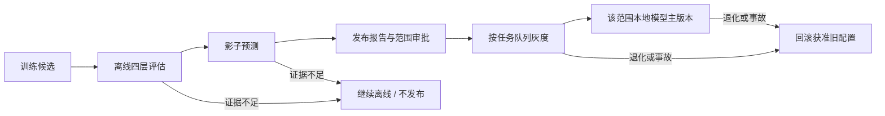

# 本地决策模型：持续训练评估、上线与回滚

> 2026-11-17 接入修订：用户当前指定 DeepSeek 执行、本地 Laya 判断；原 Jev 专属接入表述按 [最新选择](./milestones/model-provider-decision.md) 更新，判断来源与训练来源必须如实记录。
> 设计稿 v0.1，2026-11-16。扩展 [Jev 判断学习设计](./jev-decision-learning.md) 的未来发布阶段。当前生产策略仍为 Jev-only；本文定义满足什么证据后可以申请变更，并不启用本地模型。没有训练结果或真实评测数字。

## 1. 怎样定义“效果好”

训练 loss 下降、模仿 Jev 更像、少量演示成功，都不构成上线依据。需要依次证明：判断本身正确、持续学习没有破坏旧能力、放进 Agent 后质量不降且收益成立、实际部署能够稳定运行。

同时对照三个对象：冻结的 Jev 参考版本、上一版本地 champion、未训练或固定种子 student。新模型相对自己历史变好，不代表已经达到接手 Jev 的门槛；相对 Jev 不差，也不代表优于当前本地 champion。

Jev 不一定是真值。参考输出按来源分别保存，gold 来自独立证据/标注；若服务无法固定版本，记录调用时间、返回版本和请求结果，说明基线发生变化，不把跨时期结果当同版本公平对照。

## 2. 数据集怎样建立与滚动

| 集合 | 用途 | 更新与隔离规则 |
|---|---|---|
| 训练池 | 只用合格 KEEP 的 Jev 判断训练 | 按原有谱系、授权和同源分组准入 |
| 开发/校准集 | 选训练配置、温度与弃权阈值 | 不做梯度更新；已用于选型，不再称盲测 |
| 稳定回归集 | 监测旧任务、中文、协议与历史事故 | 版本化，作为长期锚点；反复查看后属于开发信号 |
| 新近盲测窗口 | 检验当前分布与泛化，做发布证据 | 候选和门槛冻结后开启；结果用于开发后下次换新窗口 |
| 难例与边界集 | 高置信错误、顺序扰动、缺信息、截断、未知选项 | 与自然分布指标分开报告，不冒充线上发生频率 |
| Reviewer 元评测集 | 检验筛样本者是否可靠 | 与 student 训练/选型隔离，不让 student 参与改裁判 |

测试输入从真实总体分布抽样，包含原来的 KEEP、DROP、HOLD、弃权和未采用答案，不只测筛过的容易题。原 Jev 答错的案例要重新标注可接受答案；HOLD 如果没有可靠 gold，只评价协议/弃权、进入人工补标，不能强制给任意正确选项。

同一 goal、重试、子任务、派生摘要、教师修订和近重复任务在一个 split。按任务家族划分，再加时间窗口；不能只随机切决策行。评测时还原决策前状态，后续 trajectory 供独立评审使用，不进入 student 输入。

gold 可以是多个合理选项或区间，不必强制唯一答案。标注分歧、证据等级和来源都保存。没有后续执行的答案只能评当时合理性，不能凭空标“帮助任务成功”。

## 3. 四层评估

### 3.1 判断层：它能否做对选择

| 维度 | 指标/检查 | 必须防止的误读 |
|---|---|---|
| 协议 | schema 有效率、非法选项、缺字段、错误处理 | 可解析不等于语义正确 |
| 分类与选择 | accuracy、macro-F1、各类 precision/recall、混淆矩阵 | 高频简单分类掩盖罕见严重误判 |
| 多解与评分 | 可接受集合命中、按问题定义的评分误差/排序质量 | 不同 score 含义不能混成一个平均数 |
| 错误代价 | 决策点的代价矩阵、严重误判率 | 把选错工具与误判取消当等价小错误 |
| 校准 | Brier、NLL、可靠性图、ECE | ECE 受分箱影响，单独低 ECE 不证明可用 |
| 弃权 | coverage、已回答子集错误率、风险—覆盖曲线 | 通过几乎全弃权伪装高正确率 |
| 稳健性 | 中文、长状态、选项顺序/措辞、未知域、量化 | 平均分提升但某个关键分组退化 |

普通分类头仅对相同语义标签空间比较概率；候选列表变化时按每条样本的实际候选集合评估。非概率 score 不强套 Brier/ECE。温度或其他校准器只在开发校准集拟合，评测使用真正部署的量化配置。

已知神经网络可能置信度失真；温度缩放可作为候选校准方法，但不保证分布漂移后仍有效。[Guo 等原论文](https://arxiv.org/abs/1706.04599)

### 3.2 持续学习层：这一轮是否真的更好

每轮在同一套适用评测上比较新候选、champion 和固定基线，分别报告新任务收益、旧任务保持、最差分组、未知域和校准变化。不能只报告新加入训练的题。

记录数据版本、任务覆盖、训练目标、随机种子、算力与 replay 比例。随机波动接近收益时，对入围配置用预先规定的重复运行复验，不无限挑最好 seed。对新增数据域做消融，区分数据、训练步数和模型变更的贡献。

模型达到不退化但没有可测收益时保留 champion；不因“训练刚完成”必须发布。减少耗时/资源是收益之一，但质量下降必须在预先允许的范围内。

### 3.3 Agent 层：选对之后任务是否更快成功

在隔离环境从相同初始状态执行 Jev 与 student 两组；固定执行模型、工具、Genome、预算和验收，仅变判断组件。任务本身随机时预设配对重复，按 goal/任务家族汇总区间，不能将同一任务的几十个决策当独立样本。

完整闭环必须执行各自后续轨迹。Jev 的后续状态通常不是 student 改变早期决定后会遇到的状态，不能只用历史静态回放宣称完整系统收益。

报告任务成功率、可避免绕路/返工、用户纠正、无效工具调用、升级、必要澄清、任务完成 p50/p95、每次成功任务总成本和失败成本。取消识别、边界保持、重复副作用是独立门禁，不能被平均效率抵消。

影子预测只检验真实输入分布下的判断和资源，不能证明 student 采用后也会成功。真实外部写只允许实际选中的一组执行；评测对照使用 fixture、可重建沙箱或只读任务，不双写生产。

### 3.4 部署层：在用户机器上是否值得使用

测试实际 checkpoint+adapter+量化+tokenizer+状态构建器+runtime：冷/热启动、p50/p95 延迟、峰值内存、吞吐、OOM、并发排队、重启与模型损坏。和本地执行模型同时运行，检查抢内存/算力是否使整个任务更慢。

全成本包含本地训练与推理资源、数据筛选、reviewer、Jev 采样、失败返工和运维。不能只比较一次判断 API 价格。

## 4. 发布门槛与证据量

针对每个 decision_kind 预先定义门槛，不规定一个万能“准确率 95%”。配置至少包括：

```yaml
evaluation_policy: decision-release-v1
scope: [tool_domain, skill_match]
reference: pinned-jev-or-approved-local-champion
quality:
  max_success_rate_drop: per-scope-predeclared-margin
  severe_error_limit: per-scope-risk-budget
  min_coverage: per-scope-threshold
  max_legacy_regression: per-critical-slice-margin
benefit:
  required: predeclared-latency-or-total-cost-benefit
evidence:
  confidence_method: goal-clustered-paired-analysis
  minimum_information: derived-from-margin-and-baseline
  sequential_monitoring: predeclared-checkpoints-and-error-budget
deployment:
  exact_bundle_required: true
  resource_budget: hardware-profile-ref
```

这是拟议配置，不是已经确定的生产参数。通过要求：质量相对参考的差值置信区间下界不越过预设非劣界；关键错误上界不越预算；收益达到目标；关键分组和回归集无不可接受退化。对只适合一个领域的模型，仅批准该领域，不全局接管。

**样本不足 = 证据不足**。粗略例子：独立同分布 Bernoulli 观察中，零错误的单侧 95% 错误率上界约为 `3/n`；300 个独立样本零错误仅支持约 1% 的上界，不证明零风险。决策高度相关、分布漂移或反复查看时这个近似不能直接套用，应按独立任务和既定统计方案计算。

持续重复挑候选会过拟合测试集；发布批次使用新盲测窗口并预设检验计划。灰度反复看数不能每次用普通 95% 区间随意宣告胜出；预设检查点与多次检验控制，或使用相容的序贯分析方法。严重事故的立即停止规则不等待统计显著。

Google 的分类评估文档提供分阈值和分类别指标；本设计借鉴其评估维度，不要求使用云平台，也不把其阈值迁移为 Auton 默认值。[官方文档](https://docs.cloud.google.com/gemini-enterprise-agent-platform/machine-learning/tabular-data/classification-regression/evaluate-model)

## 5. 怎样上线：训练自动，激活独立



影子与灰度是不同状态：前者不采用新输出，后者让小部分真实任务使用新版本。这个区分也见 Seldon 官方概念说明；Auton 可自行实现，当前不要求安装 Seldon。[官方文档](https://docs.seldon.ai/seldon-core-2/about/concepts)

### 5.1 发布状态与不可变产物

`trained → offline_passed → shadow_passed → approved → canary → active → retired/blocked`。失败可以回到候选阶段，但不能直接修改已批准的 bundle。人工首次批准上线范围；后续只有用户另行授权的既定发布政策才允许自动晋升，不因自动训练默认获得上线权。

发布对象包含模型 hash、adapter、tokenizer、量化、runtime、输入 state builder、问题与选项 schema、校准器、弃权规则、数据谱系、评测报告和作用域。模型服务加载完成并通过合成健康检查后，原子切换配置指针；保留旧 bundle，不能边训练边覆盖正在提供服务的权重。

### 5.2 按范围与任务灰度，不做难度路由

当前 Jev-only 政策只有发布批准才能改变。批准后，先让“工具域选择”或“Skill 匹配”等已证明合格的判断点在一个小范围接手。高后果判断继续由原策略处理；一个模型通过工具域评估不代表可处理取消、完成判定或所有其他判断。

灰度可按 `hash(goal_id, experiment_salt)` 固定分组，例如 5%→20%→50%→100%，比例只是示例。每阶段满足预设独立任务量、覆盖和观察窗口再扩大。个人任务少时先限制项目/判断点并人工验收，不能跑一天就认定通过。

同一 goal 的该判断点固定版本，避免中途随意切换造成串组与归因混乱。随机对照发生在任务/会话层，按预设任务类型分层；执行模型与 Genome 同期冻结。跨版本共享可变记忆会污染实验，必要时冻结或隔离写入，并在报告说明剩余干扰。

这里是发布实验分流，不是根据任务难度/置信度动态选择 Jev 或本地。范围内任务只有一个有动作权的判断来源，另一侧只做获准的只读影子。student 弃权时按预定义策略补证据、等待或阻塞，不隐式改问 Jev；如果未来要这样接管，须另改政策与评测。

### 5.3 自动回滚

以下事件立即停止扩大范围，按预设严重程度回滚或暂停：非法输出、取消/权限约束失守、重复副作用、持续 OOM/超时、关键分组错误超界；普通成功率/绕路/成本退化按预先规定的窗口和门槛判断。监控还覆盖待验收任务与评审积压，避免只统计快速成功的任务。

回滚目标是获准旧配置，可以是前一本地 champion，也可以是原 Jev 配置；**这是版本回退，不是每次请求的自动模型路由**。回到 Jev 仍必须满足当前隐私授权和可用性，否则暂停，不能因为回滚而发送禁止离机的数据。

停止分配新任务、标记受影响 goal；进行中的任务在安全 checkpoint 对账后迁移，必要时暂停人工处理。回滚恢复模型、输入构建、schema、校准器与策略的相容组合；不能撤销已产生的外部业务效果。保留事故轨迹和故障版本，不用删日志掩盖回退。

## 6. 本地模型上线后，如何继续学习而不闭环学坏

继续区分 teacher=Jev、actor=当前获准模型、reviewer=独立裁判。每条记录保存来源、是否实际采用与影响轨迹。禁止把本地预测重新标成 Jev 标签，禁止让新 student 给自己筛选正样本。

对获准外发的输入保留 Jev 只读抽样，以及一部分 Jev 控制任务；后者有真实 Jev 动作与结果，可以继续按原规则产生高质量 teacher 样本。未实际采用的 Jev 影子答案没有真实后续效果，只能进入待核验池；经过可靠隔离回放或其他充分证据复核才可改变资格，不能把本地任务成功算成 Jev 的贡献。

保持训练池中教师来源、任务难度与判断点覆盖，报告控制样本缩小后的偏差和成本。若停止所有 Jev 实际执行又坚持只学“Jev 已实际促成成功”的样本，就会失去这类新增证据；需要明确接受冻结教师池或保留上述控制通道，不能假称仍有相同闭环。

每轮自动训练仍只产生 challenger；达到既定证据后才进入同一发布状态机。新的线上分布、问题版本或硬件变更可能使旧校准失效，重新评估而非沿用旧分数。

## 7. 最小交付与验证清单

首期交付 EvalSuite、独立 gold 与标注争议队列、配对任务回放器、按 scope 的 ReleasePolicy、不可变 JudgmentBundle、影子日志、灰度分组器、监控和原子回滚。拟议命令为 `/decision evaluate`、`/decision shadow`、`/decision release-report`、`/decision approve`、`/decision rollout`、`/decision rollback`，目前均未实现。

核心验收：候选不能改 gold；旧任务退化阻止上线；低覆盖不得伪装高分；影子输出无动作权；未批准候选不能激活；同一任务不双写；student 弃权不偷偷调用 Jev；损坏/不相容 bundle 拒绝加载；回滚不重复写入；本地上线后的 Jev 影子答案不自动继承本地成功标签。

## 8. 参考阅读笔记

- [神经网络概率校准](./references/guo-neural-network-calibration.md)
- [分类模型评估与阈值](./references/google-classification-evaluation.md)
- [影子与灰度发布](./references/seldon-shadow-canary.md)

指标分组、发布状态机、具体证据要求与无动态路由政策为 Auton 设计推论，尚未实现或实验验证。
