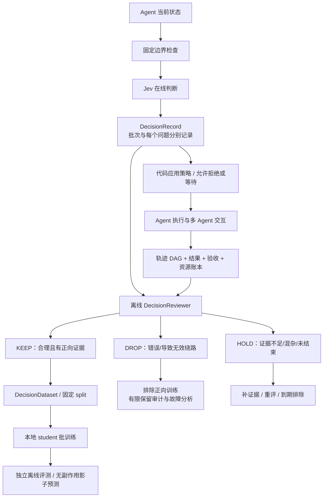

# Jev 全链路判断与本地决策模型离线学习

> 2026-11-17 接入修订：用户当前指定 DeepSeek 执行、本地 Laya 判断；原 Jev 专属接入表述按 [最新选择](./milestones/model-provider-decision.md) 更新，判断来源与训练来源必须如实记录。
> 设计稿 v0.2，2026-11-16。按本次要求修订：所有启用的在线语义判断只调用 Jev；本地决策模型只做离线训练、回放和影子评测，不与 Jev 路由，也不自动接管线上。本文尚未实现或运行训练。
> 同步修订了 [模型路由方案 v0.2](./model-routing-and-local-learning.md)，取消原 v0.1 关于本地判断器在线 fallback 和未来替换 Jev 的设想。执行模型的 2B/7B/强模型路由继续保留；它与判断模型的在线选择是两个概念。

> 后续扩展：[本地决策模型评估、上线与回滚](./decision-model-evaluation-and-release.md) 定义未来可批准的发布流程，包括完整任务对照、影子、按任务灰度和回滚。当前 Jev-only 不因此自动改变；未来发布也不采用按难度的 Jev/本地动态路由。

## 1. 模型角色与固定职责

| 模型 | 职责 | 在线参与方式 | 可训练数据 |
|---|---|---|---|
| Jev | 任务、工具、证据、过程等类型化判断 | 唯一在线语义判断来源，随后由代码应用策略 | 保存全部获准记录；经轨迹复核筛出优质判断 |
| 本地 DecisionStudent | 学习 Jev 在各判断点上的有效行为 | 无决策权；只对冻结输入离线回放或异步影子预测 | 独立 DecisionDataset，不与执行 SFT 目标混用 |
| 2B/7B/强执行模型 | 回答、规划、代码生成和工具动作 | 由模型路由策略选择 | ExecutorDataset，与上一版设计一致 |
| DecisionReviewer | 事后复核 Jev 是否合理、是否有助于高效完成任务 | 异步评审，不参与当次在线动作授权 | 使用轨迹与确定性证据，不自动自举为真值 |

Reviewer 初期采用经校准的强模型，必要时分歧送人；不是让 Jev 给自己打分，也不让仍在学习的本地 student 自己挑训练集。执行模型在生成计划时会推理，这不等于允许它替代 Jev adapter 对已声明判断点返回正式结论。

**准确描述目标**：Jev 在线产生判断 → 轨迹提供效果证据 → 独立 reviewer 归因筛选 → 高质量判断监督本地 student → 自动产生离线候选与评测报告。未来是否让 student 上线，另立决策；本方案不自动做这个转换。

## 2. Jev 还能应用在哪里

TypeSafe 官方列出路由、检索标注、证据检查、Agent 验证等用途，强调判断与代码控制分开。下表是根据这些能力映射的 **Auton 候选应用**，不代表这些节点已实测可用。[官方用途](https://docs.typesafe.ai/concepts/use-case-map.md)

| 判断点 | 发给 Jev 的有限问题 | 代码如何使用 | 事后能核对什么 | 顺序 |
|---|---|---|---|---|
| 输入意图 | 新任务/追问/修订/暂停/取消/查询？ | 更新对应 goal revision，不把状态查询当新任务 | 用户后续纠正、任务上下文延续 | P1 |
| 信息充分性 | 缺事实、目标含糊还是可直接执行？ | 获取上下文或发必要澄清 | 澄清是否消除阻塞、是否无谓打断 | P1 |
| 执行模型选择 | 当前阶段所需能力与推理复杂度？ | 在合格模型集合中选 2B/7B/强模型 | 验收、升级、成本及模型对照 | P1 |
| 工具域选择 | 文件/检索/数据库/浏览器/无工具？ | 只在允许集合中发现和暴露工具 | 误用、空结果解释、有效动作比例 | P1 |
| Skill/role 匹配 | 哪些技能/角色相关，还是都不匹配？ | 按预算加载或委派 | 触发准确、约束保持、任务收益 | P1 |
| 检索重排 | 候选证据是否相关、是否回答问题？ | 重排与定向展开，不改变原文事实 | 引用支持率、漏证据、重复读取 | P1 |
| 失败分流 | 更像参数误用、环境故障、能力不足或缺信息？ | 选修参数、对账、补上下文或升级流程 | 修复是否消除错误、是否盲重试 | P1 |
| 无进展识别 | 新动作是否重复旧失败、是否真的增加证据？ | 结合确定性重复指纹触发策略调整 | 重复回合、额外耗时、是否合理探索 | P1 |
| 子任务分配 | 哪个合格 role 适合当前有界子任务？ | 检查依赖、权限和写入所有权后委派 | 重复工作、接口冲突、集成返工 | P2 |
| 阶段完成检查 | 证据是否覆盖验收，尚缺哪类材料？ | 进入验证或补工作；不能直接覆盖 checker | 漏验收、过早/过晚停止 | P2 |
| 引用和结论对齐 | 引用是否支持这条具体结论？ | 不支持则回查或标未验证 | 原文支持与人工抽检 | P2 |
| 记忆捕获候选 | 临时事实、长期偏好、规则线索、重复或不应记？ | 进入候选区；晋升仍受治理约束 | 后续纠正、适用范围、过期与冲突 | P2 |
| 相似/冲突线索 | 两段记忆是重复、矛盾还是适用范围不同？ | 提交合并候选，不自动销毁证据 | 被误合并事实、来源范围 | P2 |
| 学习任务分流 | 更像工具 bug、技能缺陷或执行模型能力缺口？ | 分配诊断任务，不让 Genome 乱修环境故障 | 修复归因、有效候选率 | P2 |
| 通知价值 | 有实质变化/需行动/可合并/不应打扰？ | 按静默规则和渠道策略决定发送 | 用户反馈、重复通知、漏告警 | P2 |
| 候选优先级 | 哪个诊断更值得先做？ | 在固定预算和安全约束内排队 | 收益、覆盖与延迟；难以单次归因则隔离 | P3 |
| 视觉位置候选 | 给定 UI 区域中目标在哪里？ | 重新观测并检查当前状态后才可行动 | 定位与实际状态，不按旧图盲点击 | P3 |

不应为了搜集训练样本每轮问完所有问题。每个判断点先证明它比规则或现有流程带来的增量收益大于调用与上下文成本，再启用。记录未启用的节点，不虚构 Jev 参与率。

### 2.1 不能替代的固定边界

身份、真实权限、数据离机限制、预算上限、动作批准、租约、操作幂等、测试集访问都由代码和存储执行。Jev 的风险分类可提高审查优先级，但不能把一次“看起来安全”变成允许越权。

Jev 不可达或数据不允许送给 Jev 时：相关语义判断进入 pending/blocked，或者使用不需要该判断的已定义确定性流程；**不调用本地 student 接管，也不把规则结果伪装成 Jev 返回**。托管 Jev 的数据使用、留存与训练权限需按实际服务条款确认。

## 3. 开源候选：模型与工具分开选

查阅日期：2026-11-16；仅核对官方仓库/模型卡/文档，没有安装、下载权重或复现实验。以下是短名单，不是能力排名。代码、基座权重和训练数据的许可分别核对；固定版本后再做接入。

| 候选 | 类型与已核对入口 | 学习路径 | 局限与定位 |
|---|---|---|---|
| **Laya** | 开放类型化决策模型；[代码](https://github.com/NandhaKishorM/laya)标 Apache-2.0 | 仓库有 `laya.train` 等微调入口 | 适合先验证窄判断点；不能默认长轨迹可直接输入 |
| **Laya 模型卡** | [开放权重与模型卡](https://huggingface.co/convaiinnovations/laya)，标 Apache-2.0 | 固定中文/多语言适配 checkpoint 后训练 | root 卡为英语、短上下文；模型卡承认默认零样本、选项数和校准限制；中文需要单测 |
| **AnyJev / Tacit** | [官方仓库](https://github.com/nokia-applied-research/AnyJev)，代码 Apache-2.0 | 提供开放 LLM 的类型化读出及 Tacit checkpoint 路线 | “无需训练即可读出”不是自动训练器；我们的 Jev 监督训练需单独实现/验证 |
| **poorjev** | [官方仓库](https://github.com/rupeshpoojary9/poorjev)，MIT 的本地判断层 | 可借鉴 NLI 选项打分及本地校准 | 它是组合方案，不是已证明可持续训练的 Jev 等价权重；作者校准宣称不能外推分布漂移 |
| **mlx-decision** | [官方仓库](https://github.com/armbues/mlx-decision)，MIT 的 Apple Silicon 运行/训练工具 | 有数据、拟合、评测和教师标注能力 | **不是模型**，需要单选支持的权重与训练模式；是否适合用户硬件仍待确认 |

### 3.1 初始选择建议

- 第一组 PoC：Laya 的相容多语言 checkpoint，验证“意图、技能匹配、工具域”这类短状态、小选项集问题。若中文/状态长度不达标就淘汰，不因参数小而强推。
- 第二组对照：AnyJev + 合格开放基座/Tacit，验证更长状态和复杂选项的判断；推理读出、微调方式、量化后校准分别检查。
- Apple Silicon 可评估 mlx-decision 做运行与训练 adapter；训练工具选择不改变线上始终 Jev 的政策。
- 固定标签、极窄任务保留 embedding/小分类头或 NLI 基线；用来判断是否值得训练更大判断模型，不把它们当作同等通用能力。

本地判断模型不需要跟执行模型一样固定 2B/7B。可以是更小 encoder，也可以是较大开放基座；选择依据是状态长度、中文、选项数、训练成本、校准与实测质量。未确认硬件前不锁模型。

### 3.2 特别检查版本变化

AnyJev 的 changelog 明确说明部分版本移除了过去的标注学习/路由接口，不能照旧示例假定有现成 `observe` 在线学习。训练与推理能力必须按固定版本逐项验收。[官方变更记录](https://github.com/nokia-applied-research/AnyJev/blob/main/CHANGELOG.md)

不得启用候选库中现成的 Jev/本地自动 fallback、模型 router 或 adaptive 接管来改变本方案线上政策。候选库内部选择 checkpoint 的离线行为也要留版本记录。

## 4. 在线数据链路：逐次、逐问题保存



所有获准 Jev 响应都先记账，不按 Jev 自报置信度预先丢弃；包括异常、弃权、多个问题中未采用的答案。`request → question → judgment → policy action → tool/task events → outcome` 建立可追溯关联。

### 4.1 每次记录的最小内容

```yaml
decision_id: d_001
batch_request_id: jb_001
question_id: model-selection
decision_kind: execution_model_tier
goal_id: g_001
goal_revision: 3
task_id: t_001
stage_id: inspect
trace_parent_ids: [span_012]
state_snapshot_ref: state/hash-at-decision
input_event_cutoff: event_108
state_builder_revision: builder-v2
question_revision: q-v4
answer_schema_hash: schema-h1
option_ids_and_order: [local_small, local_medium, strong, insufficient]
jev_model_revision: pinned-or-reported-revision
raw_response_ref: protected-payload/001
typed_answer: local_medium
probabilities_ref: payload/distribution-001
confidence: 0.84
policy_revision: policy-r3
applied: true
policy_action_ref: route/decision-001
affected_event_refs: [modelcall_109, tool_111]
review_status: pending
```

同时保存实际允许候选及能力档案、输入被脱敏/截断的位置、请求费用与耗时。题目、选项描述和顺序都是判断输入的一部分，不能只留“medium”字符串；选项用稳定 ID，不用显示位置代表业务含义。

被 policy 拒绝、未使用的 fan-out 答案、请求失败不产生可观测动作时，不能宣称它帮助了任务成功。它们可以做诊断，但按本次规则不自动进入正向行为训练。

## 5. 事后怎样判“合理且促进快速成功”

### 5.1 结果不是单一成败标签

| 情况 | 建议判定 | 原因 |
|---|---|---|
| Jev 选择合理，后续工具故障导致失败 | HOLD / 单独的非归因故障桶 | 不能把环境故障归罪于 Jev；本次正向训练要求未满足则不纳入 |
| Jev 选错，Agent 后来重规划成功 | DROP | 最终成功不洗掉前面错误与额外绕路 |
| Jev 正确要求补信息，增加一轮后安全完成 | KEEP 候选 | 回合更多可能是必要工作，不能按最少步数机械判差 |
| Jev 建议便宜模型，后续反复失败升级才完成 | DROP 或 HOLD | 需核对失败是否由能力误判导致，而非当时未知环境 |
| Jev 合理选择强模型，一次通过但费用较高 | KEEP 候选 | 成本按质量与失败代价约束评价，不要求永远最便宜 |
| 任务成功但无法定位该判断的贡献 | HOLD | 只知道相关性，不知道有效促进 |
| 任务未结束、被取消、目标被用户改写 | HOLD / 过期排除 | 不能用新目标结果给旧目标判断打分 |
| 合理判断明确推进子目标，但整个任务后来失败 | 按已定义局部验收决定；默认 HOLD | 允许以后设计局部训练证据，首期不放宽成“所有局部看着不错就留” |

### 5.2 Review 分两次，避免后见之明

**A. 当时合理性**：Reviewer 先只看决策前状态、原问题/选项、允许范围和当时可知约束，评价回答是否有充分依据。不能因为事后出现了新信息，就要求 Jev 当时预知。

**B. 后续效果**：再展示关联轨迹、checker、用户纠正、重试/重规划、成本与交付结果，判断该选择是否实际促进进展、造成可避免失败或绕路。两次输入与结果分别记录，不让全轨迹“泄露”到 A 阶段。

### 5.3 归因证据的强弱

1. **强证据**：同初始状态的受控回放，替换该判断后对照；或者明确的错误工具选择→错误结果→用户纠正→更正后通过链路。
2. **中等证据**：有完整影响链和独立验收，但没有可比替代。可记录 provisional，不自动当作“已证明更快”。
3. **弱证据**：只有最终成功/失败、模型文字或 Jev 自报信心。不能进 KEEP。

回放只能在隔离 fixture/stub 中执行，不能为评估某个决定重复生产副作用。历史缺环境快照、工具已变或模拟可信度不足时，降低证据等级。不能生成一个想象中的替代结果当反事实真值。

### 5.4 效率比较口径

观察与决策关联的返工、无效工具调用、重复检索、模型升级、token、墙钟及队列等待，并区分必要探索和无效绕路。比较同任务类型、难度/状态、模型与工具版本下的基线；目标修订后重新分段。

质量与边界先满足，再评效率；“更少检查”“不问必要澄清”不因此获得高分。没有可比基线时只报告成本事实，不宣称相对提速。

多 Agent 用因果/依赖 DAG，不只看单个按时间排列的 event range。若多个判断共同造成结果，标记 interaction group；无法分离单个贡献则 HOLD，不把所有参与判断一起奖惩。

### 5.5 Reviewer 输出契约

```yaml
decision_id: d_001
reviewer_model_revision: judge-r1
rubric_revision: decision-quality-v2
knowledge_at_time: sufficient
decision_reasonableness: supported
applied_action_valid: true
outcome_status: verified_success
causal_attribution: supported
attribution_confidence: calibrated-or-unknown
evidence_refs: [checker_11, tool_111, counterfactual_report_9]
avoidable_detour_refs: []
efficiency_baseline_ref: controlled-pair_9
efficiency_verdict: within-budget-and-beneficial
dataset_verdict: KEEP
exclusion_reason_codes: []
review_explanation: "依据可定位证据说明，不将猜测写成因果事实。"
```

这些字段是 Auton 设计，不是任何模型的现成返回协议。Reviewer 必须引用实际证据；schema 校验通过不等于评审正确。

### 5.6 防止评审者把数据筛坏

建立人工标注校准集，覆盖“失败但判断合理”“成功但曾绕路”“合理澄清增加步骤”等易错情况；对 KEEP 随机抽检，对 DROP 与 HOLD 也抽检，观察漏掉的优质样本和错误放行。

自动 KEEP 必须同时满足：训练资格合格、输入与轨迹完整、答案已实际采用、当时合理性受支持、关联目标验收成功、贡献证据达标且没有未解释的可避免绕路。费用与延迟以该类任务已定义口径验收；具体阈值由独立校准集确定，不能随样本量不足自动降低。

初期高置信且证据充分才自动 KEEP；Reviewer 分歧、归因低置信、时序缺失或 checker 争议全部 HOLD。校准退化时暂停数据快照晋升，不能为了保证样本量强行二分类。

## 6. 删除、保留与自动训练语义

用户要求的“不合理删掉、合理留下”落实为：**DROP 不进入 DecisionStudent 的正向训练集，KEEP 才成为训练候选**。HOLD 先隔离而不是伪装成合理。

为后续排障，原始判断和排除原因按用户的数据保留策略有限保存，不能让训练数据清理破坏操作审计；到期删除 payload 可保留非敏感 tombstone。用户明确要求物理删除时，执行其策略并传播到样本、快照与模型谱系。

本版不自动把 DROP 改成负样本或 DPO 对，也不让 Reviewer 重写一个新答案混进 Jev 蒸馏。要学习修正答案，应另建人工/修正数据通道并明确来源，不能标成“原 Jev 的合理判断”。

## 7. DecisionDataset 与模型持续自动迭代

### 7.1 训练目标

`input = 当时 state + 原 question + 选项/评分 schema`；`target = 被批准 KEEP 的 Jev 答案`。后续 trajectory 只用于评审标签，**不作为 student 在当时判断的输入**。不把 Jev 的 confidence 当正确率监督；只学选中答案时使用 hard-label，分布蒸馏需另行验证是否可信。

一个任务的多个决策、重试、子任务、反事实分支与增强样本按同源 group 锁定 split。先划分再做轨迹标注与训练样本派生；受保护 test 不参与训练筛选、问题优化、teacher 重写或 student 调参。

### 7.2 本地模型不统一套用对话 SFT

- encoder/decision head：使用模型支持的分类/序数/概率训练接口，验证选项与 mask。
- LLM 型读出/adapter：用经过验证的标签或候选概率损失，不能默认聊天 SFT 等价于 decision 训练。
- 固定任务的小分类头：记录标签空间，新标签和问题版本变更需要迁移/重新评测。

执行模型的 SFT 数据仍独立处理，不将决策正确样本直接当执行答案。

### 7.3 自动迭代流水线

```text
轨迹完结或局部验收 → 异步复核 → KEEP/DROP/HOLD
→ 数据资格与去重 → immutable DecisionDatasetSnapshot
→ 覆盖/数量/预算/空闲资源门禁 → 训练 student 候选
→ 协议、中文、任务质量、校准、量化与遗忘评测
→ 离线候选 registry + 对比报告；不激活线上
```

晚到的用户纠正或 checker 修订触发重评；旧 KEEP 可撤销，已发布离线数据快照保持不可变并标记失效，阻断后续训练并追踪受影响候选。

只对新增合格数据或明确漂移触发，保留高质量 replay 和基础锚定任务。相同输入/配置的 job 有幂等 ID，恢复不重复发起训练；失败记录可查询。未达数据覆盖与质量门槛时跳过，不能以“每天训练一次”替代证据。

## 8. 影子评估：不影响生产结果

本地 student 从冻结决策前快照预测，输出只写 ShadowDecisionRecord，不进入 RoutePolicy、工具执行、角色分配或用户通知。异步影子作业不占前台必要资源；与 Jev 不一致只形成分析队列，不要求在线再请求 Jev直到与 student 一致。

评测同时报告：

- 与经复核 gold 的准确率、各 decision_kind 的表现及最差分组。
- 与 Jev 的一致率，但一致不是正确，不能作为唯一验收。
- held-out 的不合理决策识别、中文、长状态、小/大选项集、顺序扰动与分布外任务。
- Brier/ECE 等概率指标及覆盖/错误权衡，按相同校准数据与实际部署精度评测。
- 真实吞吐、冷启动、内存、量化后退化与旧判断点遗忘。

**不能只在 KEEP 子集测准确率**：那会高估质量和校准。离线测试覆盖线上总体分布，包括经独立标注的 DROP/HOLD 及拒绝/未知情况；gold 来自独立标注，不以错误 Jev 答案充当标准。

## 9. 阶段路线

| 阶段 | 交付 | 验收 |
|---|---|---|
| J1 | 判断点 registry，先上线模型选择、意图与工具域 | 每次调用、每个问题都能关联输入与实际动作 |
| J2 | DecisionRecord + 轨迹 DAG + 复核标注集 | 分得清成功绕路、失败非归因和证据不足 |
| J3 | Reviewer + 三态筛选 + 数据质量报告 | KEEP 污染率可测，DROP 无正向训练泄漏 |
| J4 | Laya 与 AnyJev 路线离线 PoC | 固定版本/语言/上下文/选项下有公平对照 |
| J5 | 自动批训练、回放和影子报告 | 本地预测不改变任何生产动作，能恢复与回滚候选 |
| J6 | 分批扩大判断点与持续漂移监控 | 每个新点有独立数据覆盖、校准和验收 |

未来 student 的评估门槛、上线范围和切换流程见 [发布扩展设计](./decision-model-evaluation-and-release.md)。当前自动化只产生离线候选；现在线上只走 Jev 的政策持续生效，实际激活由独立发布流程批准。

## 10. 核心回归用例

1. 关闭 Jev 服务：本地 student 不得自动接管。
2. student 输出与 Jev 不同：线上动作仍只使用有效 Jev+固定策略。
3. Jev 选错，强执行模型后来补救成功：错误决策 DROP。
4. Jev 合理，工具服务故障：不得仅按任务失败认定判断错误。
5. Jev 请求必要澄清：不得因多一轮自动判绕路。
6. 批次含多个问题：未采用答案不可冒充促成成功样本。
7. 用户修订目标：旧决策不使用新目标结果贴标签。
8. 并行判断共同影响结果：无法分离贡献时 HOLD。
9. Reviewer 引用不存在证据或前后矛盾：拒绝自动 KEEP。
10. DROP/HOLD 被导出到正向训练、test 经重写进 train：数据门禁必须拒绝。
11. 执行历史有真实副作用：反事实验证只能在隔离环境回放。
12. 新 student 只在 KEEP 子集高分：不认定总体质量或校准通过。
13. 更换 question、选项顺序、checkpoint、量化配置：重新核实样本与预测相容性。
14. 用户撤回数据：阻断后续训练并标记受影响候选，不能假称删样本就已清除权重影响。

## 11. 参考笔记

逐篇中文 Markdown：

- [TypeSafe 用途地图](./references/typesafe-jev-agent-use-cases.md)
- [Laya 代码与训练入口](./references/laya-local-decision-model.md)
- [Laya 权重、语言与上下文限制](./references/laya-model-card-limits.md)
- [AnyJev / Tacit](./references/anyjev-local-decisions.md)
- [AnyJev 训练接口变更](./references/anyjev-changelog-training.md)
- [poorjev 本地判断层](./references/poorjev-local-decision-layer.md)
- [mlx-decision 运行与训练工具](./references/mlx-decision-training-runtime.md)

这些资料说明候选能力与接口，不证明它们已经满足 Auton 的中文判断、轨迹归因或持续学习要求。所有 candidate 自报结果都需要在本地任务集复验。
