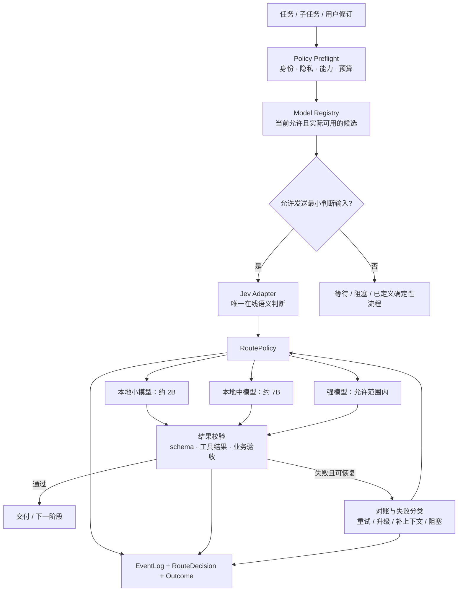
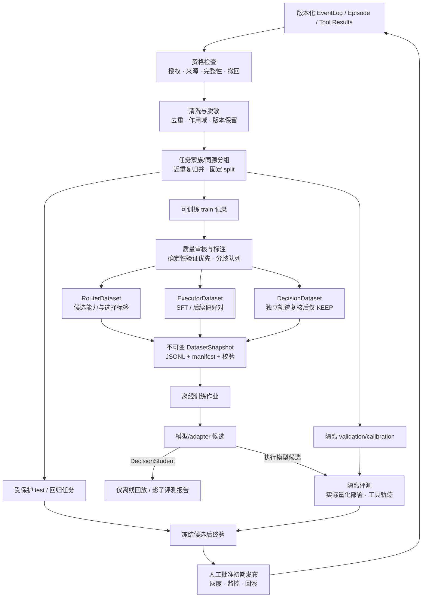

# Auton：Jev 判断层、模型路由与本地小模型持续学习

> 设计稿 v0.2，2026-11-16。用户目标：简单工作尽量交给本地约 2B/7B 模型，困难工作使用强模型；自动把历史记录加工成训练、验证和测试数据，持续提高本地模型能力。
> 发布扩展：本地决策 student 的效果评估、按判断点接手、灰度与回滚见 [专项设计](./decision-model-evaluation-and-release.md)。本文的 Jev-only 是当前运行阶段；未来须经独立发布批准才能改变，训练完成不自动激活。
> 本文是架构方案，不代表路由器、数据流水线或训练任务已实现。具体模型、硬件、训练后端和阈值通过实验选定，不凭参数量或厂商宣传确定。

## 1. 方案结论与边界

建议形成三个相互连接、但独立版本化的部分：

1. **判断与路由**：规则先筛选可用模型，Jev 判断任务性质与不确定性，RoutePolicy 决定使用哪个执行模型。
2. **经验加工**：历史轨迹经过筛选、脱敏、验证、去重与分组划分，生成路由数据、SFT 数据和隔离评测任务。
3. **离线学习与发布**：按批训练本地小模型候选，在实际部署精度和工具环境下评测，通过后发布、监控、可回滚。

核心区分：**Jev 是判断组件，本地 2B/7B 是执行模型；训练它们所需的数据也不同。** 不假定 Jev 可在本地部署或可自行微调，不把其服务接口与本地小模型训练绑定。线上语义判断始终使用 Jev，本地 DecisionStudent 仅离线学习与影子评测，不做 Jev/本地路由或故障接管。详见 [Jev 全链路判断与离线学习](./jev-decision-learning.md)。

本文扩展总架构原来的“暂不做权重训练”：Genome 进化继续负责资产补丁，新增 Model Learning 通道负责权重/adapter。两条通道共享可信经验和评测基础设施，但不能共享修改裁判或偷看测试集的权限。

## 2. Jev 在这里负责什么

### 2.1 官方资料能确认的内容

TypeSafe 官方介绍 Jev 接收 state 和类型化问题，返回代码可以消费的结构化判断；Choice、Score 等问题可返回概率与 confidence。官方另强调将判断拆解后由代码组合业务决策，而不是用一个巨大的问题替代全部策略。[官方介绍](https://docs.typesafe.ai/introduction) · [官方设计说明](https://typesafe.ai/blog/dont-call-it-a-decision-model)

这支持将 Jev 放入分类与选择链路，但**不证明它能准确预测任意本地模型是否会完成某项任务**。类型正确与语义正确不同；官方 confidence 也不能直接当作“7B 任务成功率”。

### 2.2 建议先做的判断

| 判断 | 示例输出（Auton 自定义） | 决策用途 |
|---|---|---|
| 工作类型 | extract / classify / explain / code / research / plan / other | 找到对应模型能力评测与策略 |
| 推理需求 | bounded / multi_step / open_ended / unknown | 决定是否进入更强模型或先做规划 |
| 关键能力 | tool_calling、long_context、vision、code_edit | 与 Model Registry 做匹配 |
| 信息是否充分 | sufficient / needs_context / ambiguous | 先取证或澄清，避免靠升级模型解决缺信息 |
| 路由适用性 | known_distribution / unfamiliar / unknown | 未知场景保守处理 |

这些输出是拟议的内部契约，不是复制 Jev 的请求 schema。Jev adapter 负责把它们翻译成届时固定版本的官方 API；框架不依赖 `latest` 别名作为唯一版本信息。

### 2.3 不交给 Jev 最终决定的事项

- 用户身份、数据是否允许外发、是否有工具写权限、是否需要批准。
- 硬预算、上下文硬上限、硬件可用性、工具 schema 相容性。
- 模型候选能否发布、测试集是否能进入训练、历史删除是否生效。

这些由确定性策略和可审计记录执行。Jev 可以提供风险线索，不能成为放宽权限或替代用户授权的入口。

## 3. 在线架构与路由顺序



**顺序不能颠倒**：先判断隐私和权限，再考虑是否把输入发给托管 Jev。不能虽然答案由本地模型生成，却先把完整私密历史送到云端路由器。

### 3.1 Model Registry

每个可部署版本至少记录：

```yaml
model_id: local-small
deployment_revision: small-r3-q4
base_model_revision: pinned-base-revision
adapter_revision: adapter-a3
tokenizer_revision: tokenizer-t1
chat_template_hash: template-h1
runtime_revision: runtime-r1
deployment_precision: quantized-profile-q4
location: local
capabilities: [text, structured_output]
validated_task_suites: [extract-v2, classify-v1]
validated_context_range: measured-range
privacy_domain: local-only
health: available
capacity_profile_ref: bench/hardware-and-runtime
```

模型能力按**实际部署版本**描述，包括量化、adapter、模板和运行后端。不能拿全精度评测推定量化部署的表现，也不能仅凭“7B 比 2B 大”断言在每类任务都更强。

### 3.2 起步路由策略

| 任务条件 | 初始建议 | 依据与限制 |
|---|---|---|
| 固定 schema 提取、简单分类、明确短文本处理 | 已验证适合的本地 2B 档 | 必须有格式与业务校验，不靠回答语气判通过 |
| 项目解释、有限多步处理、已验证的工具任务 | 本地 7B 档候选 | 工具协议、上下文与任务类型必须有评测证据 |
| 未知复杂度、跨模块推理、复杂规划或高失败代价任务 | 允许使用的强模型优先 | 强模型也要验收，不能因此绕过批准 |
| 数据不允许离机 | 仅本地候选 | 没有合格本地模型就补证据、澄清或阻塞，不能自动外发 |
| 任一模型缺视觉/长上下文/工具能力 | 排除该候选 | 不能因价格便宜硬塞不相容请求 |
| 信息不足或目标歧义 | 先获取上下文或澄清 | 升级参数量不能消除缺失事实 |

这是一套启动假设，最终以自身任务集校准。2B 和 7B 是用户期望的容量档位，不在此固定品牌或精确尺寸；“强模型”也可以是硬件允许的较大本地模型。

### 3.3 难度是相对于模型和任务的

应学习的是 `P(pass | request_state, model_version, task_type)` 或相对收益，而不是永远有效的 easy/hard 标签。一个模型擅长提取，不一定擅长工具调用；长但模板固定的任务也未必比短的逻辑任务难。

概念目标：在满足隐私、能力和授权约束的候选集合内，最小化 `运行成本 + 路由开销 + 预期失败代价 + 升级成本`，并满足任务类别要求的质量下限。初期用可解释规则实现，不声称已有准确概率模型。

Jev 的 confidence 衡量其某个判断的不确定性。`confidence=0.9` 不意味着本地执行成功率是 90%；必须用本地验证数据测覆盖率、错误分布及阈值行为。未知或缺失 confidence 返回 `abstain`，不得补成 1。

### 3.4 路由粒度

首期按任务/稳定阶段路由；复杂工作可以强模型规划，再把边界明确的提取、检查或格式化子任务交给本地模型。不要默认每一个 token 或工具回合都换模型。

换模型只在明确 checkpoint 发生：传递目标、约束、工具 schema、已核实结果和未决操作。不同模型的工具格式、上下文和模板不兼容时先适配；不能原样拼接一个模型的专用消息格式给另一个。

## 4. 校验、升级与降级

### 4.1 什么情况下升级

1. 结构化输出或工具协议反复失败，且不是适配器 bug。
2. 业务 checker 不通过，诊断显示能力不足。
3. 需要额外推理或上下文能力，当前模型不具备。
4. Jev 判断不确定或输入超出已验证分布，且策略允许更强候选。

不机械设为“2B 失败就 7B，7B 失败再云端”：某些任务直接强模型更划算；有些环境故障换模型无用；私密任务始终不允许云端。

### 4.2 升级不等于从头重放

外部写操作结果未知时，先查 Operation Ledger 与外部状态；确认前不重做。已有成功写入以 receipt 交接，新模型从安全 checkpoint 接续。取消、权限撤回与用户修订优先于升级。

每个任务有总 budget 和升级次数上限；路由器、重试与验证都计入。高风险动作一直由工具层审批，不能因执行者变成强模型就免审。

### 4.3 Jev 故障或本地模型不可用

- Jev 超时/不可达：依赖该语义判断的步骤等待或阻塞，不使用本地 DecisionStudent 接管。无需该判断的预定义确定性流程可以继续，记录 policy default，不能冒充 Jev 判断。
- 本地负载过高/冷启动：根据隐私策略排队、换本地候选或允许的远程候选，计入真实等待延迟。
- 无候选合格：报告能力/预算/隐私阻塞，保留任务状态；不能选择一个不满足硬约束的便宜模型凑结果。

## 5. 必须保留的运行记录

新增事件：`RouteEvaluated`、`RouteSelected`、`RouteAbstained`、`ModelEscalated`、`ModelCandidateActivated`、`ModelCandidateRolledBack`。

```yaml
route_decision_id: rd_001
goal_revision: 3
task_id: t_001
stage_id: extract-fields
input_state_ref: state/hash-before-decision
input_event_cutoff: event/108
policy_revision: router-policy-r2
judge_adapter: typesafe-jev
judge_revision: recorded-provider-revision
judgment_ref: payload/judgment-001
candidate_model_revisions: [small-r3-q4, medium-r2-q4, strong-r1]
selected_model_revision: small-r3-q4
selection_reason_codes: [known-task, capability-match, local-allowed]
budget_reservation_ref: reserve/001
later_outcome_ref: outcome/001
```

路由输入仅包含当时可见信息；完成后的成功、人工纠正、强模型修复结果是训练标签候选，不能回填到当时的输入特征。保留推断与最终业务结果的区别。

## 6. 历史到数据的自动加工链路



### 6.1 数据准入

只纳入具备下列条件的记录：任务与事件完整、输入状态可追溯、实际模型/工具版本已知、训练用途被允许、敏感信息处理完成、用户撤回与删除标记已检查。

云端教师输出是否能用于训练另一模型，按实际服务条款与数据授权逐项确认；未确认记录标为 `training_eligibility=unknown`，不能默默加入训练。真实历史、合成修订与人工标注分别记录 origin。

不得把整个 EventLog 当语言模型文本直接训练：其中混有错误、秘密、工具输出、第三方注入、尚未确认的假设和不同版本协议。

### 6.2 哪些轨迹适合什么用途

| 历史片段 | 可形成的数据 | 限制 |
|---|---|---|
| 可执行 checker 验证成功的答复或工具动作 | SFT 正样本候选 | 输入必须重建到当时状态，不带未来答案 |
| 用户纠正后已验证的最终答复 | 修订后的 SFT 目标 | 区分“用户新要求”与“原回答错误” |
| 小模型失败、强模型成功 | 路由和修复案例候选 | 两者若输入状态不同，不能直接当公平能力对比 |
| 相同输入上的多个模型受控执行 | 候选模型通过向量、成本标签 | 禁止在生产真实外部系统重复写来造标签 |
| 环境故障、超时或权限不足 | 恢复/异常决策样本、故障任务 | 不把基础设施失败标成小模型能力差 |
| 只有模型自述“已完成” | 待核验队列 | 没有外部或人工证据不能直接作 gold |
| 测试集、Judge 元评测、被撤回数据 | 受限或排除 | 不通过摘要、修订或教师重写洗入训练 |

### 6.3 三套数据必须分开

**RouterDataset** 学习该状态适合哪个候选。输入是请求、能力要求、限制和候选版本；标签来自可比较的模型结果与质量/成本政策。只有线上被选中模型的结果时，其他候选的表现是未知，不是失败，更不是“强模型一定会成功”。

**ExecutorDataset** 学习怎么正确处理任务。输入包括当时可见上下文与工具定义；监督目标是已验证的答复/工具动作。它不能简单复制路由标签，也不能把 Jev 的判断当作执行答案。

**DecisionDataset** 学习 Jev 的有效判断。每次判断关联后续轨迹，由独立 DecisionReviewer 复核合理性和贡献；只有 KEEP 原始判断进入正向训练，DROP 排除，HOLD 隔离。本地 student 只离线训练、回放和评测，不参与线上路由。详见 [判断学习契约](./jev-decision-learning.md)。

偏好数据可后续加入：相同输入上的 chosen/rejected 必须有相同验收标准与可解释偏好依据。环境不同或用户目标变更导致的差异，不直接拼成偏好对。

### 6.4 处理选择偏差

历史策略通常把简单任务给小模型、难任务给强模型，因此直接统计成功率会产生偏差。需要一个**仅在 train/开发池**中的受控对照集，让 2B、7B、强模型在相同初始状态、预算与 checker 下执行；工具副作用用 fixture/stub，失败也记录。

同一输入可有多个合格候选，标签允许“全失败”“证据不足”“小模型已够用”等状态。使用验证集选择路由阈值，不能以最终 test 分数反复筛策略。

Jev 的预测可作待审核特征，不能单独生成真值。校准器与离线本地判断候选也要接受独立评测，防止整个系统只是在模仿早期错误路由。

## 7. 数据划分与防泄漏

### 7.1 先限定来源家族，再做增强

同一 goal、任务变体、重试、用户纠正、子 Agent 轨迹、教师修复、合成扩写以及近重复文件进入同一 `group_id`，固定到一个 split。跨用户/项目隔离策略需要同时满足；时间切分可用于测试新近分布，但不能替代同源去重。

**split 在加工前生效**：val/test 的原始任务不能先给教师生成答案、再把答案作为“新样本”塞进 train。被用于诊断、训练生成或候选搜索的内容不再是干净终验。

### 7.2 与现有 Eval Store 的关系

- 现有 Eval Store 管任务与 checker，新 Dataset Store 管可训练样本和数据谱系。
- train 任务可派生训练样本；validation/calibration 用于开发与阈值选择，但不做梯度更新。
- 最终 test 与 Judge meta 集保持隔离；通过受限评测服务执行，只返回规定的结果。
- 获得 test 详细错误并据此开发后，该信息进入开发历史；下一轮终验需新的未污染集合。
- Regression 是测试用途，不等于数据来源。保留业务回归、模型能力、隐私/工具安全和长期保持套件。

首期不固定百分比分配。个人数据量可能很少，应先保证同源隔离和各主要任务覆盖，报告样本不足，不能为凑比例制造貌似可靠的测试集。

## 8. 数据产物与可直接训练的接口

建议每批数据输出：

```text
datasets/<snapshot_id>/
  manifest.json
  train/sft.jsonl
  train/router.jsonl
  validation/sft.jsonl
  validation/router-calibration.jsonl
  reports/quality.json
  reports/dedup-and-lineage.json
```

终验任务由受保护 Eval Store 持有；用户可通过有权限的 `/dataset export --split test` 导出测试包，但不会默认复制给训练 worker。公开 Git 仓库只保存 schema、合成示例与说明，真实历史与权重放在用户控制的存储。

### 8.1 Canonical 样本与训练导出分离

内部样本包含 `sample_id, group_id, source_event_refs, input_cutoff, split, origin, training_eligibility, evidence_refs, tool_schema_hash, model_revision, redaction_revision, deletion_refs`。

训练器使用的 JSONL 只包含需要的列，元数据 sidecar 由 manifest 关联。不要让完整日志元数据、评分答案或后验诊断自动进入模型 prompt。

概念性 SFT 样例：

```json
{"messages":[{"role":"system","content":"按给定字段提取信息；缺失字段填 null，不补造事实。"},{"role":"user","content":"请从以下合成文本提取日期和项目名：项目 Orion 将在 2026-12-01 冻结。"},{"role":"assistant","content":"{\"date\":\"2026-12-01\",\"project\":\"Orion\"}"}]}
```

工具学习样本还需对应 `tools` 列与 tool_calls/tool results 的完整关联；格式必须适配所选模型模板。TRL 文档支持对话 SFT、assistant-only loss 和工具调用样本，但 assistant mask 依赖模板能力。[TRL SFT 文档](https://huggingface.co/docs/trl/sft_trainer)

训练前必须检查 loss mask：只有选定的正确 assistant 目标计损失，用户消息、工具响应和错误中间动作不应因默认配置被学成目标。长轨迹截断不能切断工具调用/响应或丢失原始约束。

### 8.2 质量报告至少包含

各任务样本量、来源/模型分布、验证方式、拒绝原因、去重分组、敏感数据处理、训练用途未知数、有效 token、过长样本、loss mask 检查及 holdout 相似度审计。`dataset ready` 表示通过这些检查，不表示必然能训练出更强模型。

## 9. 本地模型学习与硬件

### 9.1 优先做有边界的能力

先选择固定提取、分类、结构化答复、有限工具决策等高频且可检验任务，而非立即要求 2B 替代复杂编码主 Agent。适合检索解决的新事实不必都写进权重；隐私事实和频繁变动知识优先留在受控记忆/检索层。

### 9.2 训练路线

1. 固定 base、tokenizer、chat template 与种子数据，先测未微调基线。
2. 以 SFT adapter 作为首期候选，比较少量配置；硬件允许时再选 LoRA 或量化适配路线。
3. 新数据分批加入，保留高质量历史 replay 与通用锚定任务，检查灾难性遗忘。
4. 定期比较“从固定 base 重训 adapter”和“继续训练旧 adapter”；不假设无限继续训练更好。
5. 只有具备可靠同输入偏好对时，再评估偏好优化；不先上自生成奖励的在线 RL。

Hugging Face PEFT 文档描述参数高效训练及量化模型的适配方法，但具体后端支持、可训练格式和资源需求必须核对实际硬件。[PEFT 量化指南](https://huggingface.co/docs/peft/developer_guides/quantization)

能推理 7B 不代表能在同一机器训练 7B；已量化的部署文件也不一定直接可用于所选训练器。需要明确训练硬件、可用内存/显存、序列长度、batch、优化器与后端，才能选具体方案。设计保留本地或用户指定训练机器的 Job Adapter，不在此承诺训练耗时。

### 9.3 自动化的范围

数据加工可以自动运行，训练也可以在预设资源窗口触发，但首期模型发布由用户批准。触发条件包含新增合格数据、分布覆盖、预算、机器空闲和最近版本表现；不是每完成一次聊天就立即更新线上权重。

“有更多新数据”不够：重复样本、单一任务占比激增或验证信号退化时，暂停训练候选并报告质量原因。

## 10. 模型候选评测、发布与回滚

### 10.1 四层评测

| 层 | 检查 | 发布意义 |
|---|---|---|
| 协议层 | 模板、输出 schema、工具调用、上下文边界、loss mask | 避免训练格式或服务适配错误 |
| 能力层 | 按 task_type 分组的业务成功率与旧任务保持 | 不能用低 loss 替代真实能力 |
| 路由层 | 规则基线、Jev 的成本/质量曲线；本地判断器仅隔离对照 | 关注难任务误下放与 abstain，而不只分类准确率 |
| 系统层 | 实际量化部署、完整工具链、冷启动、负载、升级与取消 | 本地训练收益在真实运行中成立 |

比较至少包括：全部合格任务用强模型、全部用本地候选、规则路由、Jev 路由。报告路由调用、验证、失败升级后的总成本，及本地耗电/计算占用等可测资源；不把云 API 账单降低等同于整体成本降低。

### 10.2 发布对象是 bundle

`ModelRelease = base revision + adapter + tokenizer/template + quantization + runtime + capability profile + dataset manifest + eval report + routing calibration`。

本地模型升级后重新校准路由：旧阈值只对旧能力分布有证据。初期限制单次实验中同时变化的因素，避免把模型、Skill 和路由同时改掉而无法归因。

冻结候选后终验，通过并批准后在相应低风险任务灰度；监控错误下放、升级率、纠正率、成本与能力回归。样本不足标为证据不足，不因过了固定天数就断言胜出。

回滚同时恢复模型 bundle 与相容路由配置；已经发生的业务效果不因换回旧模型自动撤销。版本 registry 记录已发布、blocked 与可回退版本。

### 10.3 数据删除与撤回

撤回沿 source → sample → dataset → adapter/model 的 lineage 传播，阻止后续训练与发布。不能承诺“删掉 JSONL 就已从模型权重里消除”；需要标记受影响模型，按要求下线、重训或采用经验证的处理方案。日志保留、数据保留和权重保留分别定义。

## 11. 模块划分与拟议命令

```text
model/
  registry/           # 真实部署与能力档案
  gateway/            # 执行模型调用
  judgment/           # 在线只使用 Jev adapter
  routing/            # 候选过滤、策略、校准、升级
learning/
  ingest/             # 资格、来源与删除检查
  curate/             # 清洗、脱敏、质量标注
  decision_review/    # Jev 轨迹归因，KEEP / DROP / HOLD
  decision_student/   # 独立本地判断模型，只离线训练与影子评测
  lineage/            # 同源分组、去重与 split 锁定
  datasets/           # snapshots、manifest、导出
  training/           # 外部训练器 job adapter
  evaluation/         # 委托 Assess 执行隔离评测
  release/            # 模型 bundle、批准与回滚
```

`learning` 不能修改 Constitution、checker、受保护 holdout 或 Judge 配置。训练 worker 只拿本次获准的 train 与开发验证数据，不拿所有历史，也不拿 provider secrets。

拟议命令：`/route explain`、`/route policy`、`/dataset build`、`/dataset inspect`、`/dataset export`、`/train plan`、`/train run`、`/train status`、`/model evaluate`、`/model approve`、`/model rollback`。训练前展示实际数据快照、硬件、预算与发布边界。

## 12. 建设路线与验收

| 阶段 | 工作 | 验收 |
|---|---|---|
| R0 | 固定 2B/7B/强模型真实版本，做手工能力基线 | 知道每类任务哪些候选合格、资源代价多少 |
| R1 | 规则 preflight + Jev adapter + RouteDecision | 私密数据不经托管判断外发；Jev 不可用时等待或阻塞，不切本地判断器 |
| R2 | 线上选路和有限安全升级；影子评估只在隔离环境 | 切模型不重复外部写；总预算包含升级成本 |
| D1 | 从历史构建首个小批快照与质量报告 | 追溯每个目标，去重分组、脱敏、split 与 loss mask 检查通过 |
| T1 | 一个本地模型、一个受限任务域的 SFT 候选 | 比未微调基线改善且旧任务/协议不退化 |
| T2 | 真实量化部署评测、路由再校准、人工批准灰度 | 系统总收益成立，可回滚模型和路由 |
| C1 | 批量持续加工、资源窗口训练、删除传播与漂移监控 | 自动流程可重复、可恢复，数据不自我污染 |

优先故障用例：Jev 高置信误判、托管判断不可用、本地 OOM/排队、缺工具能力、用户修订后路由结果迟到、外部写后升级、训练样本带未来证据、同源变体跨 split、test 经教师重写进入 train、数据撤回后继续训练、量化后能力退化和新模型配旧路由。

## 13. 仍需确认的实现信息

- 本地推理与训练设备、内存/显存、可接受训练时间；是否有单独训练机器。
- 首批 2B/7B 候选、运行后端及需要学习的高频任务。
- Jev 请求中允许包含哪些数据、强模型的允许使用范围与预算。
- 历史记录现有格式、可用量、训练用途和哪些成功结果能被 checker 核验。
- “持续优化”的节奏：执行模型先自动加工数据、批准首批训练与发布；DecisionStudent 按新专项设计自动批训练和离线评测，始终不自动上线。

这些影响实现参数，不阻止先确定数据契约、路由边界与实验方案。

## 14. 参考资料

每篇另有中文理解笔记，保持 `references/` 一篇参考一份 Markdown：

- [TypeSafe Jev：结构化判断接口](./references/typesafe-jev-judgment-routing.md)：[官方介绍](https://docs.typesafe.ai/introduction)。
- [TypeSafe：判断与代码决策的边界](./references/typesafe-jev-code-decisions.md)：[官方博客](https://typesafe.ai/blog/dont-call-it-a-decision-model)。
- [RouteLLM：路由阈值与本地模型对照](./references/routellm-routing-calibration.md)：[官方仓库](https://github.com/lm-sys/RouteLLM)。
- [TRL SFT：对话、工具样本与 loss mask](./references/huggingface-trl-agent-sft-data.md)：[官方文档](https://huggingface.co/docs/trl/sft_trainer)。
- [PEFT：本地适配器训练与量化边界](./references/huggingface-peft-local-training.md)：[官方文档](https://huggingface.co/docs/peft/developer_guides/quantization)。

资料说明接口与工具能力，本文的系统分层、数据治理与发布策略是针对 Auton 的设计推论，尚未通过实际模型与硬件实验。
