# Auton 架构设计：自进化 Agent（Greenfield 版）

> 状态：设计稿 v0.4（2026-11-11），从零构建，不考虑现有代码兼容
> v0.4 变更：吸收 EvoAgentX 中优化算法的做法：可优化字段与搜索策略分层、批量文本梯度归因、版本树搜索、示例自举、组合搜索（TPE）、候选多样化、重复评测与评测缓存、收敛停止、多样性存档、记忆写入决策。
> v0.3 变更：吸收《一篇讲透 Agent 自进化飞轮怎么搭：评测→记忆→落地→控制》（腾讯技术工程）中的工程经验：评测集三分、评估器校准、同等预算比较、Skill 四层验证、记忆三级晋升与预算、诊断分流、Playbook、Diff 模式、五道门禁、分级自主、批量审核、方向漂移防护、先跑通手动闭环。

---

## 0. 目标与范围

**Auton 是一个会随使用变强的个人 Agent。** 每完成一个任务，它都会留下可归因的经验；经验经过可信的评测和诊断，变成对自身"基因组"的候选补丁；补丁通过分层门禁后灰度上线，上线后持续监测，劣化就回滚，新的失败样本回流成为下一轮进化的输入。

### 0.1 进化发生在哪一层

| 层 | 改什么 | 持久性 | Auton 的态度 |
|---|---|---|---|
| Artifacts | 单次任务的产出物（self-refine、多次重试） | 任务结束即消失 | 运行时能力，不算进化 |
| **Harness** | 记忆、Skill、Prompt 片段、子 Agent、工具组合、参数 | 跨会话持久，立即生效，可回滚 | **本设计的主战场** |
| Model | 模型权重（RL / 微调） | 最持久，成本和风险最高 | 不做；Harness 积累的轨迹和评测集将来可作为训练数据导出 |

### 0.2 北极星指标与方向指标

结果指标（应向好）：

| 指标 | 含义 |
|---|---|
| 任务成功率（滚动 30 天） | Outcome = success 的 episode 占比 |
| 用户纠正率 | 需要用户纠正/重问的 episode 占比 |
| 单任务成本 | 同类任务的 tokens / 工具调用 / 耗时 |
| 进化有效率 | 已发布变更中，上线后指标确实改善的比例 |
| 回滚率 | 应低且稳定；过高说明门禁不够强 |

方向指标（应稳定，超出人设阈值即告警，用于发现"每步都在变好，整体却跑偏"）：平均输出长度、平均工具调用数、拒答/反问率、Genome 规模（skill 数、记忆条数、常驻 token）。

---

## 1. 设计原则

1. **代码固定，能力是数据。** Agent = 模型 + Harness 代码（稳定）+ Genome（声明式资产，可进化）。进化只改 Genome，因此可审查、可 diff、可回滚。
2. **评测可信度 > 系统复杂度。** 错误的正反馈会让 Agent 自信地学到错误经验，比没有反馈更糟。先保证信号可信，再谈自动化。
3. **闭环的价值在环节之间的衔接。** 评测结果必须自动流入记忆和 Skill 更新；更新必须被评测验证；验证结果和线上新失败必须自动回流到下一轮。任何一条数据通路断了，飞轮就停。
4. **记忆是治理问题，不是存储问题。** 版本、来源、晋升门槛、主动遗忘、冲突解决、预算，比"存得多"重要。
5. **自动化 ≠ 全自动。** 自动化覆盖"生成候选 → 验证 → 筛选"，关键决策点由人把关；人的角色是教练和裁判，不是操作员。
6. **同等预算下的提升才是进化。** 多花算力换来的提升不算。
7. **事件溯源 + 归因优先。** 唯一事实来源是 append-only 事件日志；每个 episode 都记录用了哪些资产的哪个版本。
8. **评估者独立于被评估者。** 评测规则、评测集的验证/测试部分、安全边界在 Genome 之外，进化流程无权修改。
9. **常驻、人类可读。** Auton 以本地守护进程运行，空闲时进化；Genome 是 git 仓库中的 Markdown/YAML。

---

## 2. 系统全景

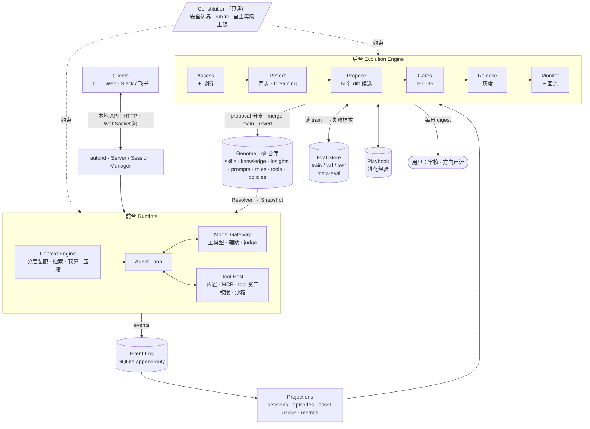

三个新增的一等存储：

| 存储 | 内容 | 谁能写 |
|---|---|---|
| **Genome** | Agent 用来做事的资产 | 只有 `evolve.release`（和用户手改） |
| **Eval Store** | 评测用例及 train/val/test 划分、元评测集 | 自动只能追加 train；val/test/meta 只能由用户或定期轮换流程写入 |
| **Playbook** | "怎么改进 Agent"的经验：试过什么方向、有效/无效、踩过的坑 | `evolve` 流程 |

Genome 中的记忆服务于"Agent 怎么做任务"，Playbook 服务于"怎么改 Agent"，两者分开存储、分开注入。

---

## 3. 进化闭环

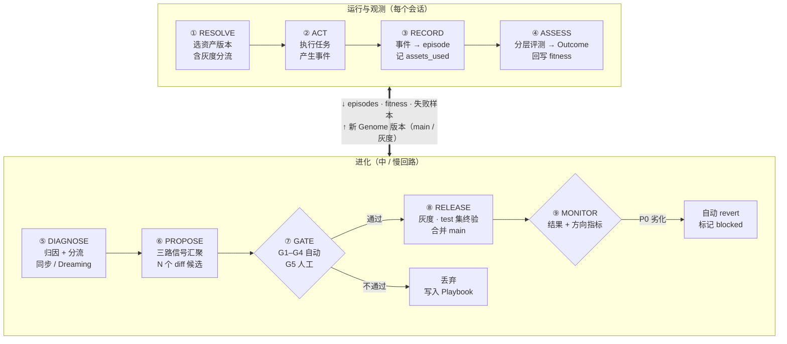

四条必须自动化的数据通路（缺一条，飞轮就停）：

| 通路 | 内容 |
|---|---|
| 评测 → 记忆 | 带正信号的经验按晋升机制写入记忆；失败经验写成反例 |
| 评测 → 进化 | 诊断结论驱动 Mutator 生成补丁 |
| 进化 → 生效 | 补丁过门禁后灰度、合并，Resolver 下一个会话即生效 |
| 生效 → 下一轮（回流） | 灰度/线上新失败自动进入 train 集和下一轮诊断；成功的新行为进入金样例 |

### 3.1 三种节奏

| 回路 | 时机 | 做什么 | 门禁 |
|---|---|---|---|
| **快回路** | 会话内，每轮 | 把可能有价值的信息写入 `learnings`（临时层）；工具失败后记"教训" | 去重 + 敏感信息扫描 |
| **中回路** | 会话结束 | 切 episode、分层评测、更新 fitness、单 episode 诊断与分流、learnings 晋升检查 | 自动 + 规则 |
| **慢回路** | 空闲 / 每日 / 累计阈值 | Dreaming 跨会话巡检、Skill 修订与挖掘、prompt/参数调整、清理冗余、评测集轮换 | 五道门禁 + 灰度 |

---

## 4. Genome：可进化的资产

### 4.1 资产类型与记忆分层

| Kind | 知识类型 | 层级 | 例子 |
|---|---|---|---|
| `learning` | 临时捕获 | 记忆 L1（临时） | "这个 API 凌晨 3 点会限流（待验证）" |
| `knowledge` | 陈述性：事实、偏好 | 记忆 L2（语义） | "用户偏好 pnpm"、"项目 X 周五冻结部署" |
| `insight` | 元认知：跨任务规则/反例 | 记忆 L2（规则级） | "修改配置前先读完整文件"、"反例：不要用默认 timeout 调 X 服务" |
| `skill` | 程序性：怎么做某类任务 | 记忆 L3（程序） | `github-pr/SKILL.md`：触发条件、步骤、检查点、坑 |
| `prompt` | 身份与行为片段 | — | 回复风格、规划习惯（仅 evolvable 片段） |
| `role` | 子 Agent 定义 | — | `reviewer.md` |
| `tool` | 可执行组合工具 | — | 沙箱脚本 + schema |
| `policy` | 数值/规则参数 | — | 压缩阈值、检索 top-k、记忆预算、灰度参数 |

情景记忆（L0：原始对话与轨迹）就是事件日志本身，不复制进 Genome，只按 `event_id` 引用。

### 4.2 资产格式

```markdown
---
id: skill/github-pr
kind: skill
scope: global                 # global | project:<hash>
origin: evolved               # builtin | user | evolved
evolvable: true
domain: coding/git            # 自主等级按 domain 管理（见 §8.2）
triggers: ["create PR", "pull request", "提 PR"]
requires_tools: [bash, git]
checkpoints:                  # 关键步骤，用于轨迹追踪（是否真的按 skill 做了）
  - id: confirm-base
    expect: {tool: bash, match: "git (rev-parse|branch|remote)"}
  - id: create
    expect: {tool: bash, match: "gh pr create .*--base"}
provenance:
  created_by: proposal/0042
  evidence: [ep_1a2b, ep_3c4d]
token_budget: 600
---
# 创建 Pull Request
1. 先确认当前分支与 base 分支 ...
```

skill 是一个目录，正文之外可以带示例：

```
skills/github-pr/
├── SKILL.md
└── examples/            # 由金样例 episode 自动提炼的成功示例（见 §7.4 示例自举）
    ├── ex_01.md         # 任务描述 + 关键步骤 + 结果，带 source episode
    └── ex_02.md
```

运行时按与当前任务的相似度选 0–2 个示例注入（计入 skill 的 token 预算）。更换示例不改动 skill 正文，是比改写正文更便宜、更安全的进化手段。

记忆类资产（learning / knowledge / insight）额外要求：

```yaml
provenance: {session: s_..., episode: ep_..., trigger: user_correction, reason: "..."}
strength: 0.42          # 强化/衰减分数
polarity: positive      # positive | negative（反例）
expires: 2027-02-01     # 可选 TTL；时效性信息必须带
```

### 4.3 记忆的治理：写入、晋升、遗忘

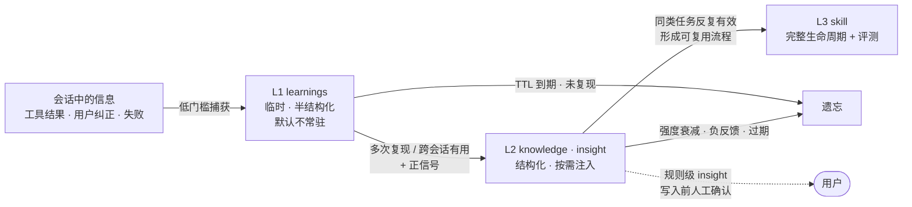

规则：

- **写入决策**：写入前先检索相似的已有记忆，由辅助模型对每条候选做出 `ADD / UPDATE / DELETE / NOOP` 决策（与已有记忆合并、替换过期的、或判定为重复而放弃），决策和理由写入 provenance。
- **策展而非全存**：只有出现正信号（用户确认、评测通过、任务成功）时，learning 才能晋升为长期记忆；默认中间过程不存。
- **失败也有价值，但存法不同**：失败经验以 `polarity: negative` 的反例形式保存（"这条路走不通，因为 …"）。
- **不对称强化**：成功使用一次强度小幅上升，导致失败一次大幅下降；默认 `+0.05 / −0.12`（policy 可调），宁可慢一点积累好经验，也不让坏经验扩散。
- **主动遗忘**：TTL 过期、使用频率衰减、负反馈即快速淘汰；遗忘是软删除（git 中可恢复）。
- **冲突解决**：新旧矛盾时按"来源可信度 > 新近程度"选择，无法判定的进入人工审核；并发写入走乐观锁（基于 blob hash）。
- **规则级记忆写入前必须人工确认**：`insight` 一旦生效，会被所有后续任务无条件遵循，影响全局，因此风险等级为 high（见 §8.3）。

### 4.4 存储：直接用 git

```
~/.auton/genome/                 # 一个 git 仓库
├── learnings/                   # L1，自动写入，带 TTL
├── knowledge/
├── insights/
├── skills/<name>/{SKILL.md, examples/}
├── prompts/
├── roles/
├── tools/<name>/{tool.yaml, main.py}
├── policies/*.yaml
└── projects/<project-hash>/     # 项目级 overlay，同结构，优先级高于全局
```

| 进化概念 | git 实现 |
|---|---|
| 资产版本 | 文件在某 commit 中的 blob hash |
| Genome 快照 | commit hash |
| 提案 | 分支 `proposal/<id>`，每个候选一个 commit；message 含 rationale、证据、诊断 id、父版本 |
| 版本树 | 候选的父版本可以是 `main`，也可以是历史上表现好的版本或未合并的候选（§7.3） |
| 补丁 | 候选以 diff 形式生成、由框架应用（§7.4） |
| 发布 / 回滚 / 谱系 | merge / `git revert` / `git log` |
| 关联评测结果 | git note 指向 Eval Store 中的评测报告 |
| 用户手改 | 用户直接 commit；`origin=user` 的文件受保护 |

fitness 等高频统计存 SQLite，按 `(asset_id, blob_hash)` 索引。Genome 是普通文件系统，Agent 也可以直接用 `grep`/`read` 检索它。

### 4.5 Resolve：为会话选版本

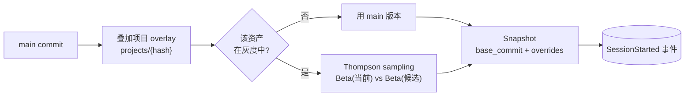

个人 Agent 流量小，按固定比例灰度很难攒够样本；Thompson sampling 让好候选自然获得更多流量，同时产生在线对比数据。

---

## 5. Runtime

### 5.1 组件

| 组件 | 职责 |
|---|---|
| **Model Gateway** | 统一 provider 接口；流式；重试；按角色路由：主模型、辅助模型（意图归纳、信号分类）、judge 模型（必须与主模型不同） |
| **Tool Host** | 内置工具、MCP、`tool` 资产；统一权限检查与沙箱；记录工具层错误（区分 Agent 用错 vs 工具/服务本身故障） |
| **Context Engine** | 分层装配、检索、token 预算、历史压缩 |
| **Agent Loop** | 最小循环：装配 → 调模型 → 执行工具 → 继续/压缩/结束。只发事件，不含学习逻辑 |
| **Roles / Delegation** | 子 Agent = 用 `role` 资产配置的另一个 Agent Loop 实例 |

### 5.2 读取：渐进披露 + 严格预算

| 步骤 | 内容 | 默认预算（policy 可调） |
|---|---|---|
| ① 常驻 | Constitution 核心、prompt 片段、用户画像、skill/role 一行目录 | 画像 ≤ 500，目录 ≤ 2000 |
| ② 按需检索 | 与当前任务相关的 knowledge / insight（含反例）、匹配的完整 SKILL.md | 事实 ≤ 800，单条 ≤ 200，最多 6 条 |
| ③ 钻取 | 需要证据时按 `event_id` 回溯原始对话/轨迹 | 仅在 Agent 主动请求时 |

- 检索三路并行：FTS5 关键词 + 可选 embedding + 精确匹配（trigger / 文件路径），融合排序后取 top-k。
- 宁缺毋滥：相关度低于阈值不注入，错误的"相关记忆"比不注入更糟。
- **每次注入都发 `AssetUsed` 事件**；执行中命中 skill checkpoint 时发 `SkillCheckpoint` 事件，用于轨迹追踪。

### 5.3 事件模型

所有事件都有 `id, ts, session_id, episode_id?, type, payload`。

| 事件 | 关键字段 |
|---|---|
| `SessionStarted` | snapshot_id, client, project, workspace_ref（项目 git commit，用于回放） |
| `UserMessage` / `AssistantMessage` | 内容引用 |
| `ModelCall` | model, tokens_in/out, latency |
| `ToolCall` / `ToolResult` | tool, args 摘要, ok, error_class（agent_misuse / tool_fault / env）, duration |
| `AssetUsed` | asset_id, blob_hash, how（injected / retrieved / invoked） |
| `SkillCheckpoint` | skill_id, checkpoint_id, hit / skipped |
| `ContextCompacted` | before / after tokens |
| `Feedback` | 显式反馈 |
| `SessionEnded` | reason |
| `Evolution.*` | 诊断、提案、门禁结果、发布、回滚、自主等级变化 |

### 5.4 一次会话的时序

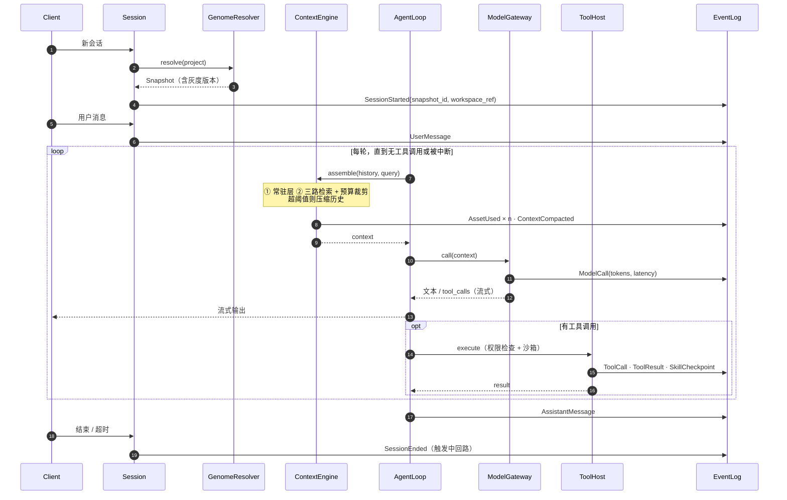

---

## 6. Assess：可信的评测

评测在自进化中承担三重职责：**方向指引**（哪里有问题）、**质量门控**（改了是否更好）、**经验筛选**（这次经验值不值得记）。它的错误会直接写进记忆和 Skill，所以可信度优先。

### 6.1 Episode

一个 episode = 一个用户意图从提出到结束；新消息被辅助模型判为"新任务"则开新 episode，追问/纠正/继续则归入当前。

```python
@dataclass
class Episode:
    id: str
    session_id: str
    snapshot_id: str
    workspace_ref: str               # 回放用的初始状态
    intent: str
    task_type: str                   # 聚类类别，用于同类基线和分层抽样
    event_range: tuple[int, int]
    assets_used: dict[str, AssetUse] # asset_id -> (blob_hash, how, count)
    checkpoints: dict[str, list[CheckpointHit]]
    metrics: Metrics                 # turns, tool_calls, tool_errors, tokens, duration
    outcome: Outcome | None
```

### 6.2 分层评测：便宜的方法能覆盖的，不用贵的

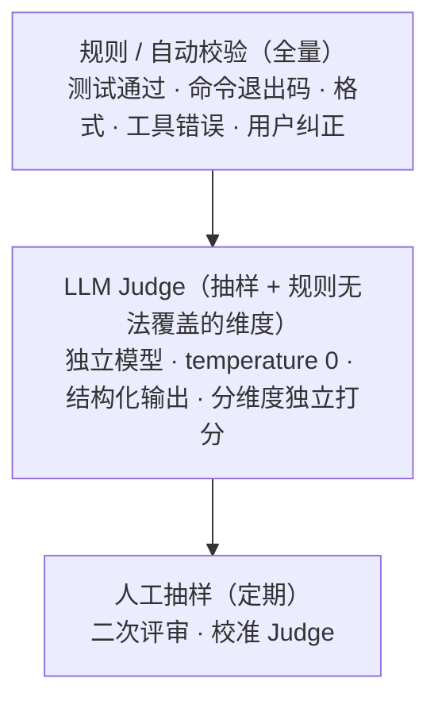

| 来源 | 信号 | 层级 |
|---|---|---|
| 工具 | 错误率、重试、退出码、测试结果 | 规则 |
| 行为 | 用户纠正、重问、中断、放弃 | 规则 + 辅助模型分类 |
| 显式 | 👍👎、`/feedback` | 规则 |
| 过程 | skill checkpoint 遵循率、冗余工具调用、token 效率 | 规则 |
| 质量 | 正确性、完整性、简洁性等（每维度独立打分） | Judge |
| 校准 | Judge 与人的一致率 | 人工 |

**评过程，不只评结果**：最终答案对了但过程有幻觉、冗余 5 倍、或没按 skill 走，下次大概率翻车。

**粒度**：日常用 episode 级粗评快速筛选；对失败 episode 再做 step 级细评定位到具体哪一步、哪个资产。

聚合为 `Outcome{score ∈ [-1,1], confidence, label, dims}`。置信度取决于信号种类和数量；低置信度 episode 在进化中权重低，且不能触发记忆晋升。

### 6.3 Judge 校准

| 机制 | 做法 | 发现什么 |
|---|---|---|
| 人工抽样 | 定期随机抽样人工复评，计算一致率（Cohen's kappa） | Judge 系统性偏差 |
| 多评估器交叉 | 2–3 个不同模型评同一批，分歧大的送人工 | 单一 Judge 盲区 |
| 元评测集 | 几十个明确"绝对正确 / 绝对错误"的样本，定期重测 | Judge 退化；判错即告警并暂停自动发布 |
| 盲诊断 | 诊断阶段只给 Judge 统计摘要，不给原始答案 | 避免 Judge 被答案风格诱导 |

Judge 的已知偏差（偏好长文本、偏好特定格式、偏好"看起来正确"）在 rubric 中显式对冲，并由元评测集持续检验。

### 6.4 Eval Store：评测集三分

```python
@dataclass
class EvalCase:
    id: str
    task_type: str
    difficulty: Literal["easy", "medium", "hard"]
    split: Literal["train", "val", "test", "meta"]
    source: Literal["episode", "human_seed", "benchmark", "regression"]
    input: list[Turn]                # 首条消息 + 记录的后续用户回复（回放时由用户模拟器按需给出）
    workspace_ref: str
    checkers: list[Checker]          # 规则检查：测试命令、文件断言、输出正则
    rubric_dims: list[str]           # 需要 Judge 的维度，含"意图对齐"维度（简洁 / 格式 / 语气）
    expected_checkpoints: list[str]  # 期望的关键步骤（过程评测）
```

| 集合 | 用途 | 可见性 | 默认比例 | 更新 |
|---|---|---|---|---|
| **train** | 诊断：哪里失败、失败模式是什么 | 可给 Mutator 看 | 50–60% | 持续追加线上新失败 |
| **val** | 筛选：候选是否比基线好 | **对 Mutator 不可见** | 20–30% | 每 2–4 周轮换 20–30% |
| **test** | 终验：上线前最后一道关 | 对 Mutator 不可见，只在发布前使用 | 15–20% | 稳定，1–2 个月更新 |
| **meta** | 校准 Judge | 只给校准流程 | 几十条 | 人工维护 |

- 按 `task_type` 分层抽样，保证每个集合都覆盖各类任务。
- 一个 episode 转成 case 后只能进入一个集合；同一 Diagnosis 的证据只进 train。
- 难度要有梯度：太简单的 case（无任何 skill 也能做对）对比不出差异，定期剔除或降权。

### 6.5 功劳分配

- `invoked` 权重最高，`injected` 最低；skill 只有在 checkpoint 遵循率达标时才按 `invoked` 记功。
- 用同类基线计算增量：`credit = outcome − baseline(task_type)`。
- 每个 `(asset, blob_hash)` 维护 Beta 分布形式的 fitness。

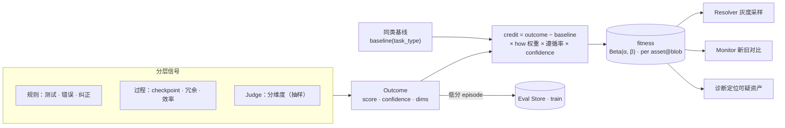

---

## 7. Evolution Engine

### 7.1 诊断与分流

诊断有两条互补的路径：

| | 同步诊断（中回路） | Dreaming（慢回路） |
|---|---|---|
| 时机 | 每个 episode 结束 | 空闲时，每天 / 每周 |
| 视角 | 单个任务 | 最近 N 天全部轨迹（含成功） |
| 擅长 | 具体错误、回归 | 反复出现的失败模式、低效模式、知识缺口、成功但无 skill 的模式 |
| 产出 | Diagnosis | 带优先级和影响面的 Diagnosis 列表 |

诊断的终点不是分数，而是**归因**：按失败类型分组，定位到具体资产、具体步骤。归因越细，修复越精准——"这个 skill 不好"只能大面积重写，"参数提取步骤漏了 `YYYY-MM-DD` 格式"才能精准修补。

**批量文本梯度**（归因到资产的具体机制）：

1. 取同一 `task_type` 下的一批失败或低分 episode（默认 4–8 个，不用单个 case，避免被个例带偏）。
2. 对每个 episode，按 `assets_used` 和 checkpoint 记录，让辅助模型为每个参与的资产写一段批评："这个资产的哪一部分、如何导致了这次失败"。
3. 资产之间有依赖时（role 调用 skill、skill 依赖 knowledge），批评沿依赖链反向传递：下游的失败先归到直接使用的资产，再判断是否源于上游。
4. 同一资产的批评跨 episode 汇总、去重，得到"文本梯度"，附在 Diagnosis 上交给 Mutator。

没有标准答案时（个人 Agent 的大多数任务），用 Outcome 的维度分数、用户纠正内容和 rubric 作为"损失"来源。

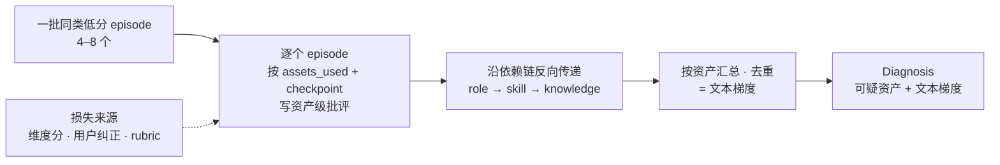

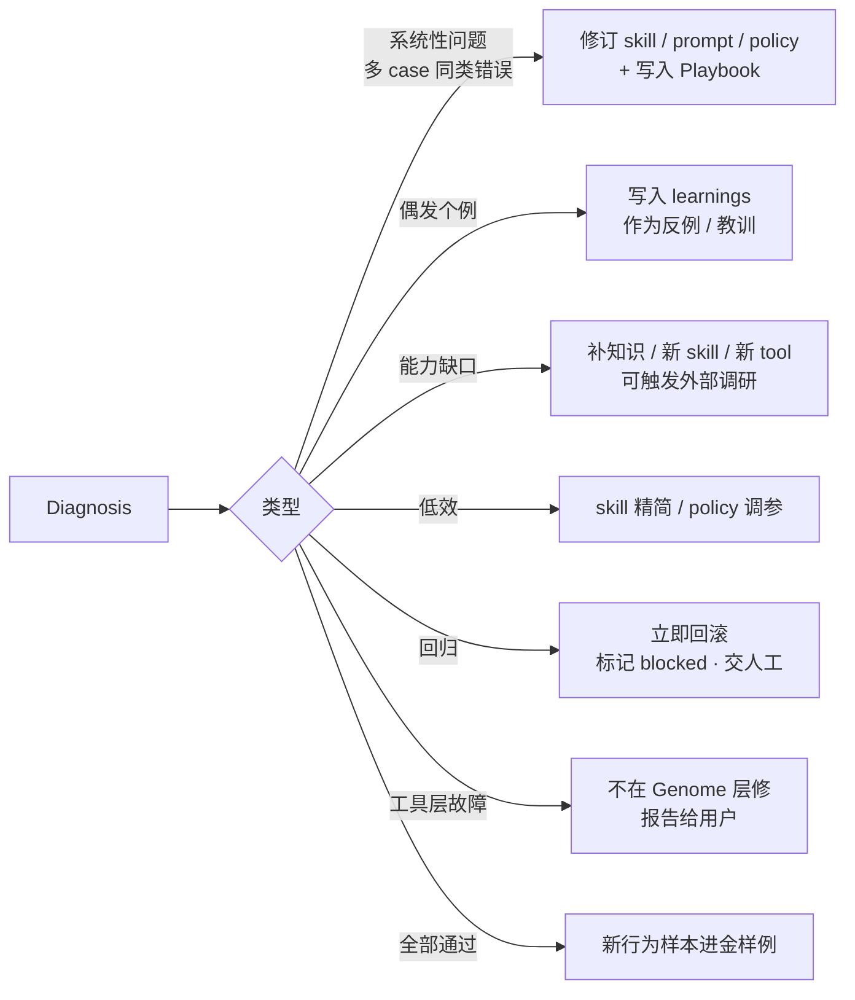

**熔断**：同一 Diagnosis 连续 3 轮候选都无法改善（或某场景失败率持续高位不降），停止 Genome 层迭代，转为"请检查工具/环境层"报告给用户。配置层的进化解决不了工具层的 bug。

### 7.2 三路信号汇聚

Mutator 生成候选前，`EvolveContext` 汇聚：

1. **本轮诊断**：这次出了什么问题（train 集的失败 case、归因与文本梯度）。
2. **Playbook**：在同一父版本上以前什么改法有效、踩过什么坑、哪些方向已被证伪。
3. **外部知识（可选）**：`Researcher` 用 web 工具检索业界做法，防止只在已知方向内打转。

### 7.3 版本树与 Playbook

**版本树**：候选不一定从 `main` 派生。每个资产维护一棵版本树（节点 = 一个被评测过的版本，含已合并的、灰度中的、未合并但 val 分数好的候选）。生成新候选时先选父版本：

- 从该资产 val 分数 top-k（默认 4，必含 `main` 当前版本）的版本中抽样。
- 抽样概率 = λ · 均匀分布 + (1 − λ) · softmax(α · 分数)，默认 λ = 0.3、α = 0.2：大部分时候在好版本上改，也保留探索其他分支的机会，避免卡在局部最优。
- 从非 `main` 父版本派生的候选，发布前要基于当前 `main` 重新应用补丁；若该资产在 `main` 上已有改动，重新跑 G2–G3。

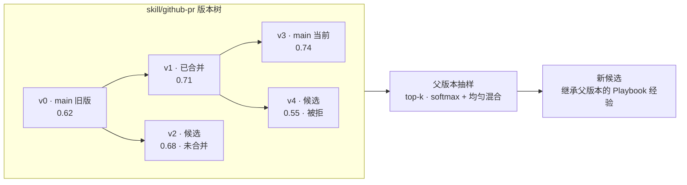

**Playbook**：每个提案无论成败都写一条，按"资产 + 父版本"组织：

```markdown
---
id: pb/0042
diagnosis: dg/2026-11-03-create-pr-base
target: skill/github-pr
parent: v1                  # 在哪个父版本上做的修改
outcome: adopted            # adopted | rejected | reverted | blocked
score: {before: 0.71, after: 0.74, runs: 3, std: 0.02}
---
方向：在 skill 第一步加入"确认 base 分支"
结果：val 纠正率 0.40 → 0.05；test 通过；灰度 9 天无回归
注意：初版把确认放在 push 之后无效（已证伪方向，见 pb/0039）
```

- 生成候选时，注入父版本上已尝试过的修改（成功的写"已采纳，勿重复"，失败的写"已证伪，勿重复"）。
- **语义查重**：新候选的修改描述与父版本上已尝试修改的 embedding 相似度超过阈值，即视为重复，直接丢弃重生成，不进入评测。
- 被拒绝、被回滚的方向也要写清原因；G4 门禁再做一次全局检查（§7.5）。

### 7.4 Mutators：可优化字段 × 搜索策略

Mutator 拆成两层：**字段层**回答"改哪里"，**策略层**回答"怎么搜"。新增一种资产只需声明字段；新增一种算法只需实现策略，两者自由组合。

**字段层**：每类资产声明自己的可优化字段，统一提供读取、写入、快照、还原：

```python
class OptimizableField(Protocol):
    id: str                    # e.g. "skill/github-pr#steps[2]"、"skill/github-pr#examples"、"policy/retrieval#top_k"
    kind: Literal["text_section", "example_set", "numeric", "categorical", "asset"]
    space: FieldSpace | None   # 数值范围 / 可选值 / 候选池
    def get(self) -> Any: ...
    def patch(self, value_or_diff: Any) -> Patch: ...   # 只产出补丁，由框架应用
    def snapshot(self) -> str: ...                      # blob hash
```

| 资产 | 字段示例 | 字段类型 |
|---|---|---|
| skill | 某个步骤段落、触发条件、checkpoint、examples | text_section / example_set |
| knowledge · insight | 条目内容、TTL、polarity | text_section / categorical |
| prompt | evolvable 片段 | text_section |
| role | 职责描述、可用工具列表 | text_section / categorical |
| policy | 压缩阈值、检索 top-k、预算 | numeric / categorical |
| 任意资产（新建） | 整个资产 | asset |

**策略层**：按字段类型和诊断类型选用：

| 策略 | 适用字段 | 做法 | 典型诊断 |
|---|---|---|---|
| **反思补丁** | text_section | 依据文本梯度 + Playbook，生成对指定段落的 diff | 系统性问题、低效 |
| **示例自举** | example_set | 从金样例 episode 中提炼成功示例，按任务相似度和多样性挑选组合 | skill 遵循率低、成功但不稳定 |
| **组合搜索** | numeric / categorical，及多字段组合 | TPE 贝叶斯优化：小批量评测筛选，定期对 top 组合做全量评测 | policy 调参、"指令候选 × 示例候选"选择 |
| **进化变异** | text_section | 一个父版本生成多个子代，各自用不同的变异风格；按分数选择存活者 | 反思补丁多轮无效时用来跳出局部最优 |
| **整体生成** | asset | 仅用于新建资产（新 skill、新 role、新 tool） | 能力缺口、成功但无 skill |

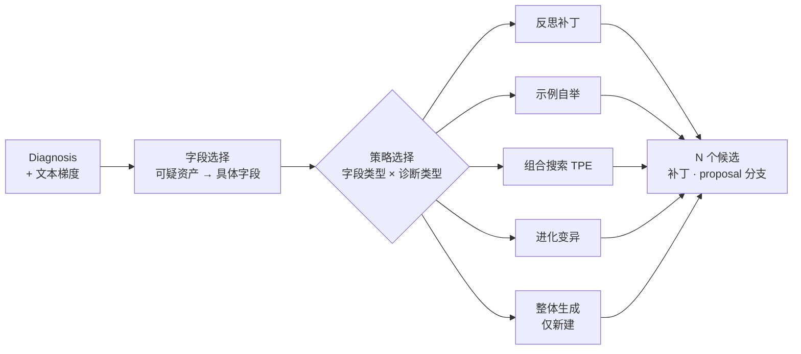

```python
class Strategy(Protocol):
    name: str
    field_kinds: set[FieldKind]
    def accepts(self, d: Diagnosis, f: OptimizableField) -> bool: ...
    async def propose(self, d: Diagnosis, f: list[OptimizableField], ctx: EvolveContext, n: int) -> list[Candidate]: ...

@dataclass
class Candidate:
    parent: str                # 父版本 blob hash（版本树）
    patches: list[Patch]       # 只描述需要改动的片段，由框架应用；禁止对已有资产全文重写
    rationale: str
    expected_effect: str       # 预期改善哪些 case、哪些指标
    mutation_style: str | None # 进化变异时使用的风格
```

通用约束：

- **Diff 模式**：已有资产只接受补丁（"把第 3 步改为 …"），框架负责合并，不覆盖无关逻辑、可 review、可精确回滚。整体生成仅用于新建资产。
- **生成背景**：补丁生成时注入资产的历史决策原因（git log + Playbook），以及与该资产相关的数据摘要（典型输入、成功示例、失败模式），避免"看起来合理实际有害"的修改。
- **候选多样化**：每个 Diagnosis 生成 N 个候选（默认 3），且必须彼此不同：每个候选分配不同的变异风格（如"精简""补充缺失步骤""调整顺序""增加检查点""换一种表述"），并做两两语义查重。
- **多文件联动**：改了 A 的输出格式需同时检查依赖 A 的 skill/role/tool；做引用和签名一致性检查。
- **表示形式影响修改质量**：资产的结构（Markdown 小节、YAML 字段）决定 LLM 修改是否精准。资产格式设计要服务于字段级修改，并通过实验验证。

Mutator 实例 = 字段选择规则 + 默认策略：

| Mutator | 字段 | 默认策略 |
|---|---|---|
| `LearningCurator` | learnings / knowledge / insight 条目 | 写入决策（§4.3）+ 反思补丁 |
| `InsightDistiller` | insight 条目 | 反思补丁 |
| `SkillRefiner` | skill 步骤段落、checkpoint | 反思补丁 → 进化变异（多轮无效时） |
| `ExampleCurator` | skill examples | 示例自举 |
| `SkillMiner` | 新 skill | 整体生成（以成功轨迹为输入） |
| `RoleTuner` | role 字段 | 反思补丁 |
| `PolicyTuner` | policy 数值 | 组合搜索 |
| `ToolSmith` | 新 tool | 整体生成（critical） |
| `Gardener` | 冗余/冲突/零贡献资产 | 合并、废弃、删除 |

### 7.5 五道门禁

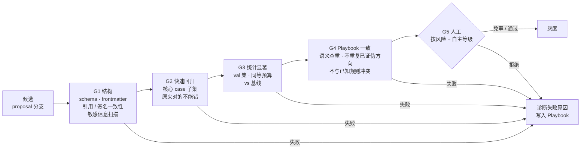

- G1–G4 全自动，目标是在人看到之前过滤掉绝大部分低质量候选，让人"做选择题而不是填空题"。
- **同等预算**：G3 中候选与基线在相同 token / 工具调用上限下比较；成本显著上升视为未通过，除非诊断类型本身就是"质量优先"且由人批准。
- **重复评测与方差**：LLM 输出有随机性，单次评测分数噪声很大。G3 中每个 case 对候选和基线各跑 k 次（默认 3，policy 可调），用配对检验判断差异是否显著，报告均值和标准差；差异落在噪声范围内即视为"未改善"。
- **分层评测控制成本**：每次变更只跑 G2 核心子集 + G3 相关 task_type 的 val；全量评测（含全部 val 与 test）每晚定时运行一次。组合搜索类策略在搜索过程中用小批量 val 快速筛选，只对 top 组合做全量 val 评测。

### 7.6 Arena：隔离执行

- 每个候选在独立工作区（`workspace_ref` 的 git worktree / 目录副本）中运行，互不干扰。
- 只读工具真实执行；外部副作用（网络写、发消息）用记录结果 stub。
- 多轮任务由用户模拟器（辅助模型 + 记录的用户回复）驱动。
- 对比：规则 checker + 过程指标 + Judge 盲评两两对比（随机左右位置）。
- **评测缓存**：缓存键 = （该 case 相关资产的 blob hash 集合 + case id + 模型版本 + 运行序号）。基线版本在多个候选的对比中反复出现，直接命中缓存；任何相关资产或模型变化都会使缓存失效。
- **补测**：组合搜索中某个候选因采样原因评测样本不足时，单独补测到最少样本数，避免它因"没机会"而被淘汰。

**Skill 的额外验证（四层）**——证明 skill "真的有用"而不是碰巧存在：

| 层 | 问题 | 做法 |
|---|---|---|
| 对照实验 | 没有它模型本来就会吗？ | 有 / 无该 skill 两组对照，增量为零则拒绝或退役 |
| 难度校准 | 任务是否太简单？ | 只用"无 skill 时部分失败"难度的 case 计算增量 |
| 轨迹追踪 | 运行时真的按 skill 做了吗？ | 检查 checkpoint 遵循率；结果对但没遵循，不记为 skill 的功劳 |
| 路径验证 | 结果对了，路径对吗？ | 关键 checkpoint 被跳过即判为风险，即使结果正确 |

已上线 skill 定期（每月）复评对照实验，环境变化导致失效的 skill 交给 `Gardener`。

### 7.7 Release 与 Monitor

| 风险 | 例子 | 流程 |
|---|---|---|
| low | learning 写入、knowledge 小修、policy 小步调参 | G1–G2 → 直接合并 |
| medium | skill 补丁、knowledge 晋升、role 补丁 | G1–G4 → 灰度 → test 终验 → 合并 |
| high | 新 skill、**规则级 insight**、prompt 片段、user 资产修改 | G1–G4 → **人工** → 灰度 → test 终验 → 合并 |
| critical | 新 tool、与安全/权限相关的任何改动 | G1–G4 + 代码审查 → **人工** → 灰度 → 合并 |

自主等级（§8.2）可以把某个 domain 的 medium/high 降为免审或改为事后抽检，但不能突破 Constitution 规定的上限。

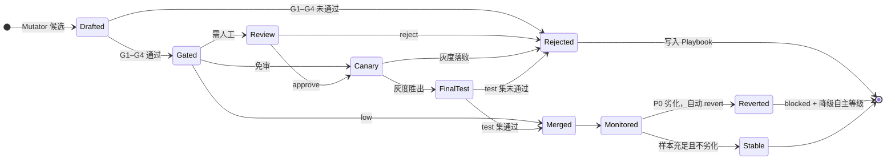

**灰度（适配个人 Agent 的低流量）**：Thompson sampling 分流；最少样本数与最长观察期（默认 ≥ 10 个相关 episode 或 14 天）由 policy 决定；样本不足时依赖离线 Arena 结果，不强行判定。

**Monitor**：比较新旧版本在成功率、token、纠正率上的差异。任一项出现 P0 级退化（例如成功率下降超过阈值）立即自动 revert，无需等人；同时标记 blocked、降级所属 domain 的自主等级，并通知用户。

**回流**：灰度期和上线后的新失败 episode 自动转为 train case，进入下一轮诊断——上线不是终点，而是下一轮的起点。

### 7.8 搜索的停止与多样性

**停止条件**（慢回路、Dreaming 和每个 Diagnosis 的迭代都适用）：

| 条件 | 规则 | 之后 |
|---|---|---|
| 收敛 | 该资产版本树 top-k 的平均 val 分数，连续若干轮（默认 5）提升不显著 | 停止该资产的搜索，等新的失败样本回流再启动 |
| 早停 | 进化变异连续若干代（默认 3）没有超过当前最好分数 | 结束本轮进化变异 |
| 熔断 | 同一 Diagnosis 连续 3 轮无法改善（§7.1） | 停止 Genome 层迭代，报告工具/环境层问题 |
| 预算 | 达到每日进化 token 上限（§8.1） | 剩余任务排队到下一天 |

**多样性存档**（M6，可选）：对重要的 skill 和 policy，不只保留一个"全局最优"版本，而是按特征维度分格保存各格的最优版本（MAP-Elites）。默认维度：平均 token 成本 × 任务难度。例如同一个 skill 同时保留"轻量快速版"和"彻底检查版"，Resolver 按任务难度和预算选用。这与"同等预算比较"配合：每个预算档位内部比较，不跨档比较。

---

## 8. 控制：Constitution、分级自主与人机协作

### 8.1 Constitution（不可进化区）

随代码发布，位于 Genome 之外，只读：

- 安全边界：危险命令、路径边界、密钥处理、外部副作用确认、权限模型。
- 评测规则：rubric、信号权重、Judge 配置；Eval Store 的 val/test/meta 集合。
- 进化边界：哪些资产可进化、风险等级定义、各 domain 自主等级上限、预算上限、方向指标阈值。
- 核心身份与诚实性要求。

**Guard**（代码实现，拦截所有候选）：拒绝修改 Constitution、拒绝放宽权限、拒绝直接修改 `origin=user` 资产（只能以建议形式提出）；独立判定风险等级；执行预算（每日进化 token、每资产每日最多一次发布、并发灰度数）；执行规模上限（超出时触发 `Gardener`）；扫描密钥与个人敏感信息。

### 8.2 分级自主

自主等级按 `domain`（如 `coding/git`、`writing`、`memory/knowledge`）分别管理，而不是全局一个开关：

| 等级 | 名称 | 行为 |
|---|---|---|
| L0 | 建议 | Agent 只生成候选，人决定并执行 |
| L1 | 审批 | Agent 执行全流程，人逐批审批（默认） |
| L2 | 抽检 | 通过 G1–G4 即灰度，人事后抽检 |
| L3 | 自主 | 全自动，人只看报告 |

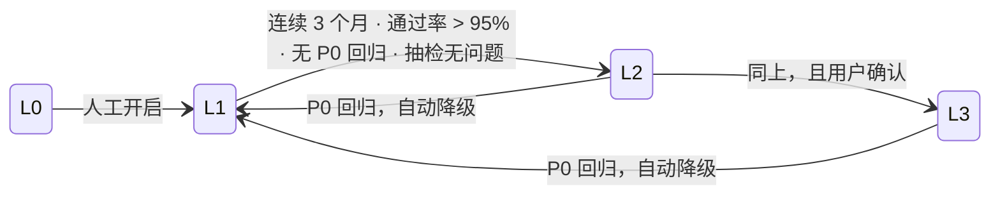

- 升级需要满足条件并由用户确认；降级自动发生。信任通过实践积累，违反即收回。
- 永远不能到 L3 的范围：安全边界、权限、拒答逻辑、`tool` 资产。

### 8.3 五个必须有人的节点

无论自主等级多高，以下节点永远需要人：

| 节点 | 原因 |
|---|---|
| ① 规则级记忆写入前 | 规则会被所有后续任务无条件遵循，一条错误规则的伤害是全局且长期的 |
| ② 涉及安全/权限的 prompt、skill 改动 | Agent 不应有权修改自己的安全约束 |
| ③ 回归发生后的决策 | 回滚到哪、优先级、是否阻断，需要上下文判断 |
| ④ 新领域冷启动 | 首批评测 case、种子 skill、边界必须由人提供；跳过冷启动会在错误方向上快速迭代 |
| ⑤ 安全边界与自主等级上限的设定 | 由 Agent 自己划边界会导致"隐蔽且累积的偏移" |

### 8.4 防审核疲劳

1. **自动化前置**：G1–G4 过滤掉绝大部分低质量候选。
2. **批量异步审核**：不逐条打断，每日生成一份 `digest`。每个待审项附：val/test 结果与相对基线的提升、影响的 case 和面、2–3 个代表性输入输出对比、AI 的推荐理由和风险提示。用户做批量选择（"这 5 个里哪些可以上？"）。
3. **审核制度自身也进化**：通过 §8.2 的升降级，让稳定 domain 的审核量自然下降。

### 8.5 防方向漂移

门控只检查"这一步有没有回归"（局部），不检查"整体方向是否偏了"（全局）。三层防护：

1. **方向指标**（§0.2）：持续监控，超出阈值告警并暂停该 domain 的自动发布。
2. **评测集包含意图对齐维度**：显式包含检查"简洁性、格式规范、语气适度"的 case，把抽象意图具象化为可评测维度。
3. **定期方向审计**（建议每月）：`/evolve audit` 生成报告——skill 库在往什么方向发展、哪类 skill 被频繁修改、记忆在积累哪类经验、输出风格变化（更长？更保守？），由用户判断是否与初衷一致。

---

## 9. 用户控制面

| 命令 | 作用 |
|---|---|
| `/feedback [+/-] [说明]` | 显式反馈当前 episode |
| `/evolve digest` | 今日待审批候选（批量选择） |
| `/evolve status` | 进行中的提案、灰度、最近发布与回滚、熔断中的诊断 |
| `/evolve show <proposal>` | diff + rationale + 证据 + 门禁/评测报告 + 相关 Playbook |
| `/evolve approve / reject <id...>` | 批量审批 |
| `/evolve rollback <asset>` | 立即回滚 |
| `/evolve autonomy [domain] [level]` | 查看/调整分级自主 |
| `/evolve pause / resume` | 暂停/恢复进化 |
| `/evolve report` | 北极星指标与方向指标趋势 |
| `/evolve audit` | 月度方向审计报告 |
| `/eval add / ls / run` | 管理评测集（人工种子 case、手动跑评测） |
| `/genome ls / show / edit` | 浏览和手动编辑资产 |
| `/learnings review` | 查看待晋升的临时记忆、确认规则级 insight |

---

## 10. 工程结构

### 10.1 技术栈

- Python 3.12、asyncio、Pydantic v2
- 存储：SQLite（WAL）存事件日志、投影、fitness、FTS 索引、Eval Store 元数据；git 存 Genome 与 Playbook
- 服务：Starlette/FastAPI + WebSocket；CLI 用 Typer + Rich
- 沙箱：首期子进程 + 工作目录隔离 + 命令白名单；后期可选容器
- 质量：ruff、mypy --strict、pytest、import-linter

### 10.2 目录

```
auton/
├── kernel/          # 核心类型、事件、EventLog、配置、ID、时钟。不依赖其他包
├── constitution/    # 只读：安全边界、rubric、进化边界、自主上限、方向阈值
├── model/           # Model Gateway 与 providers
├── tools/           # Tool Host、内置工具、MCP、权限、沙箱
├── genome/          # git 存储、资产类型、记忆治理（晋升 / 遗忘 / 冲突）、Resolver、fitness
├── context/         # Context Engine：分层装配、检索、预算、压缩
├── agent/           # Agent Loop、Session、Roles/Delegation
├── experience/      # 投影：sessions、episodes、asset usage、checkpoints、metrics
├── assess/          # 信号、judges、calibration（元评测 / 一致率）、evalstore（三分 / 轮换）、credit
├── evolve/
│   ├── diagnose/    # 同步诊断、Dreaming、分流、熔断
│   ├── research/    # 外部知识检索（可选）
│   ├── playbook/
│   ├── fields/      # 各类资产的可优化字段声明（读取 / 补丁 / 快照）
│   ├── strategies/  # 反思补丁、示例自举、组合搜索（TPE）、进化变异、整体生成
│   ├── mutators/    # 字段选择规则 + 默认策略的组合
│   ├── lineage/     # 版本树、父版本抽样
│   ├── gates/       # G1–G5
│   ├── arena/       # 隔离执行、用户模拟器、skill 四层验证、重复评测、评测缓存
│   ├── release/     # 灰度、test 终验、合并、回滚
│   ├── monitor/     # 结果/方向指标、回流
│   ├── control/     # Guard、自主等级、digest、audit
│   └── scheduler.py # 三速回路
├── server/          # autond：API、会话管理、后台任务
└── clients/         # cli/、web/、im/
```

### 10.3 依赖规则（CI 强制）

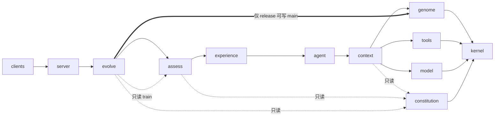

- `agent` 及以下不得 import `experience / assess / evolve`；学习只能通过订阅事件发生。
- `assess` 不得 import `evolve`（评测独立于进化）。
- `evolve` 只能通过 `assess.evalstore` 的受限接口读取 train 集、提交评测任务；val/test/meta 的内容不对 `evolve.mutators` 暴露，只返回聚合结果。
- 只有 `evolve.release` 能写 Genome 的 `main` 分支。

---

## 11. 端到端示例

1. 用户多次让 Auton 创建 PR。没有专门 skill，Agent 每次都要摸索，其中两次漏指定 base 分支，被用户纠正。
2. **快回路**：纠正时 `LearningCurator` 写入 learning："创建 PR 前需确认 base 分支（来源 ep_…，触发 user_correction）"。
3. **Assess**：这些 episode 归为 `task_type=create-pr`；被纠正的 Outcome 为 partial，自动成为 train case；部分成功样本按分层抽样进入 val/test。
4. **Dreaming**：发现"成功但无 skill"的重复模式 + 失败模式"漏 base 分支"，同一 learning 已多次复现。
5. **Propose**：三路信号汇聚（train 失败归因 + Playbook 中一条"把确认放在 push 后无效"的旧记录 + 无外部调研）。`SkillMiner` 生成 3 个候选 skill，checkpoint 包含 `confirm-base`。
6. **Gates**：G1 通过；G2 核心回归无问题；G3 在 val 上同等预算对比——候选 B 纠正率最低且 token 不增加，并通过对照实验（无 skill 时 val 上部分失败，有 skill 时显著改善）；G4 发现候选 C 重复已证伪方向，淘汰。新 skill 属于 high。
7. **Review**：当日 digest 中列出候选 A/B 的对比；用户选择 B。
8. **Release**：灰度中 Thompson sampling 逐步把流量导向 B；观察期满后 test 集终验通过，合并到 main；Playbook 写入"adopted"。原 learning 标记为已晋升。
9. **Monitor**：两周后 create-pr 成功率稳定提升，方向指标无异常。若出现 P0 劣化，自动 revert、`coding/git` 降回 L1、通知用户。

---

## 12. 实施路线

核心建议：**先手动跑通一圈闭环，再做自动化。** 一个能手推转一圈的粗糙飞轮，好过一个精美但静止的蓝图。

| 里程碑 | 内容 | 完成标志 | 人工占比 |
|---|---|---|---|
| **M1 能用的 Agent** | kernel、model、tools、context（无检索）、agent loop、CLI、EventLog | 能在 CLI 完成编程任务，全部事件入库 | — |
| **M2 手动闭环** | Genome（git + 资产格式 + 检索 + AssetUsed）、Eval Store 雏形、`/eval run` 回放、人工准备 30–100 个种子 case（含意图对齐 case）与少量种子 skill | 手动"跑评测 → 看失败 → 改 skill → 再跑评测"能看到可复现的提升 | ~80% |
| **M3 可信信号** | episode 切分、分层评测、Judge 校准（元评测集）、过程指标与 checkpoint、train/val/test 三分、功劳分配 | 每个 episode 有可信分数；Judge 与人一致率达标 | — |
| **M4 半自动** | 同步诊断与分流、批量文本梯度、Playbook、字段层 + 反思补丁 / 示例自举策略（LearningCurator、SkillRefiner、ExampleCurator）、G1–G4（含重复评测、评测缓存）、digest 审核、记忆三级晋升与写入决策 | 系统能自动产出候选并稳定"改进且不退化" | ~40% |
| **M5 飞轮运转** | 灰度 + test 终验、Monitor 与自动回滚、回流、Dreaming、SkillMiner、版本树与父版本抽样、进化变异、收敛与早停、分级自主升降级、方向指标与月度审计 | 飞轮在少量人工下自主转动 | ~15% |
| **M6 元进化** | 外部调研、PolicyTuner（组合搜索 TPE）、多样性存档、ToolSmith、Gardener、skill 定期复评、autond 常驻与 Web/IM 客户端 | 飞轮越转越快 | ~5% |

### 12.1 冷启动清单（必须由人提供）

- 高质量初始评测集：覆盖主要任务类型，标准清楚、难度有梯度。值得花 1–2 周认真设计。
- 首批种子 skill 和基础事实（项目约定、个人偏好）。
- 安全边界、各 domain 的自主等级上限、方向指标阈值。

---

## 13. 避坑清单

| 坑 | 后果 | 对策（本设计中的位置） |
|---|---|---|
| 单一评测方法 | 贵或不准 | 规则 + Judge + 人工分层（§6.2） |
| 评测集不分离 | 在 val 上"刷高分"，新问题直接崩 | train/val/test 三分，val/test 对 Mutator 不可见（§6.4） |
| 不校准 Judge | 错误正反馈，Agent 自信地学坏 | 元评测集 + 一致率 + 交叉评估（§6.3） |
| 只评结果不评过程 | 碰巧对的路径下次翻车 | checkpoint + 过程指标（§6.2、§7.6） |
| 忽视预算公平 | 把多花钱当进化 | 同等预算比较（§7.5） |
| 记忆全存全塞 | 噪声高、检索差、上下文爆 | 三级晋升 + 预算 + 宁缺毋滥（§4.3、§5.2） |
| 无遗忘机制 | 过期信息被高置信使用 | TTL + 不对称衰减 + 负反馈淘汰（§4.3） |
| 记忆不记来源 | 出错无法追溯 | provenance 必填（§4.2） |
| 全文重写 skill | 覆盖无关逻辑、无法 review | Diff 模式（§7.4） |
| 无版本管理 | 出问题无法定位和回滚 | git + git note 关联评测（§4.4） |
| 生成即上线 | 质量参差不齐 | 五道门禁 + 灰度 + test 终验（§7.5、§7.7） |
| 配置层无限打转 | 根因在工具层却不停改 skill | error_class + 熔断（§5.3、§7.1） |
| 无回流 | 进化是一次性活动 | 失败自动进 train（§7.7） |
| 自进化全自动 | 方向偏移且被放大 | 分级自主 + 五个必须有人的节点（§8.2、§8.3） |
| 审核疲劳 | 名义有人审，实际全放行 | 自动化前置 + 批量 digest（§8.4） |
| 只看技术指标不看方向 | 每步变好，整体跑偏 | 方向指标 + 意图对齐 case + 月度审计（§8.5） |
| 跳过冷启动 | 在错误方向上快速迭代 | 冷启动清单（§12.1） |
| 先建全套基础设施 | 建完才发现闭环跑不通 | 先手动闭环（M2） |
| 单次评测定输赢 | 把随机波动当成改进 | 每 case 重复 k 次 + 配对检验（§7.5） |
| 候选彼此雷同 | N 个候选等于 1 个，浪费评测预算 | 分配不同变异风格 + 两两语义查重（§7.4） |
| 只在 main 上改 | 卡在局部最优 | 版本树 + 父版本抽样（§7.3） |
| 归因只到"这次失败了" | Mutator 只能盲改 | 批量文本梯度，归因到资产和字段（§7.1） |
| 无停止条件 | 收益递减后继续烧钱 | 收敛检测、早停、熔断、预算（§7.8） |

---

## 14. 待决策问题

1. **默认自主等级**：建议所有 domain 从 L1 起步，`memory/learnings` 可直接 L2。
2. **Judge 与辅助模型**：Judge 必须与主模型不同；是否需要 2 个不同厂商的 Judge 做交叉？是否支持本地模型？
3. **种子评测集**：首批覆盖哪些任务类型（建议：改 bug、写测试、提 PR、重构、解释代码、写文档各 5–15 个）？
4. **外部调研**：是否允许进化流程主动联网检索（涉及隐私：只发送抽象化的问题描述）？
5. **Genome 同步**：是否需要在多台设备间同步（git remote 天然支持）？
6. **沙箱强度**：首期接受"子进程 + 目录隔离"，还是一开始就上容器？

---

## 参考

- 腾讯技术工程，《一篇讲透 Agent 自进化飞轮怎么搭：评测→记忆→落地→控制》（2026-08）。本文 v0.3 的评测集三分、评估器校准、Skill 四层验证、记忆三级晋升、Diff 模式、五道门禁、分级自主、审核疲劳与方向漂移的应对思路来源于此；具体数值均改为可配置的 policy 默认值。
- EvoAgentX（https://github.com/EvoAgentX/EvoAgentX，阅读的是 LB-Young/EvoAgentX 副本）。本文 v0.4 借鉴了其中：`ParamRegistry` / `OptimizableField` 的字段抽象（→ §7.4 字段层）、TextGrad 的文本梯度与无标准答案模式（→ §7.1）、AFlow 的父版本抽样、按父版本组织的经验与收敛检测（→ §7.3、§7.8）、MIPRO 的示例自举与 TPE 组合搜索（→ §4.2、§7.4）、EvoPrompt 的评测缓存、补测与早停（→ §7.6、§7.8）、SEW / PromptBreeder 的变异风格多样化（→ §7.4）、MAP-Elites 的多样性存档（→ §7.8）、MemoryManager 的写入决策（→ §4.3）。未采用：依赖带标签 benchmark 的离线范式、整体重写式修改、在同一评测集上回滚比较。
